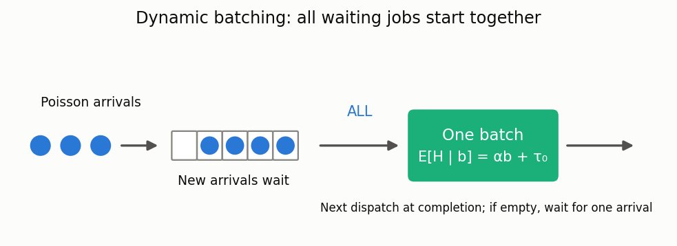

# Dynamic batching with an unbounded batch size

[🇷🇺 Русская версия](dynamic-batching.ru.md) · [← Model catalog](../models.md)

**In plain words:** requests arriving while the server is busy wait for its batch to finish.
The server then takes **all** waiting requests into the next batch. An empty server starts the
next arrival alone. Everyone in a batch finishes together; there is no timeout or physical cap.



This is an idealized inference-server model, not an implementation of a current LLM engine.
It excludes token-level continuous batching, output-length variability, KV-cache limits,
admission control, multiple GPUs and non-Poisson input.

## Model and source

Arrivals are Poisson with rate `λ>0`. Batch durations are independent conditional on their
sizes and have mean `m_b=αb+τ₀`, where `α,τ₀≥0`, not both zero.
The deterministic model and analytical identities are from Y. Inoue,
*Queueing analysis of GPU-based inference servers with dynamic batching: a closed-form
characterization*, Performance Evaluation 147 (2021), 102183
([DOI](https://doi.org/10.1016/j.peva.2020.102183),
[full preprint](https://arxiv.org/html/1912.06322v3)).

The implementation numerically truncates the author's embedded chain. Inoue already discusses
truncation in §3.1 and explains why his bounds are accurate in §4. Neither the model nor this
explanation is claimed as new.

## Calculator

`DynamicBatchingCalc` inherits `BaseQueue`; `run()` returns `DynamicBatchingResults`,
a `QueueResults` subclass.

```python
from most_queue.theory.batch.dynamic_batching import DynamicBatchingCalc

calc = DynamicBatchingCalc(tolerance=1e-9)
calc.set_sources(200.0)                       # requests / second
calc.set_servers(alpha=0.0025, tau0=0.02)     # deterministic, seconds
result = calc.run()
print(result.w, result.v)                    # [mean waiting], [mean sojourn]
print(result.converged, result.max_batch)
print(calc.bound_report())                   # deterministic service only
```

`get_w()` and `get_v()` return one-element lists. Scalar accessors are
`get_waiting_mean()`, `get_latency()`, `get_service_time_mean()`,
`get_idle_probability()`, and `get_n_mean()`. `get_batch_moments(2)` returns
`E[B], E[B²]`. The array returned by `get_batch_distribution()` is indexed from batch size 1.
It is **not** the time-stationary number in the system: result fields `p`/`pi` are unset.

| Service setter | Parameters beyond α, τ₀ | Conditional squared CV |
|---|---|---|
| `set_deterministic_service` | none | 0 |
| `set_exponential_service` | none | 1 |
| `set_erlang_service` | integer `shape≥1` | 1/shape |
| `set_gamma_service` | real `shape>0` | 1/shape |
| `set_h2_service` | `coev≥1`, balanced-means H2 | coev² |

The same laws are available through `set_servers(..., kind=..., shape=..., coev=...)`.
They use the stated distributions directly, not moment-fitting to a different family.

## What is computed

With `A` arrivals during a batch, the next batch has size `B'=max(1,A)`.
Poisson mixtures give the transition rows. For the infinite-chain stationary law:

```text
mean wait     = E[B(B−1)] / (2λ E[B])
mean service  = E[B m_B] / E[B]          # job-size bias
mean latency  = mean wait + mean service
idle fraction = P(A=0) / E[B] = 1 − λ E[H] / E[B]
```

Inoue's `W` denotes **latency**, whereas this library's `w` denotes queueing wait.
Theorem 2 bounds `φ₀,φ₁` apply to latency with deterministic affine service only.
`bound_report()` returns these bounds, the numerical latency and idle probability,
the Lemma 4 consistency check, and the slack predicted from the idle-probability gap.

The supported finite-mean regime is `ρ=λα<1`. For a fixed service squared CV `c²`,
finite mean waiting additionally requires `ρ²(1+c²)<1`. For example, exponential
service with `ρ=0.8` has no finite mean waiting despite `ρ<1`; the calculator rejects
it, including when a fixed numerical truncation would produce a finite number.

## Numerical accuracy and limits

Automatic mode compares consecutive truncations and checks the upper 20% of the batch
states' contribution to `E[B²]`, stationary balance, and the untruncated first/factorial-second
moment identities. All must meet `tolerance`. Insufficient `max_states` or
`max_nonzeros` raises an error; precision is never silently relaxed.

`max_batch=N` pins a numerical truncation and returns `converged=False` with
`refinement_error=None`. It is **not a physical batch cap**: overflow is lumped, not left
waiting for subsequent batches. Inspect `boundary_second_moment_fraction`,
`moment_residual`, `flow_residual`, and `stationary_residual`.
These diagnostics are **not a proved bound on the final answer's error**.

High load, large overhead and service variability can all make the chain expensive.
Construction has entry/state budgets; sparse factorization may need additional memory.
Higher waiting/sojourn moments and analytic CDF/tails are not implemented.

## Validation and reproduction

For the illustrative parameters `α=0.0025 s, τ₀=0.02 s` (not a new GPU measurement):

| ρ | numerical latency, s | best bound excess | idle fraction |
|---|---|---|---|
| 0.1 | 0.032383112 | 7.3792% | 0.297143 |
| 0.3 | 0.045831228 | 0.4042% | 0.0105364 |
| 0.5 | 0.064163536 | 0.004879% | 0.000117399 |
| 0.7 | 0.106617643 | 0.000003925% | 8.89e-8 |
| 0.9 | 0.319078947 | below numerical resolution | 4.39e-15 |

Accuracy depends on `τ₀/α` as well as load; no universal “exact above ρ=0.3” rule follows.
The [60-point report](../research/dynamic-batching-results-2026.json) is reproduced with:

```bash
python -m examples.dynamic_batching_experiment --output /tmp/dynamic-batching.json
```

Independent checks include constant-duration/constant-distribution closed forms, direct
Poisson-mixture quadrature, an event simulator, and the existing bounded-batch exponential
CTMC as its physical cap increases. See [method and validation](../research/dynamic-batching-validation-2026.md)
and [EPIC-084](../epics/EPIC-084-dynamic-batching-unbounded.md).

## Simulator

```python
from most_queue.sim.dynamic_batching import DynamicBatchingSim

sim = DynamicBatchingSim(seed=1).set_sources(1.0)
sim.set_h2_service(alpha=0.1, tau0=0.5, coev=1.5)
result = sim.run(num_of_jobs=30_000, warmup_fraction=0.2)
print(result.w, result.v, result.idle_fraction)
```

All five service setters are shared at the API level, but simulation draws real durations and
arrivals independently of the chain implementation. It discards complete warmup batches, then
collects at least the requested number of jobs, keeping the last batch whole. Batch statistics,
occupancy probabilities `p`, utilization and customer samples exclude warmup consistently.
CDFs from `result.cdf(t, of="w"|"v")` are empirical only. The default 20% warmup does not
certify stationarity or the direction of transient bias; use independent replications.

Related: [bounded bulk service](batch.md), [MAP/PH finite buffer](bulk-map-finite.md),
[occupancy-dependent continuous batching](continuous-batching.md).
