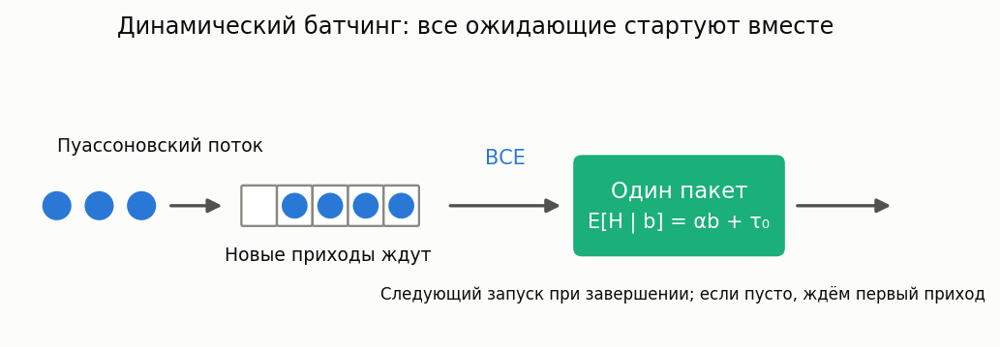

# Динамический батчинг без ограничения размера пакета

[🇬🇧 English version](dynamic-batching.md) · [← Каталог моделей](../models.ru.md)

**Суть:** запросы, пришедшие во время обработки пакета, ждут его завершения. Затем сервер
забирает **всех** ожидающих одним новым пакетом. Если очередь пуста, следующий приход
обслуживается сразу и один. Заявки пакета завершаются вместе; таймаута накопления и потолка нет.



Это идеализированная модель инференс-сервера, не современного LLM-движка во всей полноте.
Здесь нет токенового continuous batching, переменной длины вывода, KV-cache, admission
control, нескольких GPU и коррелированного входа.

## Модель и первоисточник

Вход пуассоновский, `λ>0`. Времена обработки независимы условно по размерам пакетов,
со средним `m_b=αb+τ₀`; `α,τ₀≥0`, не оба нули.
Модель, вложенная цепь, тождества и оценки принадлежат Y. Inoue,
*Queueing analysis of GPU-based inference servers with dynamic batching: a closed-form
characterization*, Performance Evaluation 147 (2021), 102183
([DOI](https://doi.org/10.1016/j.peva.2020.102183),
[полный препринт](https://arxiv.org/html/1912.06322v3)).

Реализация численно усекает цепь автора. Сам автор обсуждает усечение в §3.1,
а причины точности оценок — в §4. Это воспроизведение, не новая точная теория.

## Калькулятор

`DynamicBatchingCalc` наследует `BaseQueue`, результат `DynamicBatchingResults` —
расширение `QueueResults`.

```python
from most_queue.theory.batch.dynamic_batching import DynamicBatchingCalc

calc = DynamicBatchingCalc(tolerance=1e-9)
calc.set_sources(200.0)                      # запросов / с
calc.set_servers(alpha=0.0025, tau0=0.02)    # детерминированное время, с
result = calc.run()
print(result.w, result.v)                   # [среднее ожидание], [среднее пребывание]
print(result.converged, result.max_batch)
print(calc.bound_report())
```

`get_w()` и `get_v()` возвращают списки из одного среднего.
Скалярные методы: `get_waiting_mean()`, `get_latency()`,
`get_service_time_mean()`, `get_idle_probability()`, `get_n_mean()`.
`get_batch_moments(2)` возвращает `E[B], E[B²]`.
`get_batch_distribution()` индексируется от размера 1 и относится к моментам обработки
пакетов, **не** к числу заявок в произвольный момент; поля `p/pi` результата не заполнены.

| Настройка закона | Параметр сверх α, τ₀ | Квадрат CV |
|---|---|---|
| `set_deterministic_service` | нет | 0 |
| `set_exponential_service` | нет | 1 |
| `set_erlang_service` | целое `shape≥1` | 1/shape |
| `set_gamma_service` | вещественное `shape>0` | 1/shape |
| `set_h2_service` | `coev≥1`, H2 с балансом средних ветвей | coev² |

Также доступны через `set_servers(..., kind=..., shape=..., coev=...)`.
Gamma и детерминированный закон не заменяются фазовым приближением.

## Формулы и область применимости

```text
B' = max(1,A), где A — число приходов за обработку текущего пакета
среднее ожидание     = E[B(B−1)] / (2λ E[B])
среднее обслуживание = E[B m_B] / E[B]
среднее пребывание   = ожидание + обслуживание
доля простоя         = P(A=0) / E[B] = 1 − λ E[H] / E[B]
```

В статье `W` — **пребывание**, в библиотеке `w` — ожидание начала обслуживания.
Оценки Теоремы 2 `φ₀,φ₁` относятся к пребыванию при детерминированном аффинном времени.
`bound_report()` возвращает оценки, численное среднее, простой, самопроверку по Лемме 4
и зазор, предсказываемый разницей вероятностей простоя.

Поддерживаемый режим с конечным средним размером пакета — `ρ=λα<1`.
Для конечного среднего ожидания дополнительно нужно `ρ²(1+CV²)<1`.
Например, экспоненциальное обслуживание при `ρ=0.8` имеет бесконечное среднее ожидание,
хотя `ρ<1`; калькулятор явно отказывается считать конечное число и при фиксированном усечении.

## Усечение и точность

Автоматический подбор сравнивает два размера цепи и проверяет вклад верхних 20% состояний
в `E[B²]`, стационарную невязку и тождества первого и второго факториального моментов
неусечённой модели. Все диагностики должны уложиться в `tolerance`.
Исчерпание `max_states` или `max_nonzeros` вызывает ошибку, а не ослабление точности.

`max_batch=N` — **численное усечение, не физический лимит**: хвост перехода переносится
в последнее состояние, а не остаётся ждать следующего пакета. Результат помечен
`converged=False`, `refinement_error=None`. Проверяйте
`boundary_second_moment_fraction`, `moment_residual`, `flow_residual`,
`stationary_residual`. Это диагностики, **не доказанная верхняя граница ошибки**.

Стоимость увеличивают высокая нагрузка, накладные расходы и вариативность обслуживания.
Бюджет ограничивает построение матрицы; её факторизация может потребовать больше памяти.
Старшие моменты ожидания/пребывания, аналитические CDF и хвосты в Л1 не реализованы.

## Проверка

Для иллюстративных `α=0.0025 с, τ₀=0.02 с` (не новая GPU-калибровка):

| ρ | Численное пребывание, с | Завышение лучшей оценкой |
|---|---|---|
| 0.1 | 0.032383112 | 7.3792% |
| 0.3 | 0.045831228 | 0.4042% |
| 0.5 | 0.064163536 | 0.004879% |
| 0.7 | 0.106617643 | 0.000003925% |
| 0.9 | 0.319078947 | ниже численного разрешения |

Точность зависит и от `τ₀/α`: универсального порога «точно начиная с ρ=0.3» нет.
[Отчёт по 60 точкам](../research/dynamic-batching-results-2026.json) воспроизводится командой:

```bash
python -m examples.dynamic_batching_experiment --output /tmp/dynamic-batching.json
```

Арбитры: замкнутые частные случаи, прямая квадратура пуассоновской смеси, независимая
имитация и существующий экспоненциальный CTMC-калькулятор при росте физического потолка.
[Методика и результаты](../research/dynamic-batching-validation-2026.md),
[EPIC-084](../epics/EPIC-084-dynamic-batching-unbounded.md).

## Имитация

```python
from most_queue.sim.dynamic_batching import DynamicBatchingSim

sim = DynamicBatchingSim(seed=1).set_sources(1.0)
sim.set_h2_service(alpha=0.1, tau0=0.5, coev=1.5)
result = sim.run(num_of_jobs=30_000, warmup_fraction=0.2)
print(result.w, result.v, result.idle_fraction)
```

Доступны все пять законов. Приходы и длительности разыгрываются независимо от решателя цепи.
Прогрев отбрасывается целыми пакетами; после него собирается **не менее** заданного числа
заявок с завершением последнего пакета целиком. Прогрев исключён из всех метрик: клиентских,
пакетных и временных, включая занятость и распределение числа заявок `p`.
`result.cdf(t, of="w"|"v")` — эмпирическая CDF. Прогрев 20% не гарантирует стационарность
и не задаёт знак смещения; для оценки неопределённости нужны независимые репликации.

Смежные модели: [ограниченные пакеты](batch.ru.md), [MAP/PH и конечный буфер](bulk-map-finite.ru.md),
[continuous batching](continuous-batching.ru.md).
