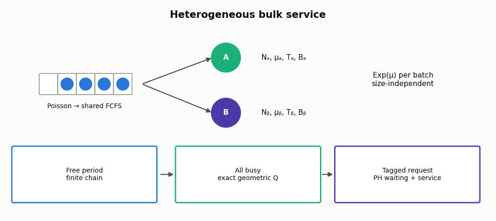

# Heterogeneous bulk service

[Русская версия](heterogeneous-bulk-service.ru.md) · [Catalog](../models.md)

Different server types have different batch rates, capacities and start thresholds.
One shared FCFS queue feeds every type. This reproduces the **exponential,
size-independent** model of [van Ommeren, Baer, Mishra and Roy (2020)](https://doi.org/10.1007/s11134-020-09654-y),
not a general-service or continuous-batching LLM model.



## Contract

Poisson rate λ>0; type σ has Nσ≥1 servers, batch duration Exp(μσ),
minimum Tσ and maximum Bσ, 1≤Tσ≤Bσ. When idle and Q≥Tσ, a server
starts min(Q,Bσ) oldest jobs. The entire batch completes together; arrivals
cannot join it. Lowest threshold wins an idle-server choice; **input order
breaks equal-threshold ties**, not the fastest rate. Type result arrays retain
input order even if thresholds are sorted internally.

Stability is λ<ΣNσμσBσ. The API additionally rejects load≥1−1e−10 as a
numerical boundary guard. Rates and aggregate capacity must be finite.
Resource limits: Bσ≤1024, at most 20,000 free-chain states including the busy
aggregate, and 1,500 waiting phases. These are not physical queue capacities.

## Exact unbounded calculation

```python
from most_queue.theory.batch import BulkServiceHeterogeneousCalc

m = BulkServiceHeterogeneousCalc([4, 2])
m.set_sources(6)
m.set_servers(rates=[0.4, 0.2], thresholds=[4, 6], capacities=[5, 9])
r = m.run(num=3)
assert abs(r.mean_queue - 2.0941799863) < 1e-8
print(r.w, r.v, r.served_probabilities)
print(m.tail(1), m.tail(1, response=True), m.lst(0.5))
```

The all-busy period has exact conditional queue PMF (1−α)α^q, q≥0.
Solve the monotone root λ=ΣNσμσΣ(k=1,...,Bσ)α^k, avoiding the extraneous
root α=1 in the uncancelled equation. Let D=ΣNσμσ(1−α^Tσ).
Mean busy duration is 1/D; aggregate exit rate to free state
(N−eσ,q), q<Tσ, is Nσμσ(1−α)α^q. The finite sparse free-state chain
uses this exact busy duration and exit distribution, not an exponential claim
about the actual busy-period duration. Its stationary masses give P(BP) and
unconditional free-state probabilities. No waiting-queue cutoff is used.

The waiting PH chain tracks the lowest idle type, tagged position and arrivals
behind it; in all-busy phases the number ahead collapses by geometric
memorylessness. Type-specific absorption rates feed separate Exp(μσ) service
phases for V. Thus W and the eventual server type are **not assumed independent**.
Raw moments use sparse linear solves; tails use matrix-exponential action.

| API/result | Meaning |
|---|---|
| `run(num=1..8)`, `get_w()`, `get_v()` | Raw W/V moments; W ends at batch start, V at completion |
| `tail(t, response=False)`, `lst(s, response=False)` | Strict P(W>t) and real nonnegative LST argument; switch to V with `response=True` |
| `queue_probability(q)` | Exact PMF of **waiting** jobs, not total population |
| `alpha`, `busy_period_probability`, `free_probabilities` | Exact geometric tail + free-state masses; `free_states` supplies labels |
| `mean_queue`, `mean_population`, `zero_wait_probability` | E[Q], λE[V], P(W=0); strict tail at zero excludes the atom |
| `served_probabilities`, `customer_throughputs`, `batch_throughputs`, `mean_busy_servers` | Input-type-order customer shares/flows, batch flows and expected busy counts |
| `root_residual`, `balance_residual`, `little_residual`, `flow_residual`, `class_residual` | Root, normalized balance, Little, total flow and PH/flow consistency diagnostics |

Inherited `p`/`pi` remain None: busy counts alone do not determine the sizes
of active batches, hence a total-population PMF is not computed.
Configuration changes invalidate cached results. PH/generator arrays are
exposed for inspection; mutating them is unsupported.

## Independent simulation

```python
from most_queue.sim.heterogeneous_bulk_service import BulkServiceHeterogeneousSim

sim = BulkServiceHeterogeneousSim([4, 2], seed=42)
sim.set_sources(6)
sim.set_servers([0.4, 0.2], [4, 6], [5, 9])
s = sim.run(10000, warmup=1000, tail_times=[0, 1, 3])
assert s.arrived == s.completed + s.unfinished
assert abs(s.total_population_area - s.completed_residence
           - s.unfinished_residence) < 1e-6
print(s.waiting_proxy, s.waiting_tails, s.response_tails)
```

`run(horizon, warmup=0, tail_times=(), cohort_end=None, arrivals=None,
service_times=None, record_trace=False, max_events=2000000)` starts empty,
uses separate seeded arrival/type-service streams, and resets them per run.
The simulator has no geometric or PH solver dependency. It can run overloaded
settings for finite-horizon diagnostics; such results are not stationary.
No drain; events exactly at horizon are excluded, completions precede tied
arrivals. Replay arrivals are sorted in [0,horizon), and duration replay has
one sequence per type. Exhaustion/event-budget failure is explicit.

Mean proxies are warmup-excluded queue/population areas divided by λ times
observation duration, not completed-only sample moments. Cohort tails use
**all** arrivals in [warmup,cohort_end), default midpoint of warmup/horizon.
Require cohort_end≤horizon−max(tail_times): even unfinished requests have known
tail indicators at all requested times. Empty cohort returns empty tail arrays;
inspect `cohort_size`. `cohort_unstarted`/`cohort_unfinished` are explicit.
Full-run queue-area and population-area identities include unfinished jobs.

## Validation and limits

[Report and reproducible experiment](../research/heterogeneous-bulk-service-validation-2026.md):
physical capped CTMC and uncompressed tagged chain, Erlang C, existing identical
bulk solver, source tables and independent DES. Table 2 diagonal queue values
match the **opposite** priority labels; Table 3 labels match. The report records
literal and independently verified values without silently changing the source.

No non-exponential/batch-size-dependent service, timeout, deadlines, migration,
continuous admission, KV constraint, TTFT/ITL, measured GPU fit, or novelty claim.
The source's discussion of a PH-service extension is not its implementation.
