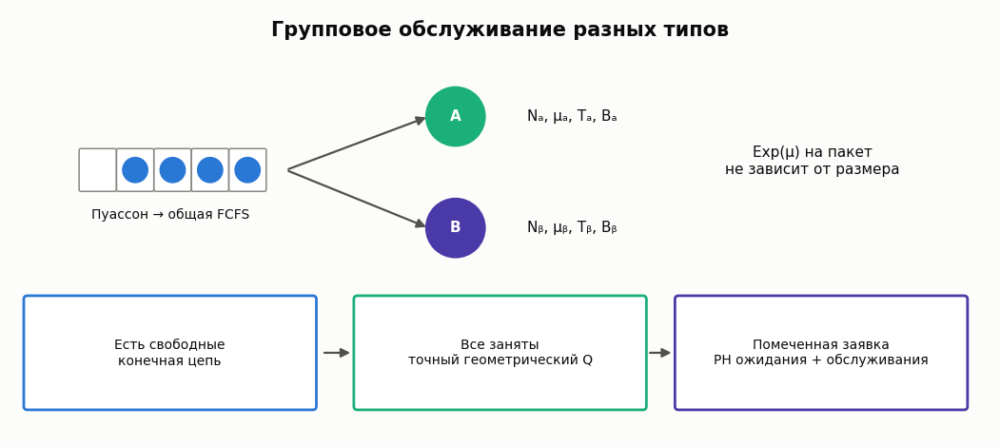

# Групповое обслуживание гетерогенными приборами

[English](heterogeneous-bulk-service.md) · [Каталог](../models.ru.md)

Одна FCFS очередь питает приборы разных типов с собственными скоростями,
размерами пакета и порогами запуска. Воспроизводится **экспоненциальная,
независимая от размера пакета** модель
[van Ommeren, Baer, Mishra, Roy (2020)](https://doi.org/10.1007/s11134-020-09654-y).
Это не G-service и не continuous batching LLM.



## Контракт

Пуассоновский поток λ>0; тип σ содержит Nσ≥1 приборов с длительностью
пакета Exp(μσ), минимумом Tσ и максимумом Bσ, 1≤Tσ≤Bσ. Свободный прибор
при Q≥Tσ забирает min(Q,Bσ) старейших заявок. Они завершаются одновременно;
новые приходы не присоединяются к работающему пакету. Выбирается меньший
порог, а при равенстве — **порядок типов во входных массивах**, не большая μ.
Результаты по типам всегда возвращаются в исходном порядке.

Устойчивость: λ<ΣNσμσBσ. Дополнительно API отклоняет load≥1−1e−10 как
численную окрестность границы, не новый критерий устойчивости. Все скорости
и суммарная мощность конечны. Ресурсные пределы: Bσ≤1024, 20 000 состояний
FP вместе с BP-агрегатом, 1500 фаз ожидания. Физическая очередь не усечена.

## Точный расчёт бесконечной очереди

```python
from most_queue.theory.batch import BulkServiceHeterogeneousCalc

m = BulkServiceHeterogeneousCalc([4, 2])
m.set_sources(6)
m.set_servers(rates=[0.4, 0.2], thresholds=[4, 6], capacities=[5, 9])
r = m.run(num=3)
assert abs(r.mean_queue - 2.0941799863) < 1e-8
print(r.w, r.v, r.served_probabilities)
print(m.tail(1), m.tail(1, response=True), m.lst(0.5))
```

В периоде полной занятости BP условная PMF ожидающих равна (1−α)α^q,
q≥0. Монотонное уравнение λ=ΣNσμσΣ(k=1,...,Bσ)α^k исключает ложный
корень α=1 несокращённого уравнения. D=ΣNσμσ(1−α^Tσ), E[BP]=1/D.
Из BP-агрегата переход в FP-состояние (N−eσ,q), q<Tσ, имеет скорость
Nσμσ(1−α)α^q. Конечная sparse цепь использует точное среднее BP и его
выходные вероятности; фактическая длительность BP не объявляется
экспоненциальной. Стационарное решение даёт P(BP) и безусловные FP-массы.

PH ожидания хранит минимальный свободный тип, позицию помеченной заявки
и число пришедших позади неё; в BP число впереди сжимается благодаря
геометрической памяти. Выходы разделяются по типам и ведут в отдельные
фазы Exp(μσ) для V. **Независимость W от будущего типа прибора не предполагается.**
Моменты рассчитываются sparse решениями, хвосты — действием exp(A t).

| API/поле | Смысл |
|---|---|
| `run(num=1..8)`, `get_w()`, `get_v()` | Начальные моменты W/V; ожидание заканчивается запуском, пребывание — завершением пакета |
| `tail(t, response=False)`, `lst(s, response=False)` | Строгий P(W>t), ПЛС при конечном вещественном s≥0; `response=True` выбирает V |
| `queue_probability(q)` | PMF только **ожидающих**, не общего населения |
| `alpha`, `busy_period_probability`, `free_probabilities` | Точный бесконечный хвост и FP-массы; метки — `free_states` |
| `mean_queue`, `mean_population`, `zero_wait_probability` | E[Q], λE[V], P(W=0); строгий хвост при нуле исключает атом |
| `served_probabilities`, `customer_throughputs`, `batch_throughputs`, `mean_busy_servers` | Доли/потоки заявок, потоки пакетов и средняя занятость в исходном порядке типов |
| `root_residual`, `balance_residual`, `little_residual`, `flow_residual`, `class_residual` | Корень, нормированный баланс, Литтл, суммарный поток и согласование PH/flow |

Унаследованные `p`/`pi` остаются None: количество занятых приборов не хранит
размеры активных пакетов, поэтому PMF общего населения не рассчитана.
Изменение настройки сбрасывает кэш. Матрицы открыты для чтения; менять их
снаружи не поддерживается.

## Независимая имитация

```python
from most_queue.sim.heterogeneous_bulk_service import BulkServiceHeterogeneousSim

sim = BulkServiceHeterogeneousSim([4, 2], seed=42)
sim.set_sources(6)
sim.set_servers([0.4, 0.2], [4, 6], [5, 9])
s = sim.run(10000, warmup=1000, tail_times=[0, 1, 3])
assert s.arrived == s.completed + s.unfinished
assert abs(s.total_population_area - s.completed_residence
           - s.unfinished_residence) < 1e-6
print(s.waiting_proxy, s.waiting_tails, s.response_tails)
```

`run(horizon, warmup=0, tail_times=(), cohort_end=None, arrivals=None,
service_times=None, record_trace=False, max_events=2000000)` начинает с пустой
системы, сбрасывает отдельные arrival/type-service RNG каждого запуска и не
использует геометрический/PH solver. Допускает конечные перегруженные опыты,
не называя их стационарными. Drain нет; события ровно на horizon исключены,
при равных временах завершение раньше прихода. Replay-приходы упорядочены
в [0,horizon); длительности заданы отдельной последовательностью для типа.
Исчерпание replay/event budget — ошибка, не частичный успешный результат.

Средние proxy — площади очереди/населения после warmup, делённые на λ и
время наблюдения, не средние только завершённых задержек. Cohort tails включают
**все** приходы [warmup,cohort_end), по умолчанию до середины warmup/horizon.
Условие cohort_end≤horizon−max(tail_times) даёт известный индикатор хвоста
даже незавершённым. При пустой когорте массивы хвостов пусты; проверять
`cohort_size`. Остатки — `cohort_unstarted`/`cohort_unfinished`.
Тождества полных площадей учитывают незавершённые заявки и ожидания.

## Проверки и границы

[Отчёт и эксперимент](../research/heterogeneous-bulk-service-validation-2026.md):
physical capped CTMC и несжатая tagged chain, Эрланг C, прежний identical bulk,
таблицы источника и независимый DES. На диагонали Table 2 средние соответствуют
**противоположному** приоритету; Table 3 согласуется с описанием. Печатные и
проверенные значения сохранены явно, без молчаливого исправления источника.

Нет неэкспоненциальных/size-dependent длительностей, timeout, deadlines,
миграции, continuous admission, KV, TTFT/ITL, GPU calibration или новой теории.
Упомянутое авторами расширение на PH-service не реализовано этой работой.
