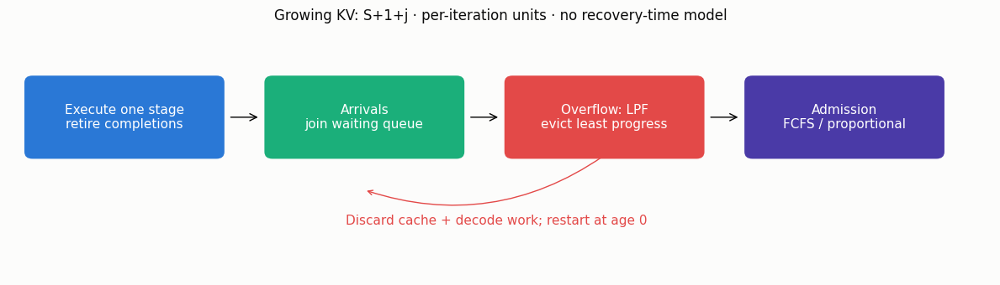

# KV-cache eviction and service-induced congestion

[Русская версия](kv-cache-congestion.ru.md) · [Catalog](../models.md)

This implements the deterministic stage-memory model of
[Ao, Dong, Luo and Simchi-Levi, arXiv:2606.15555v1](https://arxiv.org/html/2606.15555v1),
with a separate integer-request simulation. These are two different processes:
fluid linear stability is **not** a stochastic queue stability certificate.

## In plain words

Admitting a request that fits now can cause overflow later: its cache grows
at every decoding step. Eviction discards its progress and restarts it from
zero. Cohorts can synchronize, wasting decoding work. Limiting admissions
can help, but a fluid cap cannot be transferred unchanged to integer FCFS.



## Calculator and continuous trajectories

`KvCacheCongestionCalc` inherits `BaseQueue`. Memory M is a positive real
number of reserved KV tokens; each class has fixed integer input S>=0 and
decode length D>=1, with **M>S+D**. Stage j=0,...,D−1 reserves S+1+j tokens;
this includes the next token. Prefill and recovery time are abstracted out.
Every active request advances one stage per iteration and retires after D.
`set_sources` takes positive **class proportions**, summing to one, not a rate.
`set_servers` takes equal-length class vectors. Decode lengths are bounded
by `max_decode_length=256` by default, an explicit numerical resource limit.

```python
from most_queue.theory.continuous_batching import KvCacheCongestionCalc

model = KvCacheCongestionCalc(memory_tokens=24)
model.set_sources([1.0])
model.set_servers(input_tokens=[2], decode_tokens=[3])
r = model.run()
print(r.nominal_throughput)       # 2.0 completions/iteration
print(r.worst_cycle_throughput)   # 1.6; homogeneous continuous model
greedy = model.evolve(120, initial_state=[[2.5, 2, 1.7]], record_trace=True)
capped = model.evolve(120, initial_state=[[2.5, 2, 1.7]], admission_cap=2)
```

The algebraic equilibrium is `a*=M/sum(p_k*C_k)`, where
`C_k=sum(S_k+1+j, j=0,...,D_k−1)`. Every stage of class k contains p_k*a*.
For homogeneous lengths, `worst_cycle_throughput=M/(D*(S+D))`; otherwise
the worst-cycle fields are None, not a speculative heterogeneous bound.

The eviction-free recurrence has coefficients
`F_j=sum(p_k*(S_k+1+j), D_k>j)`, ordered from the leading polynomial
coefficient to the constant. Its degree is max(D_k)−1. The limiting
coefficients are `A_j=sum(p_k*r_k, D_k>j)` for an explicitly assumed
input-dominated scaling S_k≈r_k*L. `input_ratios` defaults to ones
(common-input scaling), **not** ratios inferred from finite lengths.

| Result | Interpretation |
|---|---|
| `nominal_throughput`, `fixed_point` | Continuous saturated equilibrium, completions/iteration |
| `worst_cycle_throughput`, `worst_cycle_ratio` | Homogeneous continuous maximal cycle only |
| `coefficients`, `limiting_coefficients` | Finite-input and input-dominated polynomials |
| `spectral_radius`, `limiting_spectral_radius` | Numerical root modulus, not a global certificate |
| `linear_stability` | `schur_stable_numerically`, `linearly_unstable_numerically`, or `near_boundary` |
| `root_residual`, `decode_gcd`, `diagnostics` | Backward-residual and assumption diagnostics |

Roots within `spectral_tolerance` of one are inconclusive; a large backward
residual suppresses classification. Invalid/underflowed coefficients fail
explicitly. D=1 gives a constant polynomial with radius zero. GCD=1 alone
does **not** guarantee finite-input stability. No w/v moments, utilization
or stationary queue PMF are returned: inherited fields remain None.

`evolve(iterations, initial_state=..., admission_cap=None, warmup=0,
record_trace=False)` uses continuous masses, proportional admission and
proportional trimming across classes at the same least-progress stage.
It is saturated, not a Poisson queue. A cap is a nonnegative real mass per
iteration; it is not silently rounded. Feasible initial states may have slack.
Evicted mass represents discarded progress; the fresh saturated supply is
not a tracked request queue. Results include final state, throughput, evicted
mass, memory fraction, decode-work counters and optional iteration trace.
Throughput/memory averages exclude warmup; counters and trace include it.

## Independent integer simulation

```python
from most_queue.sim.kv_cache_congestion import KvCacheCongestionSim

sim = KvCacheCongestionSim(memory_tokens=60, seed=42)
sim.set_sources([4.5])            # Poisson requests/iteration, one rate/class
sim.set_servers([2], [3])
s = sim.run(4000, warmup=500, admission_cap=5)
assert s.initial_jobs + s.arrived == s.completed + s.unfinished
assert s.initial_work + s.executed_work == (
    s.completed_work + s.discarded_work + s.remaining_work
)
```

Memory and requests are integer. The order is **execute → arrivals → LPF
eviction → FCFS admission**. Ties evict the newest request first; evicted
requests rejoin the tail at age zero. Simultaneous arrivals are queued in
class-index order. Admission does not scan past a head request that cannot
fit and does not reserve future peak memory. This is not proportional admission.

`run` also accepts integer arrival replay `[iterations, classes]`, integer
class-stage `initial_state`, `initial_queue` of class indices and opt-in
`record_trace`. A cap must be a nonnegative **integer**; fractional values are
rejected. Every run resets the seeded RNG. `saturated=True` generates a new
request only when the retry/FCFS queue is empty, using normalized source
weights: generated requests are counted, but are not exogenous Poisson arrivals.

Runs stop at a fixed horizon without drain. `unfinished` includes waiting and
active requests; `final_queue` counts only waiting requests. Conservation and
eviction/work counters include warmup, throughput and memory fraction exclude it.
No completed-only censored latency estimate or positive-recurrence claim is made.
Total source rate/replay batch is bounded at 1e6 for request-level allocation.

## Validation and limits

[Independent checks and experiments](../research/kv-cache-congestion-validation-2026.md)
include rational trajectories, a directly differentiated stage Jacobian, exact
Schur recursion, hand integer traces and work/request conservation. Finite-input
checks expose discrepancies in the printed caption/example; author software was
not audited. The [JSON](../research/kv-cache-congestion-results-2026.json) contains
10 trajectories, 48 spectra and 24 DES settings with four paired seeds each.

No Vidur/GPU replication, random unknown output lengths, latency distribution,
optimal scheduling or paid wall-clock recovery is implemented. Results are per
iteration: a median GPU slot duration cannot turn them into a time-based theorem.
The [L4 free-swap bounds](kv-cache-stability.md) concern a different policy and
must not be used as a certificate for this restart process.
