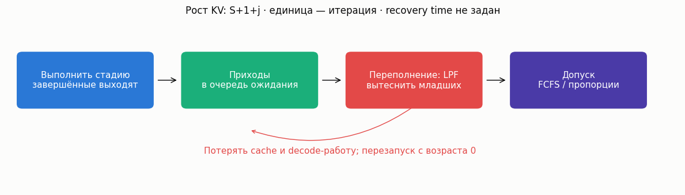

# Вытеснение KV-cache и service-induced congestion

[English](kv-cache-congestion.md) · [Каталог](../models.ru.md)

Реализована детерминированная stage-memory модель
[Ao, Dong, Luo, Simchi-Levi, arXiv:2606.15555v1](https://arxiv.org/html/2606.15555v1)
и отдельная имитация целых запросов. Устойчивость флюидного равновесия
**не означает** положительную возвратность открытой случайной очереди.

## Простыми словами

Запрос помещается при допуске, но его cache растёт с каждым токеном. Позже
может потребоваться вытеснение: выполненная работа теряется, запрос начинает
заново. Синхронизация групп запросов снижает полезную мощность. Ограничение
допуска помогает не всегда: целая FCFS-очередь отличается от пропорционального
флюидного потока.



## Калькулятор и непрерывная траектория

`KvCacheCongestionCalc` наследует `BaseQueue`. Память M — положительное
вещественное число резервируемых KV-токенов. Длины класса фиксированы:
целые S>=0 и D>=1, **M>S+D**. Стадия j=0,...,D−1 занимает S+1+j,
включая резерв следующего токена; prefill/recovery time не моделируются.
Каждый активный запрос выполняет одну стадию за итерацию, после D выходит.
`set_sources` принимает положительные **доли классов** с суммой один, не λ.
`set_servers` принимает равные по размеру векторы длин. По умолчанию D<=256;
`max_decode_length` — явный настраиваемый численный ресурсный предел.

```python
from most_queue.theory.continuous_batching import KvCacheCongestionCalc

model = KvCacheCongestionCalc(memory_tokens=24)
model.set_sources([1.0])
model.set_servers(input_tokens=[2], decode_tokens=[3])
r = model.run()
print(r.nominal_throughput)       # 2.0 завершения/итерацию
print(r.worst_cycle_throughput)   # 1.6; однородный флюидный цикл
greedy = model.evolve(120, initial_state=[[2.5, 2, 1.7]], record_trace=True)
capped = model.evolve(120, initial_state=[[2.5, 2, 1.7]], admission_cap=2)
```

Равновесие: `a*=M/sum(p_k*C_k)`,
`C_k=sum(S_k+1+j, j=0,...,D_k−1)`; масса каждой стадии класса k равна p_k*a*.
Для одинаковых длин `worst_cycle_throughput=M/(D*(S+D))`. В неоднородном
случае поля worst-cycle равны None, а не недоказанной общей границе.

Коэффициенты eviction-free recurrence:
`F_j=sum(p_k*(S_k+1+j), D_k>j)`, от старшего коэффициента до свободного;
степень max(D_k)−1. Предельные коэффициенты
`A_j=sum(p_k*r_k, D_k>j)` относятся к явно заданному S_k≈r_k*L.
`input_ratios` по умолчанию — единицы, то есть common-input scaling,
**не** отношения фактических конечных input lengths.

| Поле | Смысл |
|---|---|
| `nominal_throughput`, `fixed_point` | Непрерывное насыщенное равновесие, завершения/итерацию |
| `worst_cycle_throughput`, `worst_cycle_ratio` | Максимальный однородный флюидный цикл |
| `coefficients`, `limiting_coefficients` | Конечный и input-dominated полиномы |
| `spectral_radius`, `limiting_spectral_radius` | Численный спектр, не глобальный сертификат |
| `linear_stability` | `schur_stable_numerically`, `linearly_unstable_numerically`, `near_boundary` |
| `root_residual`, `decode_gcd`, `diagnostics` | Невязка, GCD и оговорки контракта |

В полосе `spectral_tolerance` вокруг единицы вывод неопределённый; большая
backward residual подавляет классификацию. Нефинитные/underflowed коэффициенты
отклоняются. D=1 даёт постоянный полином и radius=0. GCD=1 **не гарантирует**
устойчивость при конечном S. Поля w/v/utilization/стационарный PMF равны None.

`evolve(iterations, initial_state=..., admission_cap=None, warmup=0,
record_trace=False)` — насыщенная непрерывная карта с пропорциональным
допуском и пропорциональным удалением классов на младшей занятой стадии.
Это не Poisson-очередь. Cap — неотрицательная вещественная масса/итерацию,
без округления; начальное состояние должно помещаться, допускается slack.
Вытеснение учитывает потерянный прогресс, но идентичности запросов в свежем
насыщенном потоке не отслеживаются. Результат: final state, throughput,
evicted mass, memory fraction, баланс decode-работы и опциональная трасса.
Средние исключают warmup, счётчики/трасса включают его.

## Независимая имитация целых запросов

```python
from most_queue.sim.kv_cache_congestion import KvCacheCongestionSim

sim = KvCacheCongestionSim(memory_tokens=60, seed=42)
sim.set_sources([4.5])            # Poisson: запросов/итерацию по классам
sim.set_servers([2], [3])
s = sim.run(4000, warmup=500, admission_cap=5)
assert s.initial_jobs + s.arrived == s.completed + s.unfinished
assert s.initial_work + s.executed_work == (
    s.completed_work + s.discarded_work + s.remaining_work
)
```

Память и запросы целые. Порядок: **исполнение → приходы → LPF-вытеснение →
FCFS-допуск**. При равном прогрессе первым вытесняется более новый запрос;
его cache/возраст обнуляются, он возвращается в хвост. Одновременные приходы
упорядочены по индексу класса. Непоместившуюся голову не обходят; будущий
пик памяти при допуске не резервируется. Пропорции активных стадий не навязаны.

`run` принимает replay `[iterations, classes]`, целый class-stage
`initial_state`, `initial_queue` из индексов классов, `record_trace`.
Cap — неотрицательное **целое**, дробный отвергается. RNG сбрасывается к
seed при каждом run. `saturated=True` создаёт свежий запрос только при пустой
очереди FCFS/retry, по нормированным source weights: такие запросы учтены,
но это не внешние Poisson-приходы.

Горизонт фиксирован, drain отсутствует. `unfinished` включает очередь и активные
запросы, `final_queue` — только ожидающих. Счётчики работ/запросов/вытеснений
включают warmup, throughput/memory fraction исключают. Censored latency и
доказательство устойчивости не выдаются. Суммарная интенсивность и replay batch
ограничены 1e6 для защиты выделения памяти на отдельные запросы.

## Проверки и границы

[Отчёт](../research/kv-cache-congestion-validation-2026.md): рациональная карта,
прямой stage Jacobian, точная рекурсия Шура, ручные целые трассы, балансы.
Расхождения относятся к печатной подписи/примеру; код авторов не проверен.
[JSON](../research/kv-cache-congestion-results-2026.json): 10 траекторий,
48 спектров, 24 DES-настройки по четыре парных seed.

Не реализованы GPU/Vidur replication, случайные неизвестные output lengths,
latency distributions, оптимальный scheduler, платное wall-clock recovery.
Единица времени — итерация: медиана GPU-слота не превращает результат в теорему
о реальном времени. [Free-swap границы Л4](kv-cache-stability.ru.md) относятся
к другой дисциплине, не служат сертификатом для данного restart-процесса.
