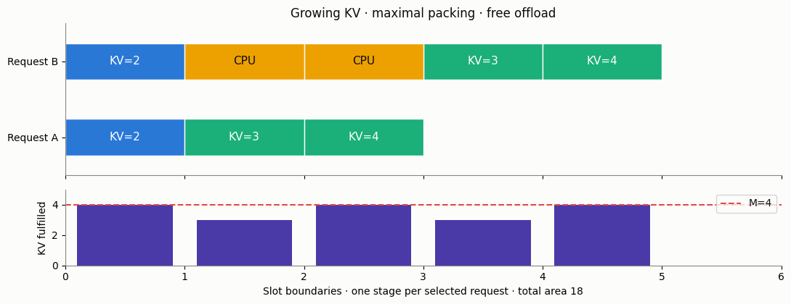

# KV-cache memory and stability

The bounds of [Nie, Si and Zhou (ICML 2026)](https://arxiv.org/html/2605.04595v1)
connect request lengths, constant iteration time and GPU KV capacity. They
give a necessary upper and a policy-dependent sufficient lower throughput
bound, **not an exact stability threshold** or a latency distribution.

[Русская версия](kv-cache-stability.ru.md) · [Model catalog](../models.md)

## In plain words

A request first processes its prompt in chunks, then generates output one
token per selected iteration. Its KV footprint grows until completion.
The simulator prioritizes ongoing requests, scans past requests that do not
fit and fills the remaining memory with waiting requests. Unselected partial
requests can reside on CPU for free: this assumption matters to the guarantee.



## Model and API

`KvCacheStabilityCalc` inherits `BaseQueue`. `memory_tokens` and `chunk_size`
are positive integers, KV capacity is measured in **tokens, not bytes**.
`set_sources(l)` takes a finite nonnegative rate per time unit. Arrivals in
different slots and request types are iid, with mean arrivals `l*slot_time`
per slot; the theorem does not require a Poisson process.

`set_servers(joint_pmf, slot_time)` accepts a finite mapping
`{(input_tokens, decode_stages): probability}`. Both lengths are positive
integers; input must be a multiple of `chunk_size`. Probabilities sum to one
(absolute rounding tolerance 1e-10); zero-probability entries do not affect
the essential supremum. Every supported peak `s+o` must fit in memory.
The constant slot duration is positive and finite. Changing parameters is
supported; each `run()` creates a new result, without stale cached bounds.

```python
from most_queue.theory.continuous_batching import KvCacheStabilityCalc

calc = KvCacheStabilityCalc(memory_tokens=40, chunk_size=2)
calc.set_sources(l=1.75)
calc.set_servers({(4, 2): 1.0}, slot_time=1.0)
r = calc.run()
print(r.status)                 # stable_under_assumptions
print(r.capacity_lower)         # 2.0 requests/time unit
print(r.capacity_upper)         # 40/17; NOT the exact threshold
print(r.delta)                  # 6/40
```

The example uses synthetic time units, not a GPU calibration. The mathematical
compute constraint is **constant slot duration**; there is no additional
compute-token budget or the alpha/beta/gamma cost law from L3.

## Bounds and outputs

For chunk size h, the charged footprints are `h, 2h, ..., s` in prefill and
`s+1, ..., s+o` in decode. A request advances at most one stage per slot.
We follow the paper's **memory-area formula**: o denotes charged decode
stages after prefill, with no extra output charged to prefill. The prose's
first-output wording is ambiguous; this convention is explicit and tested.

```text
g(s,o) = s*(s/h+1)/2 + s*o + o*(o+1)/2
G = E[g(S,O)] over the JOINT distribution
peak = max(s+o) over positive-probability support
upper = M / (slot_time*G)
lower = (M-peak) / (slot_time*G)
delta = peak/M
```

| Field | Meaning |
|---|---|
| `status` | `stable_under_assumptions` if l < lower; `overloaded` if l > upper; otherwise `inconclusive` |
| `mean_memory_area`, `peak_tokens`, `delta` | Expected KV token-slots, largest stage footprint, large-memory ratio |
| `capacity_upper`, `capacity_lower` | Necessary upper bound and sufficient lower bound; not an exact capacity |
| `utilization` | Offered resource-area load l*slot_time*G/M; **not GPU busy fraction** |
| `expected_drift_upper` | l*slot_time*G − (M−peak), valid outside the large-backlog set under policy assumptions |
| `length_covariance` | E[S*O]−E[S]E[O]; correlation must not be silently discarded |
| `necessary_replicas`, `sufficient_replicas` | ceil(l/upper) and floor(l/lower)+1 for identical, equally loaded workers |
| `diagnostics` | Assumptions and limits, not an empirical accuracy certificate |

Both threshold equalities and the gap are **inconclusive**. If `delta=1`,
the sufficient interval is empty and the sufficient replica count is None.
At zero rate, replica counts are zero when the lower interval is nonempty.
The necessary replica count alone does not guarantee stability or SLOs.
Each worker must receive an iid stream of the stated rate; deterministic
round-robin routing is not automatically covered by that assumption.

The lower theorem assumes maximal next-stage packing and zero-cost swapping.
Pass `maximal_packing=False` or `zero_cost_swap=False` to suppress its
certificate: `capacity_lower`, drift and sufficient replica count become
None, but overload above the necessary upper bound is still reported.
No arbitrary universal cutoff for “delta small” is invented. The proof's
packing drift is useful whenever peak < M in this explicit free-swap model;
the paper motivates its GPU approximation in the regime delta << 1.

`w`, `v`, `p`, `pi` remain None. Stability does not imply a specified latency
tail; the model provides neither delay means nor a stationary occupancy PMF.

## Independent slot simulation

```python
from most_queue.sim.kv_cache_stability import KvCacheStabilitySim

sim = KvCacheStabilitySim(memory_tokens=40, chunk_size=2, seed=7)
sim.set_sources(l=1.75)  # independent Poisson count at each slot beginning
sim.set_servers({(4, 2): 1.0}, slot_time=1.0)
r = sim.run(3000, warmup_slots=500)
print(r.throughput, r.unfinished, r.outstanding_memory_area)
assert r.input_memory_area == r.fulfilled_memory_area + r.outstanding_memory_area
```

`run(num_of_slots, ...)` intentionally uses a **fixed horizon**, not a target
number of completions: it can observe overload without draining a finite
cohort. Replay uses `arrivals_by_slot`, one list of supported (s,o) pairs per
slot; arrivals join at slot beginnings. `record_trace=True` records request
IDs/stages/charges, remaining work, backlog and unselected ongoing requests.
The simulator independently enumerates footprints; it never calls g or the
calculator. Repeated runs with the same seed replay the same arrivals.

Total arrival/completion/work counters include warmup. `throughput`, GPU
busy fraction (`utilization`), fulfilled-memory fraction and `observation_time`
use only post-warmup slots. `swapped_request_slots` counts unselected ongoing
request-slots, **not transfer operations or bytes**. CPU memory is unlimited;
swap, reload and scheduling cost zero. No completed-only censored latency
moments or stationary p/pi are returned. Horizons and total arrivals are
capped at 2 million; each supported type at 1 million enumerated stages.

## Validation and limits

Stage enumeration, hand replay, conservation, 729 small arrival configurations,
an independent configuration LP and saturated cycles validate the mechanics.
Poisson replications check flow below the lower bound and outstanding work
growth above the upper bound; finite experiments are not recurrence proofs.
The source's printed remaining-work expressions have indexing discrepancies
documented with independent sums in the [method report](../research/kv-cache-stability-validation-2026.md).

The [36-setting experiment](../../examples/kv_cache_stability_experiment.py)
and [saved results](../research/kv-cache-stability-results-2026.json) vary
correlation, memory, chunks and load with four replications each. They are
synthetic, not a replication of A100/LongBench measurements. Peak reservation,
hard residency, paid eviction, variable slot times and SLOs are outside the
certificate. These limitations motivate L5, rather than being silently
absorbed into a stability guarantee.
