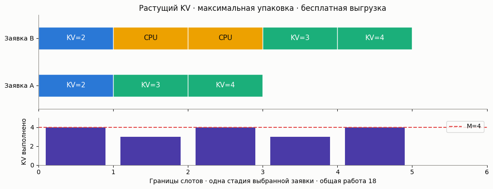

# KV-память и устойчивость

Границы [Nie, Si и Zhou, ICML 2026](https://arxiv.org/html/2605.04595v1)
связывают совместный закон длин, постоянное время итерации и KV-ёмкость.
Это необходимая верхняя и достаточная нижняя границы, **не точный порог**
и не распределение задержки.

[English](kv-cache-stability.md) · [Каталог](../models.ru.md)

## Простыми словами

Заявка проходит prefill-чанки, затем по одному выходному токену за выбранную
итерацию. Её KV-cache растёт до завершения. Сначала планируются начатые
заявки; не вмещающиеся пропускаются, свободное место заполняется ожидающими.
Не выбранные частично выполненные заявки бесплатно хранятся на CPU.



## Модель и пример

`KvCacheStabilityCalc` наследует `BaseQueue`. Память `memory_tokens` и чанк
`chunk_size` — положительные целые. Память измеряется в **токенах, не байтах**.
`set_sources(l)` принимает неотрицательную конечную интенсивность; теорема
предполагает iid число приходов по слотам со средним l*slot_time, не обязательно
Poisson. `set_servers(joint_pmf, slot_time)` принимает совместный конечный PMF
`{(s,o): p}` и положительную постоянную длительность слота.

Длины — положительные целые, s кратно размеру чанка; округление не выполняется.
Вероятности суммируются в единицу (допуск округления 1e-10). Нулевая масса
не влияет на essential supremum; каждый поддержанный пик s+o помещается в M.
Повторное изменение параметров пересчитывает границы, результат не кешируется.

```python
from most_queue.theory.continuous_batching import KvCacheStabilityCalc

calc = KvCacheStabilityCalc(memory_tokens=40, chunk_size=2)
calc.set_sources(l=1.75)
calc.set_servers({(4, 2): 1.0}, slot_time=1.0)
r = calc.run()
print(r.status)                  # stable_under_assumptions
print(r.capacity_lower, r.capacity_upper)  # 2.0, 40/17
```

Это искусственные единицы времени, не GPU-калибровка. Compute здесь задан
постоянной длительностью слота: token budget и alpha/beta/gamma из Л3 нет.
У каждой выбранной заявки выполняется не более одной стадии за слот.
Согласно формуле площади памяти статьи o — число decode-стадий **после**
prefill. Формулировка о первом выходном токене в тексте неоднозначна;
дополнительный токен к prefill не приписывается.

```text
g(s,o) = s*(s/h+1)/2 + s*o + o*(o+1)/2
G = E[g(S,O)] по совместному PMF
peak = max(s+o) по положительной массе
upper = M/(slot_time*G), lower = (M-peak)/(slot_time*G)
delta = peak/M
```

## Что возвращается

- `status`: `stable_under_assumptions` при l < lower, `overloaded` при
  l > upper, иначе `inconclusive`. Равенства и промежуток не решены.
- `mean_memory_area`, `peak_tokens`, `delta`: средняя площадь токен-слотов,
  максимальный след и отношение масштаба заявки к памяти.
- `utilization`: предложенная нагрузка l*slot_time*G/M, не доля занятости GPU.
- `expected_drift_upper`: l*slot_time*G−(M−peak), верхняя граница drift
  вне множества малых очередей, при оговорённых допущениях.
- `length_covariance`: E[SO]−E[S]E[O]; корреляция не заменяется независимостью.
- `necessary_replicas`: ceil(l/upper); это только необходимость.
  `sufficient_replicas`: floor(l/lower)+1, строгая достаточность для одинаковых
  работников с равной интенсивностью iid потоков. Не гарантия SLO или
  произвольного балансировщика; round-robin не автоматически iid.

При delta=1 достаточный интервал пуст, sufficient_replicas=None.
При l=0 обе оценки числа реплик нулевые, если нижний интервал непуст.
`w`, `v`, `p`, `pi` отсутствуют (None): задержки и стационарный PMF не вычисляются.

Нижняя граница предполагает максимальную упаковку следующих стадий и
бесплатную выгрузку. `maximal_packing=False` или `zero_cost_swap=False`
отключают достаточный сертификат, lower/drift/sufficient_replicas становятся
None; верхняя граница перегрузки остаётся. Универсальный порог «малости» delta
не выдумывается: packing-доказательство работает при peak < M в явной
free-swap модели, а приближение GPU статья мотивирует при delta << 1.

## Независимая симуляция

```python
from most_queue.sim.kv_cache_stability import KvCacheStabilitySim

sim = KvCacheStabilitySim(40, chunk_size=2, seed=7)
sim.set_sources(1.75)
sim.set_servers({(4, 2): 1.0}, slot_time=1.0)
r = sim.run(3000, warmup_slots=500)
print(r.throughput, r.unfinished, r.outstanding_memory_area)
assert r.input_memory_area == r.fulfilled_memory_area + r.outstanding_memory_area
```

`run(num_of_slots, ...)` использует конечный **горизонт**, не число завершений.
Poisson-приходы случаются в начале слота; `arrivals_by_slot` задаёт replay
списками поддержанных пар (s,o). `record_trace=True` сохраняет ID, стадии,
заряды памяти, backlog и остаточную работу. Повтор seeded run воспроизводим.
Следы стадий перечисляются независимо от калькулятора; финального drain нет.

Счётчики работы/приходов/завершений включают warmup. Throughput, memory_fraction,
наблюдаемая GPU busy fraction (`utilization`) и observation_time — после warmup.
`swapped_request_slots` — число невыбранных начатых заявко-слотов, не операции
переноса или байты. CPU-память не ограничена, swap/reload бесплатны. Смещённые
моменты только завершённых заявок не выдаются. Лимиты: 2 млн слотов и приходов,
1 млн перечисленных стадий на тип заявки.

## Проверки и область применимости

Перечисление стадий, ручная трасса, сохранение работы, 729 малых конфигураций,
независимая packing-LP и насыщенные циклы проверяют механику. Репликации Poisson
проверяют поток ниже lower и рост работы выше upper, но не доказывают recurrence.
Две ошибки индексации напечатанного остаточного workload в приложении A
разобраны с независимыми суммами в [отчёте](../research/kv-cache-stability-validation-2026.md).

[Эксперимент](../../examples/kv_cache_stability_experiment.py): 36 режимов,
по четыре репликации; [JSON](../research/kv-cache-stability-results-2026.json).
Это не повторение A100/LongBench. Резервирование пика, hard residency,
платное вытеснение, переменное время слота и SLO не покрываются сертификатом.
Их нельзя спрятать внутри μ; следующее исследование вытеснения — Л5.
