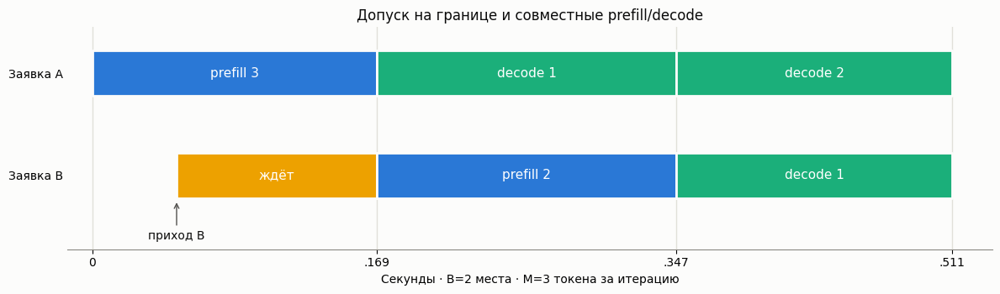

# Стоимость совместных итераций prefill и decode

Модель [Ramani и Tantawi](https://arxiv.org/html/2609.20957v1) оценивает средние
TTFT и ITL по длинам входа/вывода, интенсивности потока и трём стоимостям
акселератора. Занятость рассчитывается точно **для марковского surrogate**;
сам surrogate и TTFT/ITL приближают реальный токеновый процесс.

[English](prefill-decode.md) · [Каталог моделей](../models.ru.md)

Отдельный [стадийный mean TTFT calculator](stage-aware-ttft.ru.md) учитывает
достигнутые токены и остатки итераций. Он не меняет literal Л3: B=1 — PK,
B>1 — finite-loss либо отдельный infinite calculator с analytic truncation
bounds при достаточном условии (floating evaluation, не verified rounding).

## Простыми словами

Не более B заявок делят активный пул. Каждая сначала обрабатывает prompt,
затем выдаёт по токену за итерацию; завершившаяся заявка освобождает место
для FCFS-очереди. Длинный prefill задерживает токены уже работающих decoders.
Chunking ограничивает токены одной итерации, но не устраняет взаимное влияние.



## Калькулятор

`PrefillDecodeCalc` наследует `BaseQueue`. `set_sources(l)` принимает
положительную конечную пуассоновскую интенсивность. `set_servers(input_tokens,
output_tokens, alpha, beta, gamma)` — положительные **средние** длины и
baseline-время alpha, неотрицательные compute/KV-времена beta/gamma. Единицы
всех стоимостей одинаковы, единица l обратная. Дробные средние длины допустимы.

`batch_cap` — целое 1..4096; `token_budget` — None либо целое не меньше cap.
При конечном бюджете эффективное число prefill-стадий `c(i)` вычисляется по
приложению A, а не воспроизводит буквальное число чанков scheduler. Внешняя
очередь бесконечна. Стационарность: `rho=lambda*tau(B)/B < 1`.

```python
from most_queue.theory.continuous_batching import PrefillDecodeCalc

calc = PrefillDecodeCalc(batch_cap=256, token_budget=8192)
calc.set_sources(l=2.0)  # заявок/с
calc.set_servers(1024, 256, 0.00668, 0.0000201, 0.0000000552)
result = calc.run()
print(result.ttft_mean, result.itl_mean, result.w, result.v)
print(result.metrics_valid, result.diagnostics)
```

Здесь опубликованная оценка Llama-3.1-8B/H100 из таблицы I **переведена из ms
в s**. Это не новая калибровка вашего GPU.

## Результаты

| Поле | Смысл |
|---|---|
| `w`, `v` | Только первый момент ожидания/пребывания surrogate, точно для его цепи |
| `ttft_mean`, `itl_mean`, `prefill_mean` | Буквальная mean-occupancy оценка статьи |
| `batch_mean`, `jobs_mean`, `queue_mean` | Средние активного пула, системы, очереди |
| `waiting_probability` | PASTA-вероятность ожидания P(N >= B) |
| `queue_nonempty_probability` | P(N > B), названная в статье `P_w` |
| `utilization`, `busy_probability` | Нагрузка насыщения rho и отдельно доля занятого времени |
| `p`, `omitted_probability`, `tail_ratio` | Неперенормированный префикс PMF, пропущенная масса и геометрическое отношение |
| `metrics_valid`, `diagnostics` | Неотрицательность оценок и предупреждения, не гарантия точности |

Все средние включают **полный бесконечный хвост**. `max_output_states` (целое B+1..1000000)
ограничивает только вывод PMF и не влияет на средние. Последнее `p` —
отдельное состояние, не агрегат хвоста. `pi` не заполняется: `p` уже
описывает time/PASTA-занятость. Аналитических CDF/хвостов TTFT/ITL нет.

Безусловная средняя занятость может быть меньше единицы. Тогда формула
помеченной заявки использует отрицательную численность фона. Экстраполяция
помечается; отрицательный prefill сохраняется с `metrics_valid=False`,
а не скрытно обрезается до нуля. Даже неотрицательная оценка не гарантирует
малой ошибки приближения.

## Независимая имитация

`most_queue.sim.prefill_decode.PrefillDecodeSim` обслуживает индивидуальные
целые токены и не вызывает калькулятор. На границе итерации допускает FCFS
до B, даёт каждому decoder один токен, затем расходует оставшийся бюджет
на prefill в FCFS-порядке. Приходы внутри итерации ждут следующей границы.
Закончивший prefill не выдаёт токен в той же итерации. Время складывается
из alpha, реальных compute-токенов и KV-чтений/записей. Дисциплина явно
задана; это не копия vLLM/Sarathi.

```python
from most_queue.sim.prefill_decode import PrefillDecodeSim

sim = PrefillDecodeSim(batch_cap=4, token_budget=8, seed=7)
sim.set_sources(0.5)
sim.set_servers(8, 4, 0.1, 0.02, 0.003)  # синтетические секунды
r = sim.run(20_000, warmup_fraction=0.2)
trace = sim.replay([0, 0.05], [8, 3], [4, 2], record_iterations=True)
print(r.ttft_mean, r.itl_mean, r.all_decode_mean, trace.output_times)
```

Keyword `length_sampler(rng)->(input_length, output_length)` в `set_servers`
задаёт индивидуальные длины 1..1000000. Полные timestamp-массивы включают
warmup; статистика задержек исключает warmup по индексу прихода. Моменты
W/V эмпирические, порядков 1–3. Занятость и utilization измеряются между
первым учитываемым и последним входным приходом, без финального drain;
при нулевом временном окне `p=None`.

`itl_mean` — реальные интервалы **после первого выходного токена**, None,
если все ответы однотокенные. `first_decode_mean` — от конца prefill до
первого токена; `all_decode_mean` включает эти первые интервалы и ближе
к m-шаговому учёту статьи. При переменных длинах усреднение по токенам,
не по средним отдельных ответов.

`run` завершает конечную когорту и drain; завершение перегруженной трассы
не доказывает стационарность. `max_iterations` — ограничение вычислительной
работы, не размер очереди и не критерий устойчивости.

## Ограничения и воспроизведение

Проверенный saturated drift и infinite phase-aware means:
[стадийное расширение](stage-aware-ttft.ru.md). Exact drift не проверяет всю
арифметику mean bounds.

При B=1 и постоянных длинах DES — M/D/1, surrogate — M/M/1: ожидание
surrogate вдвое выше при том же среднем обслуживании. Также различаются
допуск на границах, неравный последний чанк, stalls бюджета и разброс длин.
Эти ошибки модели нельзя маскировать широким тестовым допуском.

Нет KV-capacity/eviction, prefix caching, speculative decoding, сети,
калибровщика и autoscaling actuator. [Общий occupancy-калькулятор](continuous-batching.ru.md)
— марковский родственник; [Л2](token-batching.ru.md) использует gated-batching
без допуска между decode-итерациями.

[Метод и проверка](../research/prefill-decode-validation-2026.md) ·
[JSON эксперимента](../research/prefill-decode-results-2026.json) ·
[Скрипт](../../examples/prefill_decode_experiment.py) ·
[EPIC-086](../epics/EPIC-086-prefill-decode-iteration-cost.md).
