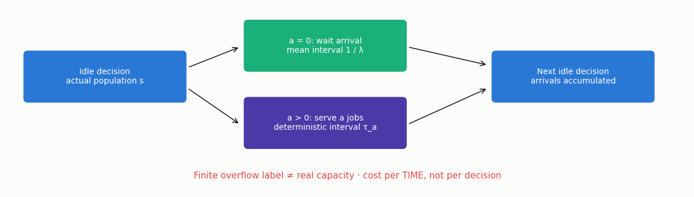

# SMDP batch launch control

[Русская версия](smdp-batching.ru.md) · [Catalog](../models.md)

Reproduction of the finite overflow approximation in
[Xu, Sun, Zhou and Niu, arXiv:2301.12865v3](https://arxiv.org/html/2301.12865v3),
with independent simulation of an **unbounded** queue. A finite optimum is not
automatically an optimal, or even stable, policy for that real queue.

## In plain words

When the server becomes free, start a batch now or wait for the next arrival?
Larger batches amortize setup energy but add waiting. Service is deterministic
and depends on batch size, not exponential. The decision intervals have unequal
lengths: optimizing cost per decision would optimize the wrong objective.



## Contract and API

One nonpreemptive server, Poisson rate λ>0, maximum batch B. Profiles specify
positive deterministic times τ_b and nonnegative energies ζ_b for b=1,...,B.
The source uses affine profiles; arbitrary finite profiles are an API extension,
not a threshold-structure theorem. λ must be below max_b(b/τ_b).
Weights are nonnegative, with at least one positive; no idle baseline power.
The objective is w1 × mean response time + w2 × mean power.

```python
from most_queue.theory.batch import BatchSmdpCalc

model = BatchSmdpCalc(40, energy_weight=4, overflow_cost=100)
model.set_sources(1.0)
model.set_servers([0.4, 0.6], [1.0, 1.3])
r = model.run(tolerance=1e-8)
assert r.converged
print(r.average_cost, r.policy)
print(r.overflow_cost_rate, r.tail_drift, r.tail_extension_stable)
```

States 0,...,N are idle-server decision populations. A separate overflow label
N+1 **represents population N**, not a capacity limit or population N+1.
Require 1≤N≤2000 and 1≤B≤min(N,128); these are numerical resource limits.
Action 0 waits for the next arrival (not a timer); action a>0 starts a jobs.
All batch jobs stay in the system until their simultaneous completion.

For ordinary state s, action 0 moves to s+1, has mean time 1/λ, expected
population area s/λ and cost w1*s/λ². At overflow it self-loops.
Positive action moves to s−a+K with K~Poisson(λτ_a); transitions above N go to
overflow. Its area is sτ_a+λτ_a²/2 and cost is
w1*(sτ_a/λ+τ_a²/2)+w2*ζ_a. Overflow uses s=N and adds c_o × mean time.
`epoch(s,a)` exposes transition row, mean time, cost, area and energy.

Uniformization uses η strictly below the source bounds; by default η is 0.9
times the smallest mean sojourn. Relative value iteration stops on increment
span, with smallest-action tie breaking. `run` accepts `max_iterations` and
`eta`; a reached limit is explicit (`converged=False`), not called optimal.
Compressed Poisson correlations avoid an O(BN²) transition tensor: RVI storage
is O(BN), arithmetic O(BN²) per iteration. Final policy evaluation uses a dense
O(N²) stationary system. `evaluate_policy(actions)` also works independently
of RVI; returned bias from RVI is scaled back to the original SMDP.

| Result | Meaning |
|---|---|
| `average_cost`, `response_proxy`, `power` | Finite stationary reward ratios per physical time |
| `decision_pmf`, `mean_epoch_time` | Embedded decision distribution and its mean interval |
| `interval_time_weights` | μ_s*y_s / sum(μ*y), **not** a real queue-population time PMF |
| `overflow_cost_rate` | Δ=μ_overflow*c'_overflow / sum(μ*y); not an error bound |
| `gain_lower`, `gain_upper`, `bellman_residual`, `balance_residual` | Finite-model numerical diagnostics |
| `policy`, `bias`, `iterations`, `converged`, `uniformization_eta` | Actions, original SMDP bias and solver status |
| `tail_drift`, `tail_extension_stable` | Separate check of the constant action used above N in a real queue |

If the real extension always uses action a>0 above N, its service-epoch drift
is λτ_a−a. Strict negativity gives a Foster stability argument for this specified
Poisson/deterministic constant-tail extension only. Action 0 waits forever above
N and has arrival-epoch drift +1. A small Δ or finite Bellman residual does not
replace this check. Changing only the tail action creates a **different policy**;
its real cost is not the original finite gain. No threshold structure is imposed.

Inherited `w`, `v`, `p`, `pi`, utilization remain None: neither latency moments
nor a continuous-time queue distribution have been solved.

## Independent simulation

```python
from most_queue.sim.smdp_batching import BatchSmdpSim

sim = BatchSmdpSim(seed=42, energy_weight=4)
sim.set_sources(1.0)
sim.set_servers([0.4, 0.6], [1.0, 1.3])
s = sim.run(20000, r.policy, warmup=2000)
assert s.initial_jobs + s.arrived == s.completed + s.unfinished
assert abs(s.total_population_area - s.completed_residence
           - s.unfinished_residence) < 1e-6
```

Policies are either N+2 feasible integer actions (last action applies unchanged
to every actual population above N), or a callable of the **actual** population.
The simulator does not cap that population, reject overflow or import the solver.
It tracks FCFS request arrival times. Arrivals during service do not trigger
control; simultaneous completion is processed before arrivals and the next
decision. Every run resets its seeded arrival RNG.

`run(horizon, policy, warmup=0, arrivals=None, initial_jobs=0,
record_trace=False, max_events=2000000)` accepts sorted arrival-time replay,
including ties, in [0,horizon). Initial jobs have arrival time zero. Runs stop
without drain; events exactly at horizon are excluded. Trace records decisions.

Full-run counters and exposure satisfy the request and population-area
identities above, including unfinished active jobs. `population_area`, `power`,
`busy_fraction`, `response_proxy` and `average_cost` exclude warmup. Energy is an
impulse cost charged **fully at batch start**, including batches crossing the
horizon; this is not partial-service physical energy metering. Full `energy`
includes warmup, whereas `power` uses observed starts only. The response proxy
is observed ∫Q(t)dt/(λ × observation time), not an uncensored latency sample mean
or a stationarity proof. No `w`/`v` moments or time PMF are returned.

## Evidence and limits

[Validation report](../research/smdp-batching-validation-2026.md) and
[reproducible JSON](../research/smdp-batching-results-2026.json): independent
occupation LP, exhaustive policies, direct Poisson sums, area quadrature,
uniformization/bias checks, replay conservation, M/D/1 and unbounded DES.
The published P4 profile is numerical input, not new GPU measurements.

```bash
OPENBLAS_NUM_THREADS=1 OMP_NUM_THREADS=1 python -m examples.smdp_batching_experiment
```

No hard SLO, random service, token/KV dynamics, general infinite-queue optimality
or certified truncation error. This control model does not combine L4/L5 cache
mechanics with L3 timing, and does not close the dissertation's synthesis layer.
