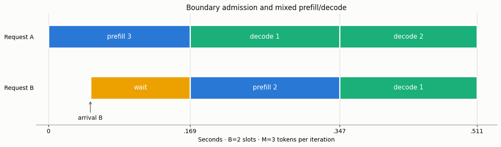

# Stage-resolved mean TTFT

[Русская версия](stage-aware-ttft.ru.md) · [Catalog](../models.md)

## In plain words

A request waits for an active slot, then processes its prompt in chunks and
generates output tokens. Other requests may arrive halfway through an iteration
and must wait for its remaining duration. The calculator tracks the ordered
attained-token stages instead of putting a typical request into the unconditional
mean occupancy. Output length does not inform the scheduler's actions.



```python
from most_queue.theory.continuous_batching import StageAwareTtftCalc

calc = StageAwareTtftCalc(batch_cap=2, token_budget=4, queue_capacity=6)
calc.set_sources(0.5)
calc.set_servers([(1, 1, 0.6), (3, 2, 0.4)], alpha=0.1, beta=0.02, gamma=0.003)
r = calc.run()
print(r.ttft_mean, r.blocking_probability, r.states)
```

## Exact model versus approximation

For **B=1**, the model is infinite-buffer M/G/1 FCFS with iid finite-support
joint input/output marks and independent Poisson arrivals. The full request
service distribution is used in PK; only the service through first decode is
added to waiting. `queue_capacity` is ignored in this explicitly documented
shortcut; the result's `model` identifies it.

For **B>1**, `StageAwareTtftCalc` and `ReducedStageAwareTtftCalc` solve the specified **finite waiting-capacity loss
system**. It is a numerical approximation to the infinite token DES only when
that change of model is acceptable. Report blocking and compare queue capacities;
neither low blocking nor refinement difference is an error certificate. Finite
systems can be stationary at offered loads where the infinite system is not.
`conservative_load=lambda*E[isolated full service]` is a serialized-work
diagnostic, not a necessary/sufficient stability threshold for shared batching.

The result inherits `QueueResults`: only `w[0]`, `v[0]` and `ttft_mean` are
supported, plus utilization, accepted rate, blocking, state count, numerical
residual and solver wall duration. `p/pi` are unset because embedded-epoch
probabilities would be misleading as time/arrival population probabilities.
No ITL/tail/SLO estimate is claimed. Costs are synthetic deterministic iteration
times, not calibrated GPU measurements. No KV limit, cache, offload or eviction.

## Discipline

At boundaries admit FIFO up to B. Existing decoders receive one token each;
FCFS prefills spend the remaining total token budget. A finished prompt produces
its first output token in the next iteration, not the same one. An arrival during
an iteration enters the waiting buffer if space is available; otherwise it is
lost, even if an active slot will be free at the next boundary. Idle first arrivals
start immediately. `None` budget removes the token constraint, not the active cap.

State is ordered `(type, attained_tokens)` active list plus FIFO waiting types.
The full type is a latent stochastic primitive; the transition policy never
looks at its future output length. Marks are **iid**, so this predictor does not
reproduce the serial dependence investigated in ГЛ2.

## Cost and evidence

Support size, lengths, B and waiting capacity cause state-space explosion.
`max_states` and `max_transition_words` raise explicit errors. This is a small-law
reference/prototype, **not a compact predictor for empirical BurstGPT support**.
On the frozen 48-point grid, median mean-TTFT error decreased versus literal L3,
including a separate B>1 comparison; some heterogeneous solves already take
longer than a single 12000-job DES. A same-clock four-case diagnostic found
solver/DES wall ratios about0.067–0.071 for homogeneous laws and1.56–1.83
for mixed laws. It did not improve the configuration choice:
both old and new predictors chose the same correct cap on all 24 tested pairs.

[Derivation and validation](../research/stage-aware-ttft-validation-2026.md),
[all results](../research/stage-aware-ttft-results-2026.json),
[epic](../epics/EPIC-093-stage-aware-ttft.md).

## Exact iid state reduction

`ReducedStageAwareTtftCalc` has the same sources/servers/run API and returns
the same first moments for this **finite-loss** model. It stores waiting count,
sampling iid joint marks only at FIFO admission, and optionally canonicalizes
decoder permutations while retaining ordered prefills. Use it in the example
above by replacing `StageAwareTtftCalc` with `ReducedStageAwareTtftCalc`.
`canonical_decoders=False` isolates waiting-count reduction.

This integrates unobserved iid waiting marks; it is not strong lumpability of
arbitrarily known waiting words, and cannot predict conditionally on a particular
observed queue. Serial mark dependence, length-aware admission, cancellation
and KV-based loss invalidate this reduction. It adds no finite/infinite error,
but also removes none of the existing finite/infinite bias. Active phase support
still grows combinatorially; empirical-support scalability is not established.
The extra `transition_words` result counts planned admission words, not the full
solver's arrival words. B1 retains the documented infinite PK shortcut.

All48 old cases and eight solvable larger-law cases agree to at most4.36e-14
across W/V/TTFT, accepted rate, loss and utilization. Eight additional full-model
state-budget refusals are recorded; the reduced model solves all16 larger-law
cases (up to2339states). They are not counted as verified full comparisons.
On the four-case paired timing diagnostic, mixed-law state reduction is
13.1–13.5x and full/reduced wall speedup18.2–27.2x (CPU similar).
Decoder sorting is slightly slower than waiting-count only on these small
mixed cases; it does not guarantee a runtime improvement.
See [proof, tests and measurements](../research/stage-aware-ttft-reduction-validation-2026.md)
and [comparison JSON](../research/stage-aware-ttft-reduction-results-2026.json).

## Infinite queue with analytic truncation bounds

```python
from most_queue.theory.continuous_batching import InfiniteStageAwareTtftCalc

calc = InfiniteStageAwareTtftCalc(batch_cap=2, token_budget=2, truncation=8)
calc.set_sources(1.3)
calc.set_servers([(1, 1, 0.6), (3, 2, 0.4)], alpha=0.1, beta=0.02, gamma=0.003)
r = calc.run()
print(r.mean_bounds["ttft"], r.waiting_tail_upper, r.dominating_load)
```

Here `truncation` is a numerical count domain, **not a loss buffer**.
The true infinite model accepts every arrival. A killed regenerative kernel
keeps exact transitions inside the domain; unbounded Poisson overshoot and
all continuation rewards until idle are bounded by a dominating M/G/1 busy
period. Never normalize the substochastic rows or substitute a finite-loss
stationary law. B1 keeps the exact PK shortcut and ignores this domain;
its truncation/tail/cycle/domination diagnostics are `None`, not zero tail.

For B>1 require `lambda*E[D]<1`, with
`D=(alpha+beta)*(S+O)+gamma*(S+O)*(S+O+1)/2`.
Token service credits prove a sufficient stability condition for this explicit
discipline, not its necessary/exact threshold. `ValueError` outside that
condition does **not** establish instability. Three original-grid cases refuse.
`max_states` and `max_transition_words` remain explicit complexity guards.

`mean_bounds` contains `(lower,upper)` for `w`, `v`, `ttft`; standard means are
their midpoints. `utilization_bounds`, `cycle_exit_probability`, cycle-time
lower/remainder upper, `dominating_load` and `truncation` expose the calculation.
The inherited `stationary_residual` field reports the killed regenerative
linear-equation residual here, not balance of an infinite stationary vector.
Accepted rate=lambda, blocking0. `waiting_tail_upper` bounds time-stationary
actual waiting count>N, including bursts within iterations. It is not a TTFT
tail/quantile, KV bound or SLO guarantee. `p/pi` and higher moments stay unset.

These are **analytic model-truncation bounds evaluated in floating point**.
`roundoff_certified=False`; solver residuals do not verify arithmetic rounding.
An extremely narrow printed interval must not be sold as certified digits.
The iid/mark-blind/finite-support/synthetic-cost restrictions above still apply.
No real GPU or empirical-support scalability has been established.
On the frozen grid45/48 cases return results (24PK,21batched); all successful
batched cases reach <=0.1% widths for all three means with N<=32/701states.
[Proof, frozen failures and independent DES](../research/infinite-stage-aware-ttft-validation-2026.md)
and [complete JSON](../research/infinite-stage-aware-ttft-results-2026.json).

## Phase-aware infinite queue (EPIC-096)

In plain words: a long queue keeps the pool full while prefill/decode stages
alternate. Follow those stages to check that departures outpace arrivals in
every reachable long-run class. No exponential service or irreducible phase
chain is assumed. The [family diagram](prefill-decode.md) shows the same policy.

```python
from most_queue.theory.continuous_batching import PhaseAwareStabilityCalc, PhaseAwareTtftCalc
law = [(1, 1, 0.6), (3, 2, 0.4)]
calc = PhaseAwareStabilityCalc(batch_cap=2, token_budget=4)
calc.set_servers(law, alpha=0.1, beta=0.02, gamma=0.003)
calc.set_sources(3.0)
print(calc.run().classification)  # positive_recurrence
means = PhaseAwareTtftCalc(batch_cap=2, token_budget=4, truncation=64)
means.set_servers(law, alpha=0.1, beta=0.02, gamma=0.003)
means.set_sources(3.0)
print(means.run().mean_bounds)
```

Stability exposes all closed SCCs, transient count, class capacities (departures
per physical time), corrector and exact rational row drift/margin. No delay or
`p/pi` is invented. Statuses: `positive_recurrence`, `positive_drift_escape`,
`critical_or_numerically_unresolved`; relative 1e-10 critical band stays unresolved.
Underflow/state/word budgets produce explicit errors. Defaults: 20000 states and
2000000 words; active combinatorics remains. Input masses are exactly rationally
normalized; mean evaluation uses their floating representations.

Phase-aware means require negative drift and replace `lambda E[D]<1` by exterior
potentials and finite-core clearing trials. `dominating_load` is now a diagnostic
and may exceed 1. N is not a loss buffer; B1 keeps PK. `drift_verified` concerns
only phase drift; `roundoff_certified=False` concerns full mean arithmetic.
Check widths: core bounds may be very loose or overflow. All iid/finite-support/
mark-blind/policy restrictions remain; no TTFT quantile or GPU certificate.
48/48 original cases pass frozen widths with N<=32, recovering all 3 old refusals;
fresh high-load cases reach N128, with 12 means inside three-seed t95 intervals.
[Proof and sources](../research/phase-aware-stability-validation-2026.md) ·
[complete JSON](../research/phase-aware-stability-results-2026.json).

## Sources

The methods are known renewal rewards/Little/PK, not a new general theorem.
[Bekker2005](https://ir.cwi.nl/pub/14125), selected Ch.1–2, distinguishes workload,
waiting and observation measures. [Zhang2009](https://repository.gatech.edu/bitstreams/7e8688af-edf1-4c43-a81f-edae8dc4d4c2/download),
Ch.2 and §6.3, describes limited PS residual states and two-moment approximations.
Iteration costs come from [Ramani–Tantawi2609.20957v1](https://arxiv.org/abs/2609.20957v1);
the discrete boundary discipline is the library's explicit token-DES contract,
not an assertion of equivalence to their mean-field policy or production vLLM.
