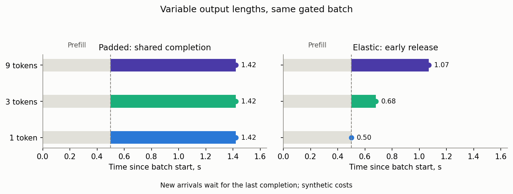

# Variable token length batching

Requests have random output lengths, not exponential processing times. Batch
duration depends jointly on batch size and the longest response. This model
implements the mechanism of [Yang, Jiao and Xu 2024](https://arxiv.org/html/2407.05347v1),
with explicit random-duration analysis and an independent request-level simulator.

## In plain words

Dynamic batching starts everyone waiting when the server becomes free. Fixed
batching waits until exactly b requests can start. Gated elastic batching starts
everyone waiting but returns short responses early and shrinks the active group;
new arrivals still wait until the last response finishes.



## Policies and outputs

| Policy | Calculator | Simulator | What is returned |
|---|---|---|---|
| Dynamic, unbounded physical batch | `TokenBatchingCalc` | `TokenBatchingSim("dynamic")` | Numerical mean waiting/sojourn, batch PMF and diagnostics |
| Gated elastic, unbounded physical batch | `TokenBatchingCalc`, `elastic=True` | `TokenBatchingSim("elastic")` | Same, with actual early-completion job rewards |
| Fixed batch b | `FixedTokenBatchingCalc(b)` | `TokenBatchingSim("fixed", b)` | Numerical means and departure-backlog PMF |
| Dynamic with physical cap | No analytic cap solver in this family | `TokenBatchingSim("dynamic", cap)` | Empirical means, three raw moments, occupancy and CDF |
| Single-request clipping | `TokenClippingCalc` | Fixed simulator with b=1 and matching costs | Exact M/G/1 first waiting/sojourn moments |

Analytical `w/v` contain only their first moments. `p/pi` are unset: neither a
batch-size PMF nor a departure-backlog PMF is a time-occupancy distribution. DES
returns a separately measured `p` and empirical `w/v` of orders 1–3.

## Token laws and cost

`TokenLengthDistribution(lengths, probabilities, max_tokens=None)` accepts a finite
sparse PMF of **total output tokens**, including the first. Decode lengths are
total−1. Clipping accumulates upper-tail mass at the limit, not renormalizes it away.
Factories `uniform(max_tokens)`, `clipped_lognormal(log_mean, log_std, max_tokens)`
and `clipped_normal(mean, std, max_tokens)` expose their discrete/ceiled conventions.
The continuous factories return `utility=NaN`: original-tail utility cannot be
recovered from a censored PMF. `clipped_fraction` remains available.

For prefill `P_b=k1*b+k2`, decode lengths N_i and maximum M:

```text
padded H = P_b + (k3*b+k4)*M
elastic H = P_b + k3*sum(N_i) + k4*M
```

Require finite `k1>0`, other costs nonnegative. This is not a model of KV-memory
limits, overlapped prefill, token-level admission or output-length-aware scheduling.

## Example

```python
from most_queue.theory.batch.token_service import TokenLengthDistribution
from most_queue.theory.batch.token_batching import TokenBatchingCalc, FixedTokenBatchingCalc
from most_queue.sim.token_batching import TokenBatchingSim

tokens = TokenLengthDistribution([1, 3, 9], [0.2, 0.6, 0.2], max_tokens=8)
cost = (0.1, 0.2, 0.025, 0.04)  # synthetic seconds, not GPU measurements
calc = TokenBatchingCalc(tolerance=1e-8).set_sources(1)
theory = calc.set_servers(tokens, *cost, elastic=True).run()
sim = TokenBatchingSim("elastic", seed=7).set_sources(1).set_servers(tokens, *cost)
observed = sim.run(num_of_jobs=30_000, warmup_fraction=0.2)
print(theory.w, theory.v, observed.w[:1], observed.v[:1])
fixed = FixedTokenBatchingCalc(4).set_sources(1).set_servers(tokens, *cost).run()
```

The finite decode cap d gives a sufficient certificate
`lambda*(k1+k3*d)<1` for dynamic/elastic finite means. For fixed batches the exact
stability check is `lambda*E[H|b]<b`. A sufficient certificate may be conservative.
Use physical `batch_size` only in the simulator; calculator `max_batch` is a
**numerical truncation**, not an admission cap.

## General service callbacks

`CallbackBatchingCalc` completes the callback interface transferred from L1. For
example, deterministic nonlinear H(b)=0.1b+0.2+0.03sqrt(b):

```python
import numpy as np
from scipy.stats import poisson
from most_queue.theory.batch.callback_batching import CallbackBatchingCalc

h = lambda b: 0.1*b + 0.2 + 0.03*np.sqrt(b)
calc = CallbackBatchingCalc(tolerance=1e-8).set_sources(1)
calc.set_servers(
    moments=lambda b: (h(b), h(b)**2),
    counts=lambda b, rate: [(1.0, poisson(rate*h(b)))],
    mean_bound=(0.13, 0.2),
    second_bound=(0.13**2, 2*0.13*0.2, 0.2**2),
)
result = calc.run()
```

Bounds must hold globally for every b, not only visited states. The first bound
is `a*b+c`, the second `u*b²+v*b+w`; require `lambda*a<1`, `lambda²*u<1`.
Count laws implement pmf/cdf/sf/ppf/isf/mean/var; ordinary SciPy frozen laws work.
Optional `job_mean(b)` permits early release. Callback consistency is checked,
but a global certificate remains the caller's responsibility. The independent
`DynamicBatchingSim.set_service_callback(sampler, mean_bound=(a,c))` accepts
`sampler(batch_size, rng)` without importing any count law.

## Clipping and optimization

`TokenClippingCalc().set_sources(rate).set_servers(tokens, a, c).run()` models
FCFS single-request `S=a*T+c`. `optimize_token_limit(original, candidates, rate,
a, c=0, theta=0.99)` exhaustively maximizes patient-user utility
`theta*E[min(T,cap)/T]-(1-theta)*E[Wq]` over the supplied finite candidates.
It needs an uncensored finite original PMF; unstable choices are reported and
excluded. This is not a universal quality metric or an impatience optimizer.

## Paper approximations and numerical limits

`FixedTokenBatchingCalc(...).set_servers(..., mean_service_surrogate=True)` exposes
the paper's deterministic-mean approximation separately. `paper_fixed_formula`
reproduces literal equation (25), including its default 20 series terms. Do not
use that raw value as full waiting: it includes service and excludes mean batch
formation. The [validation report](../research/token-batching-validation-2026.md)
derives and independently checks this discrepancy and the random elastic law.

`paper_bound_report()` provides equation (16) **waiting** bounds from a pathwise
affine envelope, not sojourn/tail guarantees. Automatic truncation checks
refinement, flow, second moments, boundary contribution and stationarity. Pinned
truncations set `converged=False`; matrix/count-cache/FFT budgets fail explicitly.
These diagnostics are not certified error bounds.

Reproduction: [experiment](../../examples/token_batching_experiment.py),
[36-configuration results](../research/token-batching-results-2026.json),
[EPIC-085](../epics/EPIC-085-variable-token-batching.md). Simulator warmup is
discarded at whole-batch boundaries; empirical uncertainty uses independent
replications, not iid assumptions about correlated requests.
