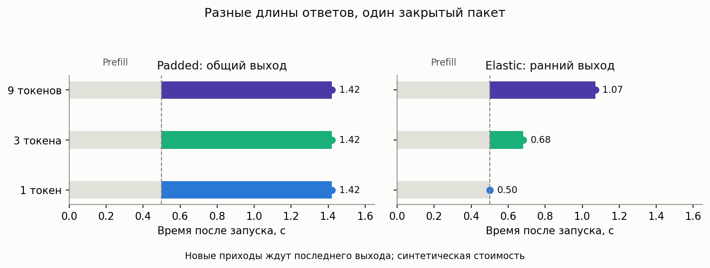

# Батчинг с переменной длиной вывода

Длительность обработки заявки не считается экспоненциальной: она определяется
числом генерируемых токенов. Время пакета зависит от его размера и максимальной
длины ответа. Реализован механизм
[Yang, Jiao, Xu 2024](https://arxiv.org/html/2407.05347v1) с сохранением случайного
времени, а не только подстановкой его среднего.

## Простыми словами

Dynamic запускает всех ожидающих при освобождении сервера. Fixed ждёт накопления
ровно b заявок. Elastic запускает ожидающих вместе, но отдаёт короткие ответы
раньше и уменьшает работающую группу. Новые заявки во всех этих пакетных
режимах ждут окончания последнего ответа; это не настоящий continuous batching.



## Дисциплины и результаты

| Дисциплина | Калькулятор | Симулятор |
|---|---|---|
| Dynamic без физического cap | `TokenBatchingCalc` | `TokenBatchingSim("dynamic")` |
| Elastic без физического cap | `TokenBatchingCalc`, `elastic=True` | `TokenBatchingSim("elastic")` |
| Fixed по b заявок | `FixedTokenBatchingCalc(b)` | `TokenBatchingSim("fixed", b)` |
| Dynamic с физическим cap | В этом семействе только имитация | `TokenBatchingSim("dynamic", cap)` |
| Одиночное обслуживание с clipping | `TokenClippingCalc` | Fixed с b=1 и соответствующими коэффициентами |

Теория возвращает только первые моменты w/v, диагностики и распределение на
вложенных эпохах, не временную PMF числа заявок. `p/pi` теории не заполняются.
DES отдельно измеряет временную PMF, занятость, три эмпирических момента w/v и CDF.

## Длины и стоимость

`TokenLengthDistribution(lengths, probabilities, max_tokens=None)` хранит конечную
PMF **полной** положительной целочисленной длины T. Decode-длина N=T−1 не содержит
первый токен. Clipping переносит хвост на cap, не перенормирует распределение
ниже cap. Доступны разреженные/эмпирические законы, `uniform(max_tokens)`,
`clipped_lognormal(log_mean, log_std, max_tokens)` и
`clipped_normal(mean, std, max_tokens)`. Непрерывные исходные величины в фабриках
округляются вверх и цензурируются; они не выдаются за непрерывные законы статьи.
Фабрики сохраняют долю урезанных ответов, но `utility=NaN`: полезность исходного
хвоста по цензурированной PMF восстановить нельзя.

Для `P_b=k1*b+k2`, `M=max(N_i)`:

```text
padded H = P_b + (k3*b+k4)*M
elastic H = P_b + k3*sum(N_i) + k4*M
```

Требуется конечное `k1>0`, остальные коэффициенты неотрицательны. Для dynamic/elastic
конечный decode-cap d даёт достаточное условие `lambda*(k1+k3*d)<1`, для fixed —
`lambda*E[H|b]<b`. Достаточный сертификат может быть консервативным. Параметр
`max_batch` калькулятора — численное усечение, не физический потолок пакета.

## Пример

```python
from most_queue.theory.batch.token_service import TokenLengthDistribution
from most_queue.theory.batch.token_batching import TokenBatchingCalc, FixedTokenBatchingCalc
from most_queue.sim.token_batching import TokenBatchingSim

tokens = TokenLengthDistribution([1, 3, 9], [0.2, 0.6, 0.2], max_tokens=8)
cost = (0.1, 0.2, 0.025, 0.04)  # синтетические секунды, не замеры GPU
theory = TokenBatchingCalc(tolerance=1e-8).set_sources(1).set_servers(tokens, *cost, elastic=True).run()
observed = TokenBatchingSim("elastic", seed=7).set_sources(1).set_servers(tokens, *cost).run(30_000)
fixed = FixedTokenBatchingCalc(4).set_sources(1).set_servers(tokens, *cost).run()
print(theory.w, theory.v, observed.w[:1], observed.v[:1])
```

## Общие callback-законы из Л1

`CallbackBatchingCalc` принимает `moments(b) -> (E[H|b], E[H²|b])`,
`counts(b,lambda) -> [(weight, count_distribution), ...]` и необязательный
`job_mean(b)` для раннего выхода. Законы счётчика реализуют
pmf/cdf/sf/ppf/isf/mean/var; подходят frozen-законы SciPy. Нужны глобальные
сертификаты `mean_bound=(a,c)` и `second_bound=(u,v,w)` для границ
`a*b+c` и `u*b²+v*b+w`, с `lambda*a<1` и `lambda²*u<1`.
Значения проверяются на посещённых состояниях, но конечная сетка не доказывает
глобальную границу: это ответственность задающего callback.
Независимый `DynamicBatchingSim.set_service_callback(sampler, mean_bound=(a,c))`
получает `sampler(batch_size,rng)`, не аналитический закон приходов.
Полный пример неаффинного H(b) приведён на [EN-странице](token-batching.md).

## Clipping и поиск конфигурации

`TokenClippingCalc` считает точные первые моменты M/G/1 для `S=a*T+c`.
`optimize_token_limit(original, candidates, rate, a, c=0, theta=0.99)` перебирает
конечный список cap по функции полезности (10) для терпеливых пользователей.
Нужна исходная нецензурированная PMF; неустойчивые варианты исключаются и явно
показываются в результатах. Вес задержки зависит от единиц времени; оптимальность
не универсальна и не относится к реальному качеству текста без отдельной модели.

## Ограничения и сверка со статьёй

`mean_service_surrogate=True` у fixed явно включает подмену случайного H средним.
`paper_fixed_formula` сохраняет буквальную формулу (25) с 20 членами по умолчанию;
это не полное ожидание клиента: она включает обслуживание и исключает среднее
накопление пакета. Независимые арбитры и выводы — в
[методическом отчёте](../research/token-batching-validation-2026.md).
`paper_bound_report()` возвращает границы **ожидания**, не пребывания или хвоста,
из поточечной аффинной границы H.

Усечение уточняется по моментным, потоковым и стационарным диагностикам;
фиксированное усечение имеет `converged=False`. Лимиты матрицы, кеша счётчиков
и FFT завершают расчёт явной ошибкой. Это не доказанная оценка погрешности.
KV-cache, перекрытие prefill/decode, нетерпение, length-aware admission и
аналитические хвосты задержки здесь не моделируются.

[Эксперимент](../../examples/token_batching_experiment.py),
[36 режимов](../research/token-batching-results-2026.json),
[EPIC-085](../epics/EPIC-085-variable-token-batching.md).
Прогрев DES исключается по целым пакетам; неопределённость считается по
независимым репликациям, не по коррелированным заявкам одного запуска.
