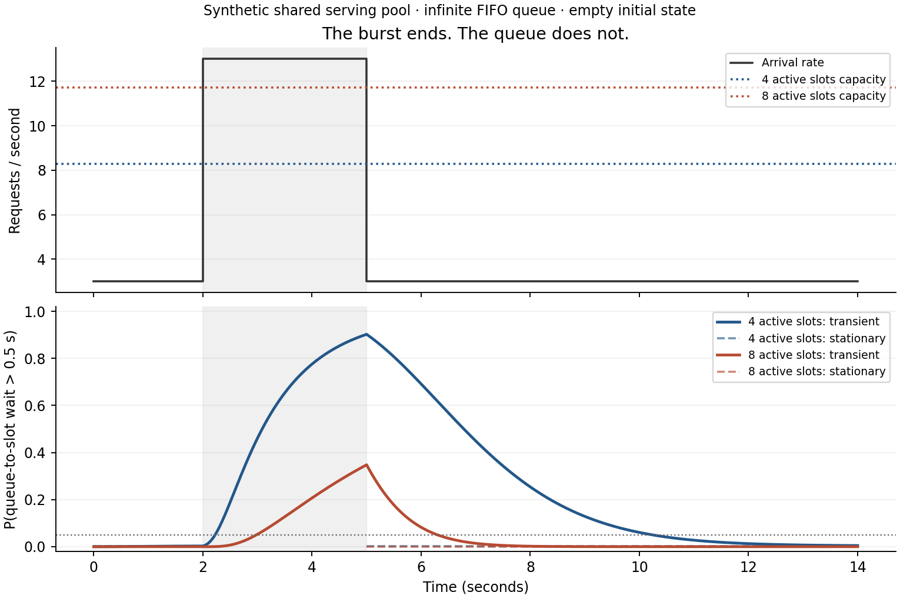

# Burst recovery in a shared serving pool

[Русская версия](transient-occupancy.ru.md) · [Model catalog](../models.md)

**In plain words:** requests share a fixed number of active slots. More active
requests can make each request slower. A burst fills the external FIFO queue;
after arrivals fall, that queue takes time to drain. This model follows that
transient distribution instead of replacing it by a stationary distribution
at every new arrival rate.

The [shared-pool diagram](../figures/continuous_batching.png) shows the same
queue and active slots; here the input rate varies with time.



## Run the example

From a source checkout, with `pip install -e .`:

```bash
python -m examples.llm_burst_recovery --output-dir /tmp/llm-burst
```

No GPU or external service is used. The command writes PNG, vector PDF, and
JSON containing every plotted point, parameter, truncation and refinement.
[Saved results](../research/llm-burst-recovery-2026.json) use synthetic completion
rates. They are **not hardware measurements** and do not reproduce vLLM.

The burst runs from 2 to 5 seconds. At its end, the probability of waiting more
than 0.5 seconds for a slot is about 90.25% with four slots and 34.79% with eight.
On the 0.05-second observation grid it falls below 5%, and stays below through
the end of the 14-second observation horizon, at 10.25 and 6.35 seconds respectively.
Those are grid observations, not exact continuous crossing times. Dashed curves
are stationary comparisons; they are deliberately absent during overload,
when a stationary distribution does not exist. Shading between lower and upper
transient bounds is narrower than a pixel in this example.

## API and model

```python
import numpy as np
from most_queue.theory.continuous_batching import TransientOccupancyQueueCalc

calc = TransientOccupancyQueueCalc(k=4, queue_truncation=64)
calc.set_sources([(0, 3.0), (2, 13.0), (5, 3.0)])
calc.set_servers(lambda active: 3.0 / (1 + 0.15 * (active - 1)))
result = calc.run(np.linspace(0, 14, 281), initial=0)
bounds = result.waiting_tail_bounds(0.5)   # shape (281, 2): lower, upper
print(bounds[-1], result.escape_probability.max())
```

Input is an exogenous piecewise-constant Poisson rate, starting at time zero;
the last rate continues. A scalar specifies a constant rate, including zero.
Population `j` has total completion rate

\[
d_j=\min(j,k)\,\mu(\min(j,k)),\qquad d_0=0.
\]

Rates must be positive and finite. The active cap and service-rate function
remain fixed throughout the run. Work completion is Markovian with these
instantaneous rates; it is not a fixed iid service duration whose rate is
chosen once at admission. Extra requests wait FCFS in an **infinite queue**.
All arrivals are accepted. Temporary or permanent overload is valid on a finite
observation horizon; no stationary distribution is asserted for it.

`initial` is a population integer or a normalized vector on states `0..N`.
`queue_truncation=N` limits total population in the numerical calculation only.
No initial mass outside that domain is accepted silently. Change points split
propagation even when not included in the requested observation grid.

## Numerical method and bounds

Let `tau_N` be the first time population reaches `N+1`. The solver propagates
states `0..N` and an absorbing first-exit accounting state. It returns

\[
q_j(t)=P(N(t)=j,\tau_N>t),\qquad
\varepsilon(t)=P(\tau_N\le t).
\]

Each constant-rate interval uses the action of the sparse matrix exponential
on the probability vector. There is no time-step approximation to the supplied
rate schedule. Matrix-exponential evaluation uses ordinary floating point.

Couple the full queue and the projected process up to their first exit. Their
paths agree until that exit; afterwards the missing trajectories have total
probability `epsilon(t)`. Consequently, for every observable `0 <= f <= 1`,

\[
\sum_{j=0}^N q_j(t)f(j)
\le E[f(N(t))]
\le \min\{1,\sum_{j=0}^N q_j(t)f(j)+\varepsilon(t)\}.
\]

This is the finite state projection principle of Munsky and Khammash,
*J. Chem. Phys.* **124**, 044104 (2006),
[doi:10.1063/1.2145882](https://doi.org/10.1063/1.2145882), applied here to
a queue and propagated across changes of arrival rate. It is an implementation
of an established method, not a novelty claim.

Escaped mass is cumulative and persists through rate changes and recovery.
It is neither a blocking probability nor `P(N(t)>N)`: a path may leave and then
return in the real system. Renormalizing `q` or reflecting arrivals at `N`
would change the model and invalidate these bounds.

## Waiting for an active slot

A hypothetical arrival that sees `j<k` enters immediately. For `j>=k`, it needs
`j-k+1` completions before admission. While it waits, all slots remain full, so
the total completion rate is the constant `c=k*mu(k)`. New FCFS arrivals join
behind it and cannot change that rate. Thus

\[
P(W_t>D\mid N(t)=j)=
\begin{cases}
0,&j<k,\\
e^{-cD}\sum_{r=0}^{j-k}(cD)^r/r!,&j\ge k.
\end{cases}
\]

Applying the bounded-observable formula gives `waiting_tail_bounds(D)`.
This remains valid across future **arrival-rate** changes; it does not support
future cap or service-rate changes. At `D=0` it bounds waiting probability.
At an instant with zero arrival rate it describes a hypothetical probe.
To summarize real arrivals over a window, weight by `lambda(t)`; uniformly
averaging the plotted probabilities is not an arrival-weighted SLO.

`W` is queue-to-slot delay. First-token latency also includes prefill and first
decode. Do not label this result TTFT, TPOT or ITL, or infer their quantiles from
it. For stage-resolved **means**, see [stage-aware TTFT](stage-aware-ttft.md).

## Results, limits and verification

- `state_probabilities`: time-indexed, unnormalized kept probabilities.
- `escape_probability`: an absolute truncation-error allowance for any bounded
  observable; increase `N` if it is too large.
- `population_tail_bounds(level)`: bounds for `P(N(t)>=level)`.
- `arrival_rates`: right-continuous input rates at observation times.
- `mass_residual`: probability-conservation diagnostic, **not** an arithmetic
  error bound. `roundoff_certified=False`; tiny printed widths do not certify
  corresponding decimal digits.
- Inherited stationary `p/pi`, latency moments `w/v` and utilization are unset.
  `max_states` explicitly limits domain size.

Tests cover a closed-form two-state projection with escape, a pure-death Poisson
anchor, the immigration/death Poisson law, the infinite Erlang-C waiting tail,
projection refinement, schedule changes, known initial Erlang waits and an
independent unbounded event simulation. The example compares `N=64` and `N=96`;
maximum escaped mass at `N=64` is approximately `7.33e-9` and `4.48e-11`.
These are bounds on truncation for this synthetic model, not fit errors against
GPU measurements. No KV growth, preemption, prefix caching, autoscaling or
two-stage prefill/decode execution is included.
