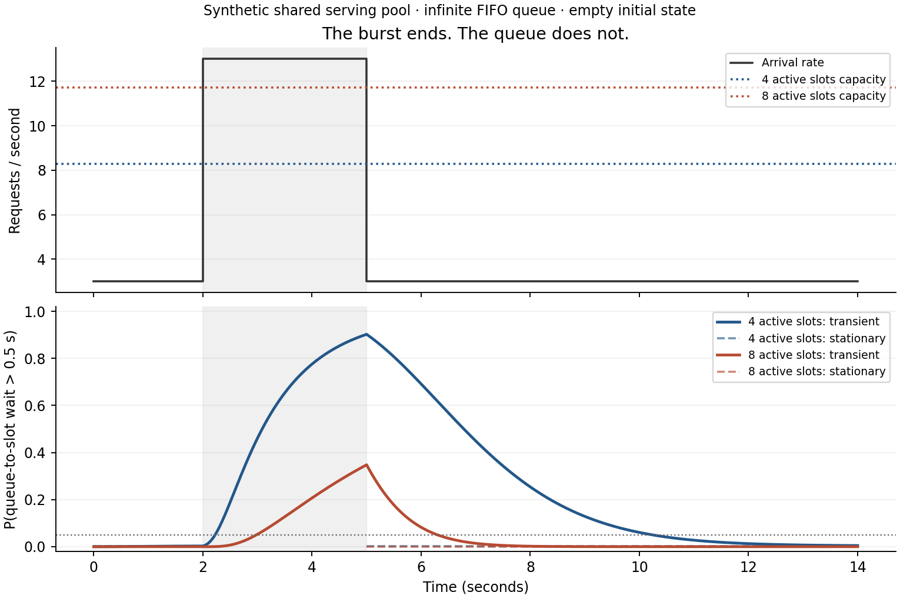

# Восстановление очереди после всплеска нагрузки

[English](transient-occupancy.md) · [Каталог моделей](../models.ru.md)

**Простыми словами:** заявки разделяют ограниченное число активных слотов.
Интенсивность завершения каждой заявки зависит от числа занятых слотов.
Всплеск поступлений создаёт внешнюю очередь FCFS; после снижения потока она
рассасывается постепенно. Расчёт отслеживает это переходное поведение.

[Схема семейства](../figures/continuous_batching.ru.png) показывает внешнюю
очередь и активные слоты; здесь интенсивность поступления меняется во времени.



Из корня исходников после `pip install -e .`:

```bash
python -m examples.llm_burst_recovery --output-dir /tmp/llm-burst
```

Пример создаёт PNG, PDF и JSON со всеми точками и параметрами. GPU не нужен.
Интенсивности синтетические: пример не является измерением vLLM или конкретной
видеокарты. [Сохранённые результаты](../research/llm-burst-recovery-2026.json).

Всплеск длится со 2-й до 5-й секунды. К его окончанию вероятность ждать слот
дольше 0,5 секунды составляет примерно 90,25% для четырёх слотов и 34,79% для
восьми. На сетке с шагом 0,05 секунды она снижается ниже 5% и остаётся ниже до
конца наблюдения в моменты 10,25 и 6,35 секунды соответственно. Это наблюдения
на сетке, а не точные моменты пересечения уровня. Стационарное сравнение
во время перегрузки отсутствует: стационарного распределения тогда нет.

## Использование

```python
import numpy as np
from most_queue.theory.continuous_batching import TransientOccupancyQueueCalc

calc = TransientOccupancyQueueCalc(k=4, queue_truncation=64)
calc.set_sources([(0, 3.0), (2, 13.0), (5, 3.0)])
calc.set_servers(lambda active: 3.0 / (1 + 0.15 * (active - 1)))
result = calc.run(np.linspace(0, 14, 281), initial=0)
print(result.waiting_tail_bounds(0.5))  # нижняя и верхняя границы
```

Поток пуассоновский с кусочно-постоянной интенсивностью. Первый момент смены
равен нулю; последняя интенсивность действует далее. Разрешены нулевая
интенсивность и временная перегрузка. При числе заявок `j` суммарная интенсивность
завершения равна `min(j,k)*mu(min(j,k))`. Число слотов и функция обслуживания
постоянны во времени; при изменении занятости меняется текущая интенсивность
завершения. Обслуживание марковское, а не заданная при поступлении длительность.

Очередь бесконечная, поступившие заявки не теряются. `queue_truncation=N`
ограничивает **общее число заявок для расчёта**, а не физический буфер.
`initial` задаёт исходное число заявок либо распределение на `0..N`.

## Метод и смысл границ

Используется метод конечной проекции пространства состояний — FSP,
Munsky–Khammash (2006), [doi:10.1063/1.2145882](https://doi.org/10.1063/1.2145882).
На каждом интервале постоянной интенсивности вычисляется действие матричной
экспоненты. Переход из `N` в `N+1` направлен во вспомогательное поглощающее
состояние. Его масса равна вероятности хотя бы одного выхода из расчётной
области к данному моменту; она сохраняется при смене интенсивности.

Для любой характеристики `f` со значениями от нуля до единицы её значение
по сохранённым состояниям — нижняя граница. Добавление массы поглощения даёт
верхнюю границу. Сохранившиеся вероятности не нормируются. Масса поглощения
не является ни вероятностью отказа, ни вероятностью находиться за границей
области именно в данный момент: реальные траектории могут вернуться.

Приходящая заявка, заставшая `j>=k` заявок, ожидает `j-k+1` завершений при
постоянной суммарной интенсивности `k*mu(k)`: все слоты заняты до её допуска.
Отсюда условное распределение Эрланга и границы `waiting_tail_bounds(D)`.
При `D=0` получаем вероятность ожидания. Для реальных поступлений за интервал
времени требуется взвешивание по интенсивности потока, а не простое среднее
по временной сетке. При нулевом потоке результат относится к гипотетической
заявке-пробе.

Это ожидание свободного слота, **не TTFT**: в TTFT входят ещё prefill и первый
decode. [Стадийные средние TTFT](stage-aware-ttft.ru.md) рассчитываются другой
моделью. Динамическое изменение числа слотов, KV-память, кэширование префикса,
вытеснение и физическая калибровка здесь отсутствуют.

Полный вывод и описание полей приведены в [английской версии](transient-occupancy.md).
Границы относятся к усечению модели и вычислены в обычной плавающей арифметике:
`roundoff_certified=False`. Невязка нормировки не является оценкой округления.
Средние задержки и стационарные поля `p/pi/w/v` не заполняются.

Проверки включают аналитические частные случаи, сгущение области, смену режимов
между точками наблюдения и независимое событийное моделирование. Для примера
сопоставлены `N=64` и `N=96`; максимальная масса выхода при `N=64` составляет
около `7,33e-9` и `4,48e-11` для четырёх и восьми слотов.
