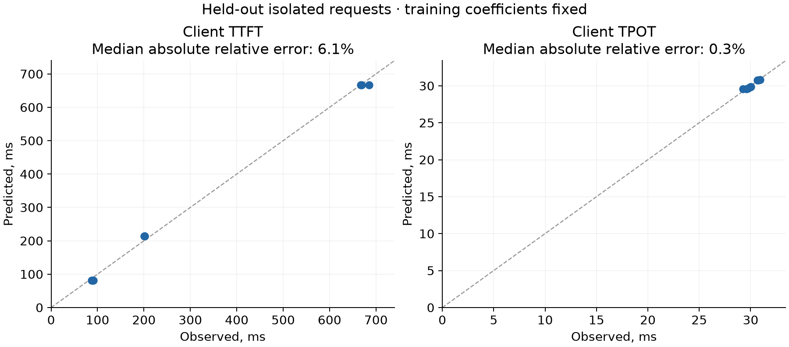
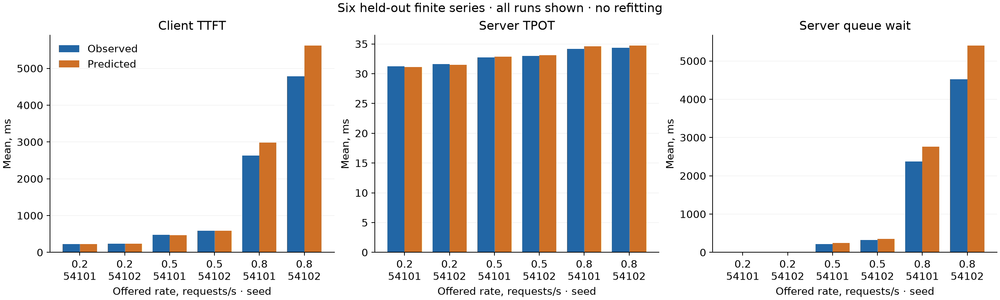

# Проверка модели serving на A40 и Qwen3-8B

14.11.2026. **Заранее заданные критерии одиночной и потоковой проверки пройдены.**
Получен 721 успешный запрос: 21 прогревочный, 27 обучающих и 673 проверочных.
Модель настроена только на обучающих запросах. Ошибка среднего клиентского TTFT
в шести потоковых сериях составила 0.12–17.42%, серверного TPOT — 0.26–1.16%.
Пакетные приходы показали более заметные расхождения: до 35.39% по среднему
клиентскому TTFT и до 28.15% по серверному TPOT. Область подтверждённой точности
ограничивается проверенными критериями и профилем этого опыта.

[Полный численный отчёт](serving-calibration-v1-results.json) ·
[Данные, хэши и команды воспроизведения](../../tests/fixtures/serving_measurements/runpod_qwen3_8b_a40_calibration_v1_20261114/README.md) ·
[План до измерений](../../tests/fixtures/serving_measurements/runpod_qwen3_8b_a40_calibration_v1_20261114/analysis-plan.md).

## Данные и расчёт

Одна NVIDIA A40, Qwen3-8B BF16, vLLM 0.32.0, PyTorch 2.13.0+cu130.
Образ и модель закреплены по digest и ревизии. Четыре активных слота,
token budget 18432, max-model-len 4608; prefix caching и chunked prefill
выключены, `enforce_eager` включён. Полный профиль и фактические версии лежат
рядом с исходными потоками. Это экспериментальная конфигурация: сборка vLLM
предупреждает, что отключение chunked prefill официально не поддерживается
данной моделью. Качество сгенерированного текста здесь не оценивалось.

Обучение: девять пар входных/выходных длин 128/1024/4096 × 32/128/512,
по три одиночных запроса на пару. Проверка: ещё девять одиночных запросов,
36 пакетов из двух/четырёх запросов — всего 108, затем шесть потоковых серий
по 180 с — всего 556 запросов. Каждая серия начинается после завершения
предыдущей, из пустого состояния. Приходы заданы заранее экспоненциальными
интервалами; число запросов в конечной серии случайно.

Для каждого запроса сохранены исходные SSE-события, фактические длины `usage`,
клиентские времена и штатные серверные отметки queued/scheduled/first/last-token.
Wrapper записывает отметки при завершении запроса и сохраняет исходный объект
ответа. ID и разности серверных отметок сверены с метриками ответа. Вытеснений,
отказов и незавершённых исходов нет. Максимальное опоздание dispatch относительно
расписания — 18.10 мс, 95-й процентиль — 4.63 мс; запуск HTTP-worker учитывается
отдельно. DES воспроизводит фактические серверные приходы.

Использован существующий неотрицательный NNLS-оцениватель, затем
`PrefillDecodeSim` с фиксированными коэффициентами. Он задаёт собственные правила
допуска и выполнения стадий; точное воспроизведение планировщика vLLM не заявляется.
Ранг обучающей матрицы — 4, число обусловленности после масштабирования — 3.0411.

| Коэффициент эффективного закона | Значение |
|---|---:|
| delta — дополнительная клиентская задержка | 0.00340068 |
| alpha | 0.02935832 |
| beta | 0.000147130 |
| gamma | 3.05733 × 10⁻⁷ |

Времена модели задаются в секундах; смысл множителей определён в
[описании калибровки](../serving_measurements.md). Эти коэффициенты не являются
отдельными измерениями физических затрат GPU-ядер или сетевой задержки.

## Одиночные запросы

На девяти отложенных запросах медианная абсолютная относительная ошибка
клиентского TTFT — **6.099%**, клиентского TPOT — **0.348%**.
Оба значения ниже заранее заданного порога 15%.

## Заданный поток

Ни одна из этих серий не участвовала в настройке. Порог относительной ошибки
среднего клиентского TTFT и среднего серверного TPOT — 20% для каждой серии.
В таблице времена TTFT приведены в миллисекундах; сначала измерение, затем расчёт.

| Заданная интенсивность, заявок/с | Seed | Запросов | TTFT: измерение / расчёт, мс | Ошибка TTFT | Ошибка TPOT |
|---:|---:|---:|---:|---:|---:|
| 0.2 | 54101 | 35 | 229.51 / 221.80 | 3.36% | 0.49% |
| 0.2 | 54102 | 41 | 239.29 / 231.13 | 3.41% | 0.32% |
| 0.5 | 54101 | 78 | 472.63 / 462.33 | 2.18% | 0.26% |
| 0.5 | 54102 | 89 | 586.44 / 587.12 | 0.12% | 0.28% |
| 0.8 | 54101 | 147 | 2634.44 / 2978.17 | 13.05% | 1.16% |
| 0.8 | 54102 | 166 | 4784.00 / 5617.20 | 17.42% | 0.95% |

Для ожидания закреплена нормировка
`abs(mean_predicted - mean_observed) / max(mean_observed, 0.05 s)` и порог 25%.
Это особенно существенно для почти нулевого ожидания при редком потоке.

| Интенсивность | Seed | Измеренное ожидание, мс | Расчёт, мс | Абсолютная ошибка среднего, мс | Нормированная ошибка |
|---:|---:|---:|---:|---:|---:|
| 0.2 | 54101 | 0.026 | 7.506 | 7.480 | 14.96% |
| 0.2 | 54102 | 0.024 | 9.229 | 9.205 | 18.41% |
| 0.5 | 54101 | 218.728 | 243.171 | 24.443 | 11.17% |
| 0.5 | 54102 | 324.004 | 356.402 | 32.398 | 10.00% |
| 0.8 | 54101 | 2372.385 | 2760.849 | 388.464 | 16.37% |
| 0.8 | 54102 | 4525.270 | 5399.923 | 874.653 | 19.33% |

При 0.2 заявки/с критерий допускает абсолютную ошибку до 12.5 мс. Его прохождение
не устанавливает малую относительную ошибку почти нулевого ожидания:
измерены 24–26 микросекунд, модель даёт 7.5–9.2 мс. При 0.8 заявки/с ошибка
среднего ожидания достигает 0.875 с. Все исходные значения и ошибки отдельных
запросов сохранены в JSON.

## Пакетные приходы и границы точности

Для пакетов порог приёмки не задавался. Ниже приведён максимум относительной
ошибки среднего по четырём пакетам для каждой пары длин: два размера пакета
и два повтора. Все 36 отдельных результатов доступны в полном JSON-отчёте.

| Вход, токенов | Выход, токенов | Клиентский TTFT | Серверный TPOT | Серверный TTFT |
|---:|---:|---:|---:|---:|
| 128 | 32 | 18.22% | 0.74% | 70.53% |
| 128 | 128 | 35.39% | 0.46% | 67.65% |
| 128 | 512 | 27.02% | 0.68% | 69.00% |
| 1024 | 32 | 27.22% | 11.37% | 59.11% |
| 1024 | 128 | 30.22% | 2.78% | 58.96% |
| 1024 | 512 | 24.52% | 1.36% | 58.56% |
| 4096 | 32 | 27.03% | 28.15% | 36.99% |
| 4096 | 128 | 29.95% | 7.19% | 36.87% |
| 4096 | 512 | 28.32% | 1.74% | 36.89% |

Разложение задержки по стадиям остаётся приближённым: дополнительная проверка
серверного TTFT даёт ошибку среднего 22.1–24.9% даже при редком потоке 0.2
заявки/с. Эта метрика не входила в критерии приёмки, но опубликована наряду
с ними. Малые ошибки клиентского TTFT нельзя переносить на серверные стадии.
Наблюдаемые расхождения сами по себе не устанавливают их единственную причину.

Опыт покрывает один GPU/движок/профиль и конечные серии от пустого состояния.
Проверка стационарности, точности p99, других политик кэша, chunked prefill,
CUDA graphs и других GPU в него не входит. Двух повторов на интенсивность
недостаточно для заявлений о надёжных интервалах хвостовых метрик.

Следующая исследовательская задача — уточнить совместное выполнение prefill
и decode и измерить затраты итераций в зависимости от состава пакета. Текущие
проверочные данные после этого становятся материалом для разработки; новой
версии модели понадобится отдельная новая проверочная выборка.

## Расходы, сохранность и проверки

Одна попытка: 1876 с от запроса выделения до подтверждения отсутствия pod,
включая 1726.918 с программы измерений. Ставка compute $0.59/ч, оценка диска
$0.011112/ч; итоговая консервативная оценка **$0.313247** при лимите $5 и
четырёх GPU-часов. API биллинга на момент проверки ещё не вернул записи;
это оценка по ставке и времени, а не окончательный счёт.

Сохранялись промежуточные локальные копии исходной трассы. Проверены их
совпадение с префиксом окончательных данных, SHA256 экспорта и всех файлов.
Pod удалён; отдельная свежая проверка API и полного списка ресурсов подтвердила
отсутствие. Цикл закрыт, `authorized=false`; его бюджет нельзя повторно открыть
переносом исходников на другой компьютер.

Полный финальный набор: **3927 passed**. Отдельный набор без `slow`:
3907 passed; последние поправки также покрыты полным финальным прогоном.
В первом прогоне выявлен старый нестабильный тест M/G/1 с разогревом:
глобальный seed NumPy не задавал seed генератора симулятора. Исправлена
инициализация этого генератора без изменения допуска теста. Новые модули
прошли black/isort и pylint 10/10; общая оценка pylint библиотеки — прежние 9.97/10.

До измерений сохранены хэши плана, сценария и расчётных модулей. Позднее
исправлена только ошибочная диагностика первого короткого пилота: его шесть
одиночных наблюдений имеют полный ранг 4 и позволяют исследовательскую подгонку,
но не содержат заранее выделенной проверочной выборки и точных серверных
приходов. Новый метод, его 27 обучающих запросов, разбиение и пороги не менялись.
