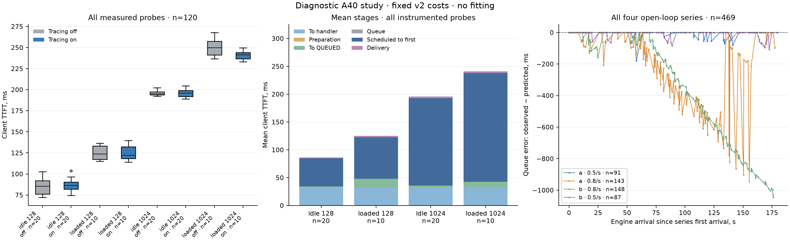

# Задержки frontend и повторяемость TTFT на A40

Дата: 14.11.2026. Диагностический цикл выполнен одной попыткой: **613 успешных
запросов**, все **533 frontend-записи** и **613 engine-записей** проверены,
нарушений условий фоновых сравнений нет. Pod удалён, цикл закрыт. Аренда заняла
**1597 с**, оценка расходов с диском — **$0.266660**.

**Добавочная задержка на фоне генерации сосредоточена после подготовки запроса,
но до его регистрации в очереди планировщика.** Средний интервал
`render_exit_ts → queued_ts` возрастает с **1,863 до 15,029 мс** для входа 128
и с **2,274 до 9,728 мс** для входа 1024. Получение body, разбор/валидация и
подготовка по отдельности занимают в этих группах менее миллисекунды.

Это уточняет следующий шаг: учитывать входной этап до `QUEUED`, а не относить
всю дополнительную задержку к обычному ожиданию свободного слота или разбору
prompt. Сам интервал пока объединяет несколько операций; полное физическое
разделение ещё требует внутренних отметок EngineCore.

Точность жёсткого SLO текущая модель не приобрела. При TTFT ≤250 мс и
TPOT ≤35 мс в блоке a, 0,5 запроса/с, фактически проходят **33/91**, прогноз
неизменной v2 — **72/91**: **39 ложных успехов, 42,86 п.п. ошибки доли**.
Все исходы сохранены; новая модель не подгонялась.



Слева показаны все 120 коротких проб, включая on/off контроль; середина
суммирует **средние**, а не медианы, по всем 60 инструментированным пробам.
Справа сохранены все 469 потоковых запросов. Отрицательная ошибка означает
завышение прогноза очереди. Фоновые и прогревочные запросы остаются в исходных
данных, но не смешиваются с короткими пробами на этих панелях.

## Что и как измерено

[Архивный план](serving-frontend-v1-plan.md),
[зафиксированные файлы](../../configs/runpod/frontend-v1-freeze.json),
[полная выборка с MIT-лицензией](../../tests/fixtures/serving_measurements/runpod_qwen3_8b_a40_frontend_v1_20261114/README.md),
[аудит](serving-frontend-v1-audit.json), [все результаты JSON](serving-frontend-v1-results.json).
План был заморожен до разрешения и сбора данных; его исторический статус
ожидания разрешения сохранён в архиве. Пользователь затем разрешил этот цикл.

Одна A40, 9 vCPU по allocation metadata, Qwen3-8B BF16, vLLM 0.32.0,
PyTorch 2.13.0+cu130, CUDA 13.0. Ревизия весов и digest образа закреплены
в профиле; B=4, unchunked prefill, prefix caching выключен, eager execution.
В выборке 4 прогревочных и 609 диагностических запросов: 80 проб при пустом движке,
40 проб на фоне 20 длинных генераций и 469 потоковых запросов. Два блока
повторяют условия в одном pod. Все серии полностью завершались перед следующей.

В каждой из 60 пар token IDs одинаковы; порядок новой трассировки on/off
задан до опыта. Это контролируемые повторы одной работы, а не разнообразная
выборка текстов и машин. Все данные имеют роль `diagnostic` и не подтверждают
точность будущей v3. Сравнение с v2 использует её прежние фиксированные
коэффициенты и точные моменты `queued_ts`; наблюдённые исходы не поступают
в предсказатель.

Клиентский TTFT начинается после чтения payload дочерним worker и заканчивается
первым непустым текстом SSE. TPOT использует промежуток от этого события до
DONE, делённый на число последующих токенов. Новые отметки следуют общему
монотонному отсчёту на host. `first_response_body_ts` — транспортное событие,
оно не заменяет первый текстовый токен.

## Где находится добавочная задержка

Ниже средние по инструментированным коротким пробам, оба блока объединены.
Входы 128/1024, выход всегда 32. Таблица не смешивает фон с пробами.
Все времена в миллисекундах. Показаны основные интервалы; сумма включает также
получение body (0,306–0,436 мс) и вход в обработчик подготовки (0,008–0,014 мс),
отдельно сохранённые в JSON.

| Условие | Вход | n | Клиент → HTTP | Разбор и маршрут | Подготовка | Подготовка → QUEUED | Весь путь до QUEUED |
| --- | --- | --- | --- | --- | --- | --- | --- |
| idle | 128 | 20 | 31.000 | 0.596 | 0.336 | 1.863 | 34.131 |
| idle | 1024 | 20 | 31.547 | 0.826 | 0.677 | 2.274 | 35.640 |
| loaded | 128 | 10 | 31.571 | 0.701 | 0.375 | 15.029 | 48.127 |
| loaded | 1024 | 10 | 31.430 | 0.793 | 0.298 | 9.728 | 42.612 |

При входе 128 путь до `QUEUED` возрастает на 13,996 мс; из этого роста
13,167 мс приходится на последний интервал. При входе 1024 соответствующие
изменения — 6,972 и 7,454 мс; некоторые другие интервалы немного сокращаются.
Это разложение средних в выбранных группах, а не оценка независимого причинного
эффекта каждого обработчика. Порядок условий внутри блока фиксирован,
а граница итерации при приходе пробы может отличаться.

В потоковых сериях средний `render_exit_ts → queued_ts` составляет
19,268/24,329/28,026/24,281 мс (a/0,5, a/0,8, b/0,8, b/0,5). Максимальные
внешние добавки достигают 185–213 мс. Поэтому постоянная добавка,
обученная на одиночных запросах, не описывает весь этот путь под нагрузкой.

Название поля `outside_engine` условно: это остаток **вне интервала
QUEUED → первый токен**, а не обязательно вне процесса EngineCore.
В исходниках vLLM v0.32.0 приём сокета кладёт запрос во входную очередь;
основной цикл обрабатывает её между шагами движка. Событие `QUEUED`
записывается позже, при добавлении запроса планировщику.
[EngineCore](https://github.com/vllm-project/vllm/blob/v0.32.0/vllm/v1/engine/core.py),
[Scheduler](https://github.com/vllm-project/vllm/blob/v0.32.0/vllm/v1/core/sched/scheduler.py).
Следовательно, часть ожидания может происходить **до метрики queue_time**,
уже внутри входного пути EngineCore. Это согласуется с наблюдаемым ростом;
доля именно его input queue ещё не отделена от IPC и остальных операций
между `render_exit_ts` и `queued_ts`.

Отдельный постоянный компонент — около 31 мс от старта клиентского измерения
до входа HTTP в middleware. В используемом worker внутри этого интервала
каждый раз создаётся новый `urllib` opener. В CPython 3.12 его стандартный
набор включает HTTPS handler с созданием TLS context, даже если затем
используется HTTP loopback.
[Клиент](../../tools/runpod_frontend_workload.py),
[исходник CPython](https://github.com/python/cpython/blob/v3.12.3/Lib/urllib/request.py).
Этот факт выявляет издержки самого измерителя, но текущие отметки не позволяют
приписать TLS все 31 мс: интервал включает также передачу HTTP и ожидание входа
в ASGI. В данном опыте этот компонент почти не изменился между пустым и занятым
движком, поэтому он не объясняет основной рост на фоне генерации.

## Повторяемость короткого TTFT

В следующей таблице показан контроль **без новой frontend-трассировки**,
оба блока объединены. Прежний engine trace оставался включённым.
Время в миллисекундах; prompt фиксирован для каждой длины.

| Условие | Вход | n | Сервер min | Сервер медиана | Сервер max | Клиент медиана |
| --- | --- | --- | --- | --- | --- | --- |
| idle | 128 | 20 | 39.123 | 49.817 | 60.295 | 85.527 |
| idle | 1024 | 20 | 155.719 | 157.274 | 159.038 | 195.145 |
| loaded | 128 | 10 | 74.623 | 74.745 | 74.921 | 123.737 |
| loaded | 1024 | 10 | 190.642 | 195.667 | 196.127 | 249.843 |

Для пустого 128/32 серверный TTFT меняется от **39,123 до 60,295 мс** даже
при одном prompt. Медианы двух блоков — 46,400 и 53,087 мс. Таким образом,
разброс короткого запроса воспроизведён; прошлое наблюдение 60,035 мс нельзя
просто объявить несущественным и удалить. Это не точная реплика прошлой точки:
там использовались другой prompt и другой запуск. Причину серверного разброса
новые frontend-часы сами по себе не устанавливают.

Для входа 1024 диапазон пустого серверного TTFT значительно уже:
155,719–159,038 мс. На фоне генерации серверные времена коротких проб также
сосредоточены узко, тогда как клиентские остаются заметно изменчивыми за счёт
добавки до `QUEUED`. Среднее не определяет индивидуальный исход у жёсткого порога.

## Контроль влияния инструментовки

Разности ниже вычислены **внутри пар on минус off**, затем взяты медианы;
это не разность двух несвязанных медиан. Порог предупреждения определён
заранее: `max(5 мс, 5% среднего off-TTFT)`.

| Условие | Вход | Пар | Δ клиентского TTFT, мс | Δ серверного TTFT, мс | Порог, мс | Предупреждение |
| --- | --- | --- | --- | --- | --- | --- |
| idle | 128 | 20 | 0.322 | 0.549 | 5.000 | нет |
| idle | 1024 | 20 | -0.461 | 0.016 | 9.794 | нет |
| loaded | 128 | 10 | -1.616 | -0.077 | 6.253 | нет |
| loaded | 1024 | 10 | -8.012 | -0.056 | 12.531 | нет |

Ни одна из четырёх групп не пересекла заданный порог. Это не доказательство
нулевого overhead: у фонового входа 1024 медианная парная разность −8,012 мс,
в основном во внешней добавке. Размер группы всего 10 пар, а фаза фоновой
итерации и время внутри блока меняются. Общие wrapper и engine trace есть
и в off; сравнение оценивает только дополнительную работу новых отметок и
заголовка. Неопределённость переноса на полностью неинструментированный сервер
сохраняется. Все разности и отдельные блоки доступны в JSON.

## Сравнение с фиксированной v2

Все 469 запросов остаются в знаменателе каждой своей потоковой серии.
Таблица показывает совместное выполнение клиентских TTFT ≤250 мс и TPOT ≤35 мс.

| Блок | Интенсивность | N | Факт | Прогноз | Ложный успех | Ложный отказ | Ошибка доли, п.п. |
| --- | --- | --- | --- | --- | --- | --- | --- |
| a | 0.5 | 91 | 33 | 72 | 39 | 0 | 42.857 |
| a | 0.8 | 143 | 17 | 33 | 18 | 2 | 11.189 |
| b | 0.8 | 148 | 14 | 32 | 18 | 0 | 12.162 |
| b | 0.5 | 87 | 33 | 62 | 29 | 0 | 33.333 |

В блоке a/0,5 ошибка среднего клиентского TTFT всего **2,39%**,
но ошибка доли при 250 мс — **42,86 п.п.** Поэтому малое расхождение средних
не является проверкой жёсткого SLO. Для 1 с / 35 мс максимальная ошибка доли
среди этих серий — **1,40 п.п.**; малое расхождение долей может скрывать компенсацию
ложного успеха ложными отказами (a/0,8: один и три).

Под высокой нагрузкой накопление ошибки очереди тоже сохраняется.
В b/0,8 её наблюдаемое среднее **4,475 с**, прогноз **4,838 с**; у последнего
запроса очередь завышена на **1,045 с**. Средний серверный TPOT при этом
завышен примерно на **0,406 мс**. Ошибки времени генерации и последовательных
освобождений слотов надо проверять отдельно от входного интервала.
Показанные периоды занятости определены после опыта объединением интервалов
`[queued_ts, last_token_ts)`; это не измерение загрузки GPU и не вход модели.

## Решение для продолжения

1. Выделить входной путь **до `QUEUED`** в явный этап модели. Сначала проверить
   CPU-прототип допуска новых запросов на границе итерации с учётом двух
   запланированных batch; не заменять этот этап произвольной поправкой к
   обычному ожиданию свободного слота.
2. Добавить минимальные отметки получения и обработки запроса во входной
   очереди EngineCore, чтобы отделить IPC от ожидания допуска. В клиенте
   отдельно отмечать создание HTTP-инфраструктуры и начало отправки;
   при её переиспользовании сохранять прежний end-to-end TTFT как отдельную
   метрику, а не выдавать смену границы измерения за ускорение GPU.
3. Учитывать разброс короткого серверного TTFT и накопление ошибки генерации.
   Для нового предсказателя заранее определить обучение, критерии и новую
   проверочную выборку. Эти диагностические данные могут служить разработке,
   но не её подтверждением. Текущая v2 и её прежние результаты сохранены.

Это завершённый измерительный этап. Новая модель и следующий платный опыт
не выполнялись в рамках этого цикла; его остаток бюджета не является новым
разрешением.

## Выгрузка и подтверждение завершения

Сбор данных завершился одной попыткой. Первая операция экспорта получила
`ApiError (HTTP None)`; точная транспортная/парсерная причина не установлена.
Контроллер выполнил резервный экспорт: **1 815 968 байт**,
SHA256 `60304821c5c9f6e8d947e38b9302084adbb07e19237470188c3d7fe70922f610`.
Все файлы и записи проверены независимым от producer аудитором.

Исходный `outcome.successful=false` не переписан: он сохранён вместе с причиной,
потому что первый экспорт прервал штатный путь завершения контроллера.
Оболочка сообщила 143; её точная причина отдельно не установлена.
Цикл закрыт записью сверки на основании полного архива, аудита и свежих
GET/inventory подтверждений отсутствия точного pod. Повтор измерений
и второе выделение не потребовались.
[Сохранённые доказательства и учёт](../../tests/fixtures/serving_measurements/runpod_qwen3_8b_a40_frontend_v1_20261114/completion.json).

Итого одна A40, **1597 с / $0.266660** с оценкой container disk. Постоянных
томов нет. Биллинг провайдера пока вернул `records=[]`; это не означает
нулевой расход и не является окончательным счётом. Разрешение деактивировано,
журнал закрыт. Все 13 файлов измерительного манифеста и 18 старых научных
SHA256 сохранились; анализ не менял параметры сбора и не подгонял модель.

## Воспроизведение и программные проверки

Из исходного checkout с зависимостями, без GPU и сетевых запросов:

```bash
PYTHONPATH=. python examples/serving_frontend_diagnostics.py \
  --output frontend-v1-results.json
python docs/figures/plot_frontend_diagnostics.py --report frontend-v1-results.json
```

Аудит перед анализом проверяет 613 engine- и 533 frontend-записи, реальные
длины, временные контракты и все фоновые условия. Сырые данные хранятся в gzip
с точными SHA256; архивный план не редактируется после опыта. Временная метка
назначения и наблюдённые токены служат целями, а не входами предсказателя.
Только для разбора строгим старым импортёром диагностический `split`
копируется в памяти с технической меткой validation; сохранённые строки
и научная роль данных остаются diagnostic.

Новый анализ имеет 39 целевых проверок на Python 3.10/3.12: ручная арифметика,
полнота пар, знак разностей, пороги, SHA256, сохранение роли данных и отсутствие
утечки наблюдённых исходов в прогнозы. Полный набор — **4315 passed**,
19 прежних предупреждений, 968,82 с; без `slow` — **4297 passed**,
19 предупреждений, 737,86 с. Форматирование и pylint новых скриптов проходят.
PNG просмотрен, все четыре серии и все пробы сохранены на графике.
Общий `pylint most_queue` возвращает прежние замечания (9,97/10, код 30),
включая распознавание SciPy/NumPy и стиль существующих модулей. Файлы библиотеки
в этом этапе не менялись; полностью чистый общий pylint не заявляется.

## Полная сетка SLO

Временные ограничения указаны в миллисекундах. Ошибка доли — абсолютная
разность долей в процентных пунктах. Строки с 30 мс также сохранены, даже если
обе доли равны нулю; это не свидетельство полезной точности на этом пороге.

| Блок / поток | TTFT | TPOT | N | Факт | Прогноз | Ложный успех | Ложный отказ | Ошибка, п.п. |
| --- | --- | --- | --- | --- | --- | --- | --- | --- |
| a / 0.5 | 250 | 30 | 91 | 0 | 0 | 0 | 0 | 0.000 |
| a / 0.5 | 250 | 35 | 91 | 33 | 72 | 39 | 0 | 42.857 |
| a / 0.5 | 250 | 40 | 91 | 33 | 72 | 39 | 0 | 42.857 |
| a / 0.5 | 500 | 30 | 91 | 0 | 0 | 0 | 0 | 0.000 |
| a / 0.5 | 500 | 35 | 91 | 77 | 77 | 0 | 0 | 0.000 |
| a / 0.5 | 500 | 40 | 91 | 77 | 77 | 0 | 0 | 0.000 |
| a / 0.5 | 1000 | 30 | 91 | 0 | 0 | 0 | 0 | 0.000 |
| a / 0.5 | 1000 | 35 | 91 | 82 | 82 | 0 | 0 | 0.000 |
| a / 0.5 | 1000 | 40 | 91 | 82 | 82 | 0 | 0 | 0.000 |
| a / 0.8 | 250 | 30 | 143 | 0 | 0 | 0 | 0 | 0.000 |
| a / 0.8 | 250 | 35 | 143 | 17 | 33 | 18 | 2 | 11.189 |
| a / 0.8 | 250 | 40 | 143 | 17 | 33 | 18 | 2 | 11.189 |
| a / 0.8 | 500 | 30 | 143 | 0 | 0 | 0 | 0 | 0.000 |
| a / 0.8 | 500 | 35 | 143 | 43 | 38 | 0 | 5 | 3.497 |
| a / 0.8 | 500 | 40 | 143 | 43 | 38 | 0 | 5 | 3.497 |
| a / 0.8 | 1000 | 30 | 143 | 0 | 0 | 0 | 0 | 0.000 |
| a / 0.8 | 1000 | 35 | 143 | 53 | 51 | 1 | 3 | 1.399 |
| a / 0.8 | 1000 | 40 | 143 | 53 | 51 | 1 | 3 | 1.399 |
| b / 0.8 | 250 | 30 | 148 | 0 | 0 | 0 | 0 | 0.000 |
| b / 0.8 | 250 | 35 | 148 | 14 | 32 | 18 | 0 | 12.162 |
| b / 0.8 | 250 | 40 | 148 | 14 | 32 | 18 | 0 | 12.162 |
| b / 0.8 | 500 | 30 | 148 | 0 | 0 | 0 | 0 | 0.000 |
| b / 0.8 | 500 | 35 | 148 | 34 | 33 | 0 | 1 | 0.676 |
| b / 0.8 | 500 | 40 | 148 | 34 | 33 | 0 | 1 | 0.676 |
| b / 0.8 | 1000 | 30 | 148 | 0 | 0 | 0 | 0 | 0.000 |
| b / 0.8 | 1000 | 35 | 148 | 34 | 34 | 0 | 0 | 0.000 |
| b / 0.8 | 1000 | 40 | 148 | 34 | 34 | 0 | 0 | 0.000 |
| b / 0.5 | 250 | 30 | 87 | 3 | 3 | 0 | 0 | 0.000 |
| b / 0.5 | 250 | 35 | 87 | 33 | 62 | 29 | 0 | 33.333 |
| b / 0.5 | 250 | 40 | 87 | 33 | 62 | 29 | 0 | 33.333 |
| b / 0.5 | 500 | 30 | 87 | 3 | 3 | 0 | 0 | 0.000 |
| b / 0.5 | 500 | 35 | 87 | 66 | 66 | 0 | 0 | 0.000 |
| b / 0.5 | 500 | 40 | 87 | 66 | 66 | 0 | 0 | 0.000 |
| b / 0.5 | 1000 | 30 | 87 | 3 | 3 | 0 | 0 | 0.000 |
| b / 0.5 | 1000 | 35 | 87 | 70 | 69 | 0 | 1 | 1.149 |
| b / 0.5 | 1000 | 40 | 87 | 70 | 69 | 0 | 1 | 1.149 |
