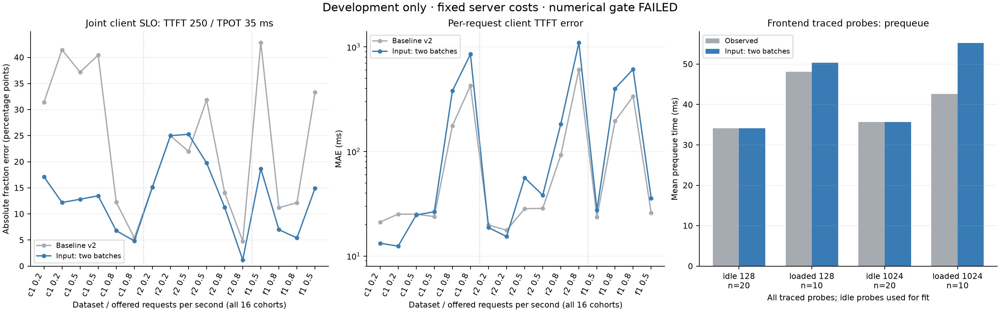

# Входной допуск и две запланированные итерации: результат CPU-прототипа

Дата: 14.11.2026. **Кандидат не принят как улучшенный прогноз задержек.**
Проверены все **1978 запросов в 233 сериях** трёх совместимых запусков;
новой аренды GPU не было. Код и полные отрицательные результаты сохранены.

На всех 16 потоковых сериях максимальная ошибка доли при TTFT ≤250 мс /
TPOT ≤35 мс снизилась с **42,86 до 25,27 п.п.**, медианная — с **23,49 до
13,15 п.п.** Однако средняя абсолютная ошибка клиентского TTFT выросла с
**193,630 до 364,584 мс**. Это ухудшение есть в каждом из трёх наборов.
При TTFT ≤1 с / TPOT ≤35 мс максимальная ошибка доли выросла с 3,52 до
**5,59 п.п.**, превысив заранее выбранный предел 5 п.п.

Пять из девяти численных условий пройдены, четыре — нет. Поэтому следующий
платный опыт на основании этого кандидата не готовится. Результат показывает
предел данного приближения; его нельзя представлять как готовую v3.



Слева — все 16 ошибок доли при 250/35 мс. В центре — MAE клиентского TTFT
тех же серий с логарифмической шкалой; справа — все 60 инструментированных
проб, сгруппированных по режиму и длине. Idle-пробы использовались для
оценки базовых задержек; совпадение их средних не является проверкой точности.
Обозначения c1/r2/f1 соответствуют калибровке v1, проверке v2 и frontend v1.

## Данные и порядок решения

[План и критерии до первого сравнения](serving-input-admission-development-plan.md),
[сводный JSON](serving-input-admission-development.json),
[полные результаты всех запросов и вариантов](serving-input-admission-development.requests.json.gz).

| Набор | Непрогревочные запросы | Серии | Потоковые запросы / серии |
| --- | --- | --- | --- |
| Калибровка v1 | 700 | 78 | 556 / 6 |
| Проверка v2 | 669 | 51 | 552 / 6 |
| Frontend v1 | 609 | 104 | 469 / 4 |
| Всего | 1978 | 233 | 1577 / 16 |

Все три набора прошли прежние аудиторы и проверку SHA256 до расчёта. Прогрев
исключён по исходному назначению, не по величине задержки. В 700 запросах
калибровки сохранены все 27 прежних обучающих наблюдений. Среди 609 frontend
сохранены 40 проб, обучающих новые базовые задержки. Их роли явно указаны.
Первоначальные split train/validation/diagnostic остаются в сырых данных;
для нового кандидата **все три набора являются материалом разработки**.
Старый короткий пилот с другим профилем сюда не смешивается.

Цель — проверить конкретный механизм по устройству движка с общими параметрами.
Варианты, обучение и критерии были записаны до первого сравнения кандидата.
После неудачного результата коэффициенты, пороги и выбор варианта не менялись.
Файлы прежних научных манифестов и измерительные данные сохранены без изменений.

## Явная дисциплина модели

[IterationAdmissionSim](../../most_queue/sim/iteration_admission.py) использует
очередь входных запросов, FCFS-очередь слотов и очередь максимум из двух
заранее запланированных итераций. На опросе готовые запросы регистрируются
как QUEUED; затем планируется один batch. Пока очередь batch не заполнена,
допускается следующий опрос без ожидания. При заполнении ожидается старейший
результат GPU. Все GPU-итерации выполняются последовательно.

Планирование продвигает счётчик запланированных выходных токенов, поэтому
следующий decode может быть подготовлен до получения предыдущего результата.
Уже подготовленные действия не меняются при приходе новой заявки. Слот
освобождается только после фактического последнего результата. Prefill выдаёт
первый токен; лишний decode после заданного числа токенов не планируется.

Это наш DES с явно заданными допущениями. Мотивирующие первоисточники —
[EngineCore.step_with_batch_queue и run_busy_loop](https://github.com/vllm-project/vllm/blob/v0.32.0/vllm/v1/engine/core.py)
и [AsyncScheduler](https://github.com/vllm-project/vllm/blob/v0.32.0/vllm/v1/core/sched/async_scheduler.py)
версии 0.32.0. Мгновенные CPU-операции и последовательная GPU-работа остаются
приближением реального асинхронного выполнения.

Для клиентского старта c, базовой готовности b(n), доставки d(n), опроса e,
резервирования слота s и первого GPU-результата f:

```text
готовность входа r = c + b(n)
входное ожидание   = e - r
очередь слотов    = s - e
путь до QUEUED   = e - c
серверный TTFT   = f - e
клиентский TTFT  = f + d(n) - c
```

Обычное ожидание слота и ожидание опроса не складываются повторно. Метрика
`w` нового симулятора включает оба ожидания от готовности входа; отдельно
возвращаются `engine_entry_times`, `input_wait_times`, `start_times` и
`first_compute_times`. Занятость включает готовые, ещё не опрошенные запросы;
временное окно заканчивается последним входным приходом, до финального drain.

Серверные alpha/beta/gamma прежней v2 фиксированы. Общие b(n) и d(n) оценивает
[fit_input_timing](../../most_queue/theory/continuous_batching/input_timing.py)
по всем 40 инструментированным idle-пробам, не по загруженным сериям:

```text
b(n) = 0.03391543934204881 + 1.6839249773121458e-6 * n   секунд
d(n) = 0.0014520903475516071 + 1.5228120836192312e-6 * n  секунд
```

Оба неотрицательных аффинных закона общие для трёх запусков. b включает
базовый IPC в пустом режиме; приравнивание этой величины готовности входа
приближённое. Диапазон обучения — 128–1024 токена. Для 87 запросов с входом
4096 в одиночных/пакетных сериях используется линейная экстраполяция. Все 1577
потоковых запросов имеют входы 128/1024, поэтому их ухудшение не объясняется
выходом за диапазон обучения. Перенос CPU/транспортных затрат между разными pod
также является допущением: одинаковые GPU и версии не фиксируют время работы host.
Одинаковая доставка первого и последнего результата
оставляет клиентский TPOT равным модельному серверному TPOT.

Новые прогнозы получают клиентские старты, запрошенные длины и собственное
состояние. Наблюдённые QUEUED/SCHEDULED/выходные отметки служат только целями.
Прежняя v2 использует точные серверные приходы, то есть более подробный вход.
Поэтому дополнительно сравниваются варианты с одинаковой информацией клиента.
В закрытых сериях фактические старты зависели от завершений прежних запросов;
это условное воспроизведение наблюдавшегося потока, не новый нагрузочный опыт.

## Полное сравнение вариантов

Для потоковых серий MAE усредняется по всем 1577 запросам с их весом.
Ошибка доли — абсолютная разность фактической и предсказанной долей, в п.п.;
это отличается от доли индивидуально неверно классифицированных запросов.

При 250/35 мс на всех 1577 потоковых запросах v2 даёт 315 ложных успехов и
4 ложных отказа; кандидат — 40 и 210. Доля индивидуальных ошибок уменьшается
с 20,23% до 15,85%, но характер ошибки смещается к ложным отказам. В наборе
проверки v2 эта доля, напротив, растёт: с 16,49% до 17,57%. Компенсация ложных
успехов и отказов в итоговой доле не заменяет проверку обоих исходов.

| Вариант | MAE TTFT, мс | Максимум ошибки 250/35, п.п. | Медиана 250/35, п.п. | Максимум 1000/35, п.п. |
| --- | --- | --- | --- | --- |
| v2: наблюдённые QUEUED | 193,630 | 42,857 | 23,489 | 3,521 |
| Прежняя политика, предсказанный вход | 190,528 | 39,326 | 23,489 | 3,521 |
| Опрос, одна итерация | 190,528 | 39,326 | 23,489 | 3,521 |
| Две итерации, непрерывный вход | 364,584 | 25,275 | 13,152 | 5,594 |
| Опрос, две итерации — основной | 364,584 | 25,275 | 13,152 | 5,594 |

Контроль с одной итерацией и прежняя политика на предсказанном входе дают
одинаковые абсолютные выходные времена с погрешностью округления. Отличается
разделение ожидания до/после QUEUED. Для двух итераций контроль с непрерывной
регистрацией входа и основной кандидат дают одинаковые выходные времена.
Таким образом, одно переименование ожидания не улучшает end-to-end TTFT.

Добавление второй запланированной итерации меняет временную диаграмму: новый
запрос не попадает в уже подготовленный batch. При завершении заявки её
замена также не входит в ранее подготовленные действия. На загруженных
сериях этот эффект усиливает накопление ошибки. Контроль с тем же
предсказанным клиентским входом имеет MAE 190,528 мс; две итерации — 364,584 мс.
Ухудшение нельзя объяснить только преимуществом прежней v2 в знании QUEUED.

| Набор | Запросов в потоке | MAE v2, мс | MAE кандидата, мс | Изменение |
| --- | --- | --- | --- | --- |
| Калибровка v1 | 556 | 184,178 | 364,389 | +97,85% |
| Проверка v2 | 552 | 218,796 | 396,762 | +81,34% |
| Frontend v1 | 469 | 175,214 | 326,944 | +86,60% |
| Все три | 1577 | 193,630 | 364,584 | +88,29% |

В наиболее загруженной frontend-серии b/0,8 наблюдаемый средний TTFT 4,737 с;
v2 прогнозирует 5,060 с, кандидат — 5,349 с. Средняя очередь: факт 4,475 с,
v2 4,838 с, кандидат 5,074 с. Увеличение ошибки очереди остаётся видимым,
даже когда классификация около 250 мс становится лучше.

## Что получилось с входным интервалом

Следующая таблица использует только короткие инструментированные пробы,
оба блока объединены. Фоновые запросы участвуют в симуляции, но не в этих
средних. Все времена в миллисекундах.

| Режим / вход | n | До QUEUED: факт / кандидат, мс | Клиент TTFT: факт / v2 / кандидат, мс |
| --- | --- | --- | --- |
| idle / 128 | 20 | 34,131 / 34,131 | 86,617 / 84,896 / 83,399 |
| loaded / 128 | 10 | 48,127 / 50,322 | 125,311 / 101,614 / 129,995 |
| idle / 1024 | 20 | 35,640 / 35,640 | 196,060 / 216,241 / 214,450 |
| loaded / 1024 | 10 | 42,612 / 55,262 | 241,201 / 225,489 / 264,465 |

Для loaded/128 кандидат приблизил клиентское среднее, а для loaded/1024
завысил и входной путь, и TTFT. Следовательно, есть частное улучшение,
но устойчивого общего выигрыша нет. Остаток вне QUEUED → первый токен
не равен задержке отдельного физического процесса.

Прежний закон также даёт одиночный серверный TTFT 175,798 мс для входа 1024
вместо наблюдаемых 157,409 мс у этих idle-проб. Эта ошибка одинакова у всех
новых вариантов: один входной этап её не устраняет. Alpha/beta/gamma были
эффективными одиночными затратами; их перенос в очередь последовательных
GPU-итераций сам является допущением. Данные не устанавливают, какая часть
оставшегося рассогласования принадлежит kernels, CPU-планированию, выдаче
результатов или изменчивости времени итерации.

## Заранее заданное решение

| Критерий | Факт | Предел | Пройден |
| --- | --- | --- | --- |
| Максимальная ошибка 250/35 уменьшена на 25% | 25,275 п.п. | 32,143 п.п. | да |
| Медианная ошибка 250/35 уменьшена на 20% | 13,152 п.п. | 18,791 п.п. | да |
| Максимальная ошибка 1000/35 ≤5 п.п. | 5,594 п.п. | 5,000 п.п. | нет |
| Калибровка v1: медиана 250/35 не растёт | 12,508 п.п. | 34,304 п.п. | да |
| Калибровка v1: MAE TTFT в пределах +5% | 364,389 мс | 193,387 мс | нет |
| Проверка v2: медиана 250/35 не растёт | 17,466 п.п. | 18,565 п.п. | да |
| Проверка v2: MAE TTFT в пределах +5% | 396,762 мс | 229,736 мс | нет |
| Frontend v1: медиана 250/35 не растёт | 10,968 п.п. | 22,748 п.п. | да |
| Frontend v1: MAE TTFT в пределах +5% | 326,944 мс | 183,974 мс | нет |

Непройденное условие 1000/35 соответствует frontend a/0,8: фактически проходят
53/143, кандидат даёт 45/143 — восемь ложных отказов, ошибка доли 5,59 п.п.

**Разработку этого кандидата как замены v2 на данном этапе завершаем.**
Он остаётся диагностическим инструментом для исследования дисциплины, с
явными ограничениями. Условия для новой платной проверки не выполнены.
Прежняя v2 и её ограничения сохраняются; улучшение у одного SLO не служит
основанием повысить статус точности. Перебор индивидуальных поправок и
повторная подгонка после просмотра исходов не выполнялись.

## Все потоковые серии при 250/35 мс

| Набор / серия | λ | N | Факт | v2 | Кандидат | Ошибка v2, п.п. | Ошибка кандидата, п.п. |
| --- | --- | --- | --- | --- | --- | --- | --- |
| Калибровка v1 / s0085-validation-open_loop | 0,2 | 35 | 24 | 35 | 18 | 31,429 | 17,143 |
| Калибровка v1 / s0086-validation-open_loop | 0,2 | 41 | 24 | 41 | 19 | 41,463 | 12,195 |
| Калибровка v1 / s0087-validation-open_loop | 0,5 | 78 | 32 | 61 | 22 | 37,179 | 12,821 |
| Калибровка v1 / s0088-validation-open_loop | 0,5 | 89 | 26 | 62 | 14 | 40,449 | 13,483 |
| Калибровка v1 / s0089-validation-open_loop | 0,8 | 147 | 12 | 30 | 2 | 12,245 | 6,803 |
| Калибровка v1 / s0090-validation-open_loop | 0,8 | 166 | 11 | 20 | 3 | 5,422 | 4,819 |
| Проверка v2 / s0058-validation-open_loop | 0,2 | 33 | 26 | 31 | 21 | 15,152 | 15,152 |
| Проверка v2 / s0059-validation-open_loop | 0,2 | 28 | 21 | 28 | 14 | 25,000 | 25,000 |
| Проверка v2 / s0060-validation-open_loop | 0,5 | 91 | 41 | 61 | 18 | 21,978 | 25,275 |
| Проверка v2 / s0061-validation-open_loop | 0,5 | 91 | 34 | 63 | 16 | 31,868 | 19,780 |
| Проверка v2 / s0062-validation-open_loop | 0,8 | 142 | 24 | 44 | 8 | 14,085 | 11,268 |
| Проверка v2 / s0063-validation-open_loop | 0,8 | 167 | 7 | 15 | 5 | 4,790 | 1,198 |
| Frontend v1 / s0055-open_loop | 0,5 | 91 | 33 | 72 | 16 | 42,857 | 18,681 |
| Frontend v1 / s0056-open_loop | 0,8 | 143 | 17 | 33 | 7 | 11,189 | 6,993 |
| Frontend v1 / s0107-open_loop | 0,8 | 148 | 14 | 32 | 6 | 12,162 | 5,405 |
| Frontend v1 / s0108-open_loop | 0,5 | 87 | 33 | 62 | 20 | 33,333 | 14,943 |

Полная сетка 250/500/1000 × 30/35/40 мс, включая ложные успехи и отказы,
сохранена для всех пяти вариантов. Сводный JSON содержит все 16 потоковых
серий, общий инвентарь 233 серий и агрегаты; gzip-архив сохраняет массивы
наблюдений/прогнозов и сетку всех 233 серий. Нулевое совпадение долей при
непригодном пороге не доказывает полезную точность.

## Воспроизведение и проверка реализации

Из исходников с установленными зависимостями, без GPU и сетевых запросов:

```bash
PYTHONPATH=. python examples/serving_input_admission.py \
  --output docs/research/serving-input-admission-development.json
python docs/figures/plot_input_admission.py
```

Программа проверяет все fixture SHA256 и запускает прежние аудиторы, затем
записывает сводку и детерминированный gzip с полными результатами. SHA256
плана, кода, коэффициентов и исходных данных сохранены в provenance.

98 новых тестов проверяют ручные диаграммы, B=1 через рекурсию Линдли,
неизменность подготовленных итераций, точное число токенов, освобождение слота,
временную занятость, общую NNLS-оценку и отсутствие утечки наблюдённых исходов
в новые прогнозы. Они проходят на Python 3.10 и 3.12. Две контрольные пары
вариантов дополнительно проверены на всех 1978 измеренных запросах.

Полный набор: **4413 passed**, 19 прежних предупреждений, 784,72 с. Без `slow`:
**4395 passed**, 19 предупреждений, 567,18 с. Форматирование, isort, pre-commit,
JSON и локальные ссылки проходят. Новые модули и скрипты получают pylint 10/10;
общий `pylint most_queue` сохраняет 53 замечания в неизменённых файлах, код 30.
Новых замечаний в библиотеке нет. Все 18 прежних научных и 13 измерительных
SHA256 сохранены.

Повторное выполнение даёт побайтно одинаковые JSON и gzip. PNG просмотрен,
все 16 серий и 60 проб показаны. Локальные sdist/wheel собраны без изменения
версии 2.12 и прошли `twine check`; вне checkout проверены импорты новых API
и ручная временная диаграмма. Эта сборка предназначена для проверки разработки;
новая версия на PyPI не публиковалась. Дополнительный расход Runpod — **$0**.
