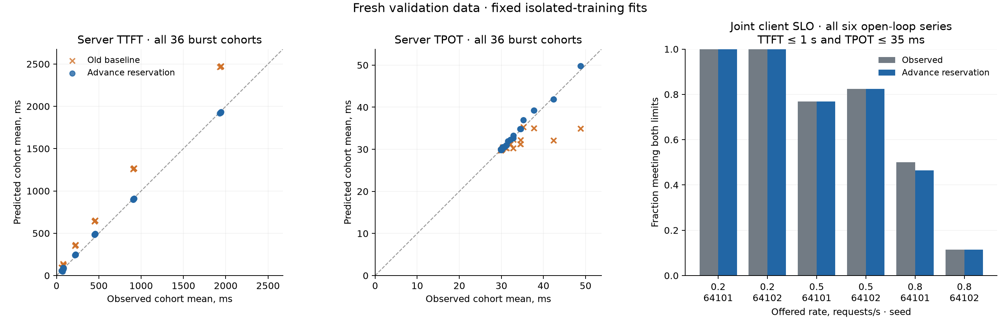

# Advance reservation v2: fresh A40 validation

Date: 2026-11-14. The complete experiment contains **690 successful requests**,
including 21 warm-up and 669 evaluation requests. **13 of 14 frozen criteria
pass. The isolated server-TTFT maximum-error criterion fails.** All results,
including the failed criterion and large errors at tighter SLO thresholds,
remain in the report. No coefficient, workload or criterion was changed after
collection; no accuracy-based retry was performed.

The new policy substantially improves burst timing compared with the retained
baseline: median server-TTFT error is **7.69% versus 43.05%**, and maximum
server-TPOT error is **4.75% versus 28.44%**. For the primary joint client SLO
(TTFT ≤1 s and TPOT ≤35 ms), the largest pass-fraction error across six loaded
series is **3.52 percentage points**, below the prespecified 10-point limit.
These observations support this bounded comparison, not universal SLO accuracy.



## What was fixed before measurement

The [archived plan](serving-reservation-v2-plan.md),
[frozen coefficients](../../configs/runpod/reservation-v2-fit.json) and
[18-file scientific manifest](../../configs/runpod/reservation-v2-freeze.json)
were fixed before the campaign. Both policies use only the original 27 isolated
training requests. The previously inspected v1 observations are
[development data](serving-v2-model-audit.md) for this revision and are not
reused as fresh validation.

Hardware/software: one A40, Qwen3-8B BF16 at revision
`b968826d9c46dd6066d109eabc6255188de91218`, vLLM 0.32.0 at the pinned image digest,
PyTorch 2.13.0+cu130, CUDA 13.0, four active sequences, 18432 batch tokens,
unchunked prefill, prefix caching disabled, eager execution. The full profile
and exact runtime fields are in the
[fixture](../../tests/fixtures/serving_measurements/runpod_qwen3_8b_a40_reservation_v2_20261114/README.md).

Nine isolated cases, 36 bursts (108 requests) and six 180-second open-loop
series (552 requests) follow seed 2026111403. Loaded rates are 0.2/0.5/0.8
requests/s, each with seeds 64101 and 64102. All requests drain before the next
series. Replay inputs are exact engine queue arrivals and token lengths;
observed scheduling/token-completion times are outcomes, not predictors.

## Failed criterion and limits of the result

The isolated request with 128 input and 32 output tokens, series
`s0013-validation-isolated`, has server TTFT **60.035 ms** against a fixed
prediction of **47.621 ms**: **12.413 ms / 20.68% error**, exceeding 15%.
The other two isolated 128-input cases measure 49.908 and 52.225 ms; the model
predicts the same 47.621 ms for all three. There is only one evaluation request
per isolated length pair. These data do not establish repeatability or identify
the cause of that variation. The request is retained, and the failure is not
dismissed as noise or repaired by refitting on the evaluation data.

Joint SLO accuracy depends strongly on the threshold. At TTFT ≤250 ms and
TPOT ≤35 ms, rate 0.5/s, seed 64102, **34/91** requests pass in the measurements,
while **63/91** are predicted to pass: **29 false passes**, no false failures,
and **31.87 percentage points** error. The same maximum occurs with TPOT ≤40 ms.
These points belong to the prespecified diagnostic grid, not the primary gate;
all 12 grid points are retained below. Thus the model is unsuitable as a general
certificate of tight request-level SLO compliance, despite its improved mean
predictions and agreement at the primary threshold.

Not every metric improves: maximum open-loop server-TPOT mean error is 1.39%
for the new policy versus 1.23% for the baseline. Maximum burst client-TTFT mean
error remains 32.84%. Server queue error uses the predeclared 50-ms denominator
floor; a small normalized error near zero does not demonstrate relative accuracy
for microsecond queue waits. The policy approximates vLLM's two-inflight engine,
and the client residual does not model frontend contention. The finite cohorts
do not establish steady-state capacity, p99 accuracy or independent-sample
confidence intervals. Every offered request remains in the denominator.

## Campaign completion and operational record

The first two allocations ended in operational interruptions; the first partial
snapshot is retained and excluded from accuracy validation. The user then
approved exactly one extra allocation under the same $5 / 4 GPU-hour limits.
The [operational addendum](serving-reservation-v2-operations-addendum.md) records
the failures and bounded controller corrections. The final attempt required
one bounded retry of a transient observational progress read and completed.

The final pod ran for **2065 s**, estimated **$0.344805** including disk.
The complete three-allocation campaign accounts for **3329 s** and **$0.555862**.
All three exact pod IDs are absent in subsequent provider GET and inventory
reads. No persistent storage was retained. These are conservative local cost
estimates; provider billing queries still returned no records when checked.
The authorization is closed, with previous costs and attempts preserved.
[Sanitized completion evidence](../../tests/fixtures/serving_measurements/runpod_qwen3_8b_a40_reservation_v2_20261114/completion.json).

The raw export SHA256/size, all public file hashes and all 18 frozen scientific
files were checked. The standalone completeness audit verifies every planned
identity, all 690 offered/completed/successful outcomes, exact lengths, all
series and the producer summary. The complete and interrupted fixtures remain
separate. Full local software tests after the additional numerical correction
pass **4053 tests**; see [release validation](../releases/2.12-validation.md).

## Reproduce without renting a GPU

From a source checkout with dependencies installed:

```bash
PYTHONPATH=. python examples/serving_reservation_slo.py \
  --evaluation-fixture tests/fixtures/serving_measurements/runpod_qwen3_8b_a40_reservation_v2_20261114 \
  --frozen-fit configs/runpod/reservation-v2-fit.json \
  --output reservation-v2-results.json
```

The command deliberately exits **1**, because one frozen accuracy target fails;
it still writes the complete report. This is distinct from a completeness
failure: `audit.status` is `complete_success`, while
`targets.all_targets_met_on_this_data` is `false`.
The default invocation without an evaluation fixture uses development data.
[Full request-level JSON](serving-reservation-v2-results.json).

## Full audit, errors, criteria and SLO grid

The following tables are rendered directly from the saved JSON. Mean errors
are absolute differences divided by observed means unless the queue floor is
explicitly indicated. SLO fraction errors expressed as percentages in the last
table are **percentage-point differences**, not relative errors of fractions.

Data role: fresh evaluation; fixed fit

| Identity | SHA256 |
| --- | --- |
| Evaluation trace | 15c5027dc9a6ca74b8baa03a86b442db1f96dec8469950e3e3bc22506b5ea31e |
| Training trace | b407d000e2b4e8d82b7f05c3b5c08598e7f2acbe6988cdb5e570f5e31cd18582 |
| Frozen fit (canonical sorted compact JSON) | 1c7dfae7ec47f1815b9d6a9293fa76a54fdc582a4030993cd582254e25d978ba |

| Audit field | Recorded count |
| --- | --- |
| planned | 690 |
| completed | 690 |
| offered | 690 |
| successful | 690 |
| failed | 0 |

| Split | Mode | Planned | Completed | Successful | Failed |
| --- | --- | --- | --- | --- | --- |
| warmup | isolated | 9 | 9 | 9 | 0 |
| warmup | burst | 12 | 12 | 12 | 0 |
| validation | isolated | 9 | 9 | 9 | 0 |
| validation | burst | 108 | 108 | 108 | 0 |
| validation | open_loop | 552 | 552 | 552 | 0 |

| Mode | Metric | Error basis | Baseline median | Baseline maximum | Advance median | Advance maximum |
| --- | --- | --- | --- | --- | --- | --- |
| isolated | client_ttft | relative mean error | 7.765805% | 14.689881% | 4.645042% | 10.780249% |
| isolated | server_ttft | relative mean error | 34.103879% | 55.835941% | 8.814813% | 20.676936% |
| isolated | server_tpot | relative mean error | 0.339361% | 1.737270% | 0.354883% | 1.580855% |
| isolated | server_queue_wait | mean-error / max(observed mean, 50 ms floor) | 0.050328% | 0.097032% | 0.050328% | 0.097032% |
| burst | client_ttft | relative mean error | 22.933476% | 33.441613% | 2.847457% | 32.842724% |
| burst | server_ttft | relative mean error | 43.050893% | 85.833734% | 7.693323% | 29.004923% |
| burst | server_tpot | relative mean error | 1.473429% | 28.439601% | 0.695726% | 4.754634% |
| burst | server_queue_wait | mean-error / max(observed mean, 50 ms floor) | 166.140410% | 902.992183% | 0.062946% | 0.085951% |
| open_loop | client_ttft | relative mean error | 3.723360% | 9.746495% | 1.804711% | 4.479008% |
| open_loop | server_ttft | relative mean error | 13.637647% | 29.290340% | 4.846115% | 6.259137% |
| open_loop | server_tpot | relative mean error | 0.547935% | 1.229057% | 0.784101% | 1.385940% |
| open_loop | server_queue_wait | mean-error / max(observed mean, 50 ms floor) | 12.970973% | 28.025783% | 4.645494% | 8.525487% |

| Frozen check | Value | Limit | Passed |
| --- | --- | --- | --- |
| isolated.server_ttft.maximum | 20.676936% | 15.000000% | false |
| isolated.server_tpot.maximum | 1.580855% | 5.000000% | true |
| burst.server_ttft.median | 7.693323% | 15.000000% | true |
| burst.server_ttft.maximum | 29.004923% | 35.000000% | true |
| burst.client_ttft.median | 2.847457% | 15.000000% | true |
| burst.client_ttft.maximum | 32.842724% | 40.000000% | true |
| burst.server_tpot.maximum | 4.754634% | 10.000000% | true |
| open_loop.client_ttft.maximum | 4.479008% | 20.000000% | true |
| open_loop.server_ttft.maximum | 6.259137% | 20.000000% | true |
| open_loop.server_tpot.maximum | 1.385940% | 5.000000% | true |
| open_loop.server_queue_wait.maximum | 8.525487% | 25.000000% | true |
| primary_joint_client_slo.maximum_fraction_error | 3.521127% | 10.000000% | true |
| burst_baseline_comparison.server_ttft.median | 7.693323% | 21.525446% | true |
| burst_baseline_comparison.server_tpot.maximum | 4.754634% | 14.219801% | true |

Primary paired client SLO: TTFT <= 1 s and TPOT <= 0.035 s.

| Rate / s | Repetition | Offered | Observed fraction | Predicted fraction | False passes | False failures |
| --- | --- | --- | --- | --- | --- | --- |
| 0.2 | 64101 | 33 | 100.000000% | 100.000000% | 0 | 0 |
| 0.2 | 64102 | 28 | 100.000000% | 100.000000% | 0 | 0 |
| 0.5 | 64101 | 91 | 76.923077% | 76.923077% | 0 | 0 |
| 0.5 | 64102 | 91 | 82.417582% | 82.417582% | 0 | 0 |
| 0.8 | 64101 | 142 | 50.000000% | 46.478873% | 0 | 5 |
| 0.8 | 64102 | 167 | 11.377246% | 11.377246% | 0 | 0 |

Grid diagnostic: unweighted range of absolute fraction errors across six open-loop cohorts; rates are retained as separate cohorts. This range is not an additional gate.

| TTFT limit / s | TPOT limit / s | Minimum error | Maximum error |
| --- | --- | --- | --- |
| 0.25 | 0.03 | 0.000000% | 3.571429% |
| 0.25 | 0.035 | 4.790419% | 31.868132% |
| 0.25 | 0.04 | 4.790419% | 31.868132% |
| 0.5 | 0.03 | 0.000000% | 0.000000% |
| 0.5 | 0.035 | 0.000000% | 1.098901% |
| 0.5 | 0.04 | 0.000000% | 1.098901% |
| 1.0 | 0.03 | 0.000000% | 0.000000% |
| 1.0 | 0.035 | 0.000000% | 3.521127% |
| 1.0 | 0.04 | 0.000000% | 3.521127% |
| 2.0 | 0.03 | 0.000000% | 0.000000% |
| 2.0 | 0.035 | 0.000000% | 2.816901% |
| 2.0 | 0.04 | 0.000000% | 2.816901% |
