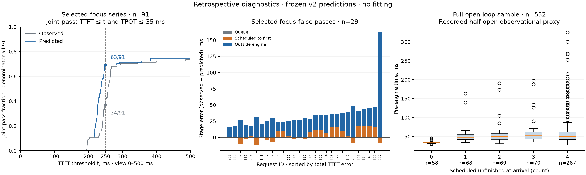

# Разбор ошибок совместного SLO в модели serving v2

Дата: 14.11.2026. Локальный диагностический этап завершён.
[Исходная проверка v2](serving-reservation-v2-results.md) и выпущенная модель
сохранены. Ни коэффициенты, ни критерии не менялись; новые GPU не выделялись.

**Основной источник 29 ложных прогнозов успеха — недооценённая задержка вне
интервала движка.** Во всех 29 случаях TPOT укладывается в 35 мс, а клиентский
TTFT превышает 250 мс. Обычное ожидание в серверной очереди у этих запросов
составляет лишь 7–25 мкс. Недооценка внешней добавки имеет медиану **24,678 мс**;
по записанным часам большая её часть приходится на путь до входа в очередь
движка. Точное внутреннее место задержки пока не измерено.

Этот результат определяет следующий кандидат: отдельно измерить и моделировать
зависимость клиентской добавки от нагрузки. Одновременно необходимо проверить
накопление ошибки времени обслуживания: под большой нагрузкой нынешняя модель
заметно завышает ожидание, даже при небольшой ошибке среднего TTFT.



Левая панель сохраняет все 91 предложение в знаменателе; показан диапазон
порогов TTFT 0–500 мс. Средняя панель содержит ровно 29 выбранных ложных
прогнозов, отрицательные составляющие показаны ниже нуля. Правая использует
все 552 потоковых запроса, включая большие значения задержек.

## Данные и определения

Разобраны все **669 проверочных запросов**: 9 одиночных, 108 в пакетах,
552 в шести потоковых сериях. 21 прогревочный запрос остаётся в исходном
690-запросном наборе. Проверены идентификаторы, контрольные суммы, равенство
исходных наблюдений сохранённому отчёту, все 612 сочетаний серии и порогов
(51 серия × 12 порогов). Ни один проверочный запрос не отброшен.

Прогнозы взяты из зафиксированного отчёта v2, не пересчитаны с новыми параметрами.
[Скрипт разбора](../../examples/serving_slo_diagnostics.py),
[полный JSON с запросами и диагностикой](serving-slo-v2-diagnostics.json).
В JSON сохранены SHA256 входной трассы, отчёта, коэффициентов и скрипта.

Используется точное разложение:

```text
client TTFT = Q + S + R
Q = scheduled_ts - queued_ts
S = first_token_ts - scheduled_ts
R = client TTFT - (first_token_ts - queued_ts)
error = observed - predicted
```

`S` включает всё время от назначения до первого токена, в том числе ожидание
вычисления после назначения. По первой отметке назначения нельзя установить
реальный старт GPU-вычисления. `R` — суммарная добавка вне серверного интервала.
Для одинаковых входов 1024 токена v2 предсказывает её постоянной: **40,443 мс**.

Клиент и движок выполнялись на одном host, в трассах заявлены монотонные часы.
При этом контракте `R` дополнительно раскладывается на
`queued_ts - client_start` и `client_start + client_TTFT - first_token_ts`.
Это разделение предполагает общий отсчёт часов разных процессов; суммарная
`R` вычисляется как разность длительностей и такого предположения не требует.

Клиентский TTFT начинается в дочернем worker после чтения payload, перед
созданием HTTP-запроса. Путь до `queued_ts` включает клиентскую сериализацию,
HTTP loopback, обработку frontend и передачу движку. Вход уже задан token IDs;
приписывать весь интервал текстовой токенизации оснований нет. Отдельных
внутренних отметок этих операций в текущей трассе нет.
[Сбор клиентских часов](../../tools/runpod_workload.py),
[сопоставление серверных отметок](../../tools/runpod_calibration_workload.py),
[wrapper движка](../../tools/runpod_vllm_server.py).

## Все 29 ложных прогнозов в выбранной серии

Серия `s0061-validation-open_loop`: 0,5 запроса/с, seed 64102, вход 1024,
выход 128 токенов. Фактически оба ограничения выполняют **34/91**,
модель предсказывает **63/91**: 29 ложных прогнозов успеха, ложных отказов нет.
У всех 29 клиентский TPOT находится между 29,948 и 34,363 мс.

| Составляющая, мс | Медиана наблюдения | Медиана прогноза | Медиана ошибки | Средняя ошибка |
| --- | --- | --- | --- | --- |
| Очередь Q | 0.009 | 0.000 | 0.009 | 0.012 |
| От назначения до токена S | 195.648 | 192.317 | 1.917 | 3.837 |
| Внешняя добавка R | 65.121 | 40.443 | 24.678 | 29.446 |

Средняя суммарная недооценка TTFT у этих 29 запросов — **33,295 мс**.
Из суммы знаковых ошибок 88,44% приходится на `R`, 11,52% на `S`, 0,04% на `Q`.
Это бухгалтерское разложение ошибки в выбранной группе; оно не устанавливает
причинные доли физической задержки. Медианы отдельных ошибок не обязаны
складываться в медиану общей ошибки.

Медиана наблюдаемой `R` — 65,121 мс. При общем отсчёте часов она состоит из
59,844 мс до очереди движка и 5,277 мс до клиентского первого непустого события
(это отдельные медианы). Запуск дочернего worker занимает медианно 74,510 мс,
но находится **до начала определённого здесь TTFT**. Прибавлять его к ошибке
TTFT или объявлять причиной этих 29 промахов было бы неверно.

Ни у одного из этих 29 запросов при приходе нет ранее пришедших, ещё не
назначенных запросов. Записано 1–3 других назначенных, но незавершённых запроса.
Это согласуется с ростом внешней добавки во время обслуживания других запросов.

## Подстановка наблюдённых составляющих

Чтобы выяснить чувствительность именно классификации у порога, в сохранённый
прогноз по очереди подставлены наблюдённые `Q`, `S`, `R`. Эти величины известны
после завершения запроса. Таблица — проверка разложения, а не новая модель
и не результат доступного заранее предсказателя. Клиентский TPOT здесь
по-прежнему берётся из прогноза.

| Наблюдённые составляющие | Предсказано успешных из 91 | Ложный успех | Ложный отказ |
| --- | --- | --- | --- |
| Нет | 63 | 29 | 0 |
| queue | 65 | 31 | 0 |
| scheduled_to_first | 63 | 29 | 0 |
| outside_engine | 42 | 11 | 3 |
| queue + scheduled_to_first | 64 | 30 | 0 |
| queue + outside_engine | 43 | 12 | 3 |
| scheduled_to_first + outside_engine | 34 | 0 | 0 |
| queue + scheduled_to_first + outside_engine | 34 | 0 | 0 |

Подстановка одной `R` убирает 18 из первоначальных 29 ложных прогнозов,
но оставляет 11 и создаёт 3 ложных отказа в других запросах. Подстановка только
серверного интервала проблему не решает. Совместная подстановка `S` и `R`
в этой серии устраняет расхождения; полная подстановка всех наблюдений
воспроизводит исходную классификацию. Подстановка наблюдённого TPOT не меняет
ни одну из этих строк — проблема данной серии около 250 мс сосредоточена в TTFT.
Обобщать этот факт на весь диапазон TPOT нельзя.

## Повторяется ли эффект в других сериях

Ниже все шесть потоковых серий с TTFT ≤250 мс и TPOT ≤35 мс. Во всех ложных
прогнозах успеха превышен только TTFT; у каждого внешняя добавка недооценена.
Это повторяющийся эффект, а не один необычный запрос выбранной серии.

| Интенсивность, 1/с | Seed | Запросов | Фактически успешных | Прогноз успешных | Ложный успех | Ложный отказ |
| --- | --- | --- | --- | --- | --- | --- |
| 0.2 | 64101 | 33 | 26 | 31 | 5 | 0 |
| 0.2 | 64102 | 28 | 21 | 28 | 7 | 0 |
| 0.5 | 64101 | 91 | 41 | 61 | 20 | 0 |
| 0.5 | 64102 | 91 | 34 | 63 | 29 | 0 |
| 0.8 | 64101 | 142 | 24 | 44 | 21 | 1 |
| 0.8 | 64102 | 167 | 7 | 15 | 8 | 0 |

При основном пороге TTFT 1 с ложных прогнозов успеха в этих шести сериях нет;
в серии 0,8/64101 остаются пять ложных отказов. Таким образом, совпадение при
1 с не характеризует качество у 250 мс.

По всем 552 потоковым запросам длины одинаковы, что исключает смешение длин
в следующей таблице. Признак — число **других назначенных и незавершённых**
запросов в момент `queued_ts`; интервалы полуоткрытые, завершение ровно
в момент прихода уже освобождает слот. Это наблюдаемый после опыта показатель,
а не загрузка GPU и не готовый вход нового предсказателя.

| Назначенных незавершённых | Запросов | Медиана до движка, мс | Медиана доставки первого события, мс | Медиана R, мс |
| --- | --- | --- | --- | --- |
| 0 | 58 | 34.766 | 4.499 | 39.316 |
| 1 | 68 | 47.135 | 5.001 | 52.809 |
| 2 | 69 | 50.563 | 5.231 | 56.104 |
| 3 | 70 | 52.474 | 5.445 | 58.826 |
| 4 | 287 | 50.578 | 5.822 | 56.669 |

Рост между пустым движком и занятым виден, но зависимость не монотонна во всех
группах. Группы зависимы во времени и смешивают разные серии. Эта таблица
не доказывает причинный эффект числа активных запросов, линейность зависимости
или пригодность регрессии с таким признаком. Общего доверительного интервала
по отдельным запросам с предположением независимости здесь нет.

## Почему небольшая ошибка среднего TTFT недостаточна

Средние знаковые ошибки компонентов по шести сериям приведены отдельно.
Отрицательная величина означает завышение прогноза. Последний столбец показывает
ошибку серверного TPOT, а не новое слагаемое разложения TTFT.

| Серия | Ошибка Q, мс | Ошибка S, мс | Ошибка R, мс | Ошибка TTFT, мс | Ошибка TPOT, мс |
| --- | --- | --- | --- | --- | --- |
| s0058 | -2.064 | -7.901 | 4.898 | -5.067 | 0.050 |
| s0059 | 0.022 | -10.209 | 10.702 | 0.515 | 0.032 |
| s0060 | -27.863 | 4.877 | 20.256 | -2.730 | -0.278 |
| s0061 | -18.035 | 5.278 | 22.030 | 9.273 | -0.239 |
| s0062 | -107.302 | 15.976 | 23.126 | -68.199 | -0.471 |
| s0063 | -649.618 | 15.286 | 32.403 | -601.929 | -0.423 |

В серии `s0063`, 0,8/64102, наблюдаемое среднее ожидание **14,198 с**, прогноз
**14,847 с**. Средняя ошибка очереди −649,618 мс частично погашается ошибками
`S` +15,286 мс и `R` +32,403 мс. У последнего запроса завышение очереди достигает
1,460 с. При этом средний серверный TPOT завышен лишь на 0,423 мс, или примерно
53,667 мс на 127 промежутков генерации одного запроса. Накопление ошибки
обслуживания — обоснованная гипотеза для проверки, но из одних первых/последних
отметок нельзя восстановить весь асинхронный конвейер и доказать эту причину.

Малое среднее расхождение TTFT поэтому не проверяет точность каждого компонента.
Порог 50 мс в прежнем нормированном показателе очереди также нельзя трактовать
как абсолютную погрешность не более 50 мс для любого запроса.

Отдельное непрохождение одиночного TTFT при входе 128/выходе 32 сохраняется:
60,035 мс против 47,621 мс. Оно относится к серверному интервалу, поэтому
добавка frontend сама по себе его не исправит. По одному повтору на пару длин
причину и воспроизводимость такого отклонения установить нельзя.

## Решение по следующему этапу

1. **Первый кандидат уточнения — клиентская добавка с учётом нагрузки.**
   Сохранить раздельные `Q`, `S`, `R`; для будущей модели использовать только
   доступное состояние предсказателя. Сравнить постоянную текущую добавку
   с минимальным вариантом «пусто / есть другая работа», прежде чем вводить
   более сложную регрессию. Не подставлять фактически наблюдённую занятость
   и задержки в рабочий прогноз. Решение о параметризации и коэффициентах
   требует обучения и отдельной проверки.
2. **Сначала дополнить измерения пути до движка.** Нужны отметки входа HTTP,
   окончания разбора/валидации запроса и передачи движку, а также повторные
   одинаковые короткие запросы при пустом движке и при фоновой генерации.
   Сохранять прежнее определение TTFT и отдельно время запуска клиента.
   Это позволит различить клиентские издержки и серверную обработку до очереди.
3. **Отдельно проверить накопление ошибки под нагрузкой.** Сравнить интервалы
   генерации и освобождения слотов по устойчивым периодам занятости; проверить
   необходимость более точной записи двух одновременно запланированных итераций.
   Уточнение frontend не должно скрыть завышение серверной очереди.
4. **Зафиксировать новые обучение и проверку до следующего GPU-опыта.**
   Проверять ошибки компонент, ложные успехи и отказы у 250/500/1000 мс,
   а также прежний критерий одиночного TTFT. Эти v2 данные остаются исторической
   проверкой фиксированной v2; при выборе по ним модели v3 они становятся
   материалом разработки v3 и не могут подтвердить её точность.

Следующие задачи — оформить измерительный план и проверить уточнение модели
на новой выборке. Прежний цикл Runpod закрыт.

## Воспроизведение и проверки

```bash
PYTHONPATH=. .venv/bin/python examples/serving_slo_diagnostics.py \
  --output docs/research/serving-slo-v2-diagnostics.json
.venv/bin/python docs/figures/plot_serving_slo_diagnostics.py
OPENBLAS_NUM_THREADS=1 OMP_NUM_THREADS=1 PYTHONPATH=. \
  .venv/bin/pytest tests/units/test_serving_slo_diagnostics.py -q
```

Диагностический скрипт возвращает код 0, если исходные данные согласованы и
разбор завершён. Непройденный критерий модели в исходном отчёте v2 сохраняется.
25 целевых тестов проверяют ручное разложение интервалов, TPOT, исключение времени
запуска, включение равенства порогу, пересечение двух ограничений, границы
занятости, отказы по некорректным часам и точное воспроизведение всех идентификаторов.
Итоговые проверки: полный набор — **4078 passed**, 19 прежних предупреждений,
806,68 с; без `slow` — **4060 passed**, 19 предупреждений, 706,83 с. Оба прогона
используют `.venv`, `-n 8`, `OPENBLAS_NUM_THREADS=1 OMP_NUM_THREADS=1 PYTHONPATH=.`.
25 целевых тестов также прошли на Python 3.10. Black/isort, pre-commit и проверка
локальных ссылок проходят; pylint обоих новых скриптов — 10/10. Все 18 научных
SHA256 и исходные измерения v2 сохранены. Код библиотеки `most_queue` не менялся.

## Приложение с 29 запросами

Все значения времени ниже в миллисекундах; ошибка имеет знак «наблюдение минус
прогноз». У всех запросов вход/выход равен 1024/128. Число назначенных других
запросов — наблюдаемый признак в момент прихода. Округлённые слагаемые могут
давать небольшую разницу суммы; исходные значения сохранены в JSON.

| ID | Других назначено | TTFT факт | TTFT прогноз | Ошибка Q | Ошибка S | Ошибка R |
| --- | --- | --- | --- | --- | --- | --- |
| 292 | 1 | 257.586 | 232.760 | 0.007 | 1.917 | 22.901 |
| 293 | 2 | 284.228 | 245.449 | 0.019 | -9.613 | 48.373 |
| 296 | 2 | 251.927 | 234.387 | 0.008 | 1.704 | 15.828 |
| 297 | 3 | 399.400 | 246.854 | 0.010 | -9.317 | 161.853 |
| 299 | 3 | 260.423 | 226.723 | 0.009 | 10.584 | 23.107 |
| 301 | 2 | 258.467 | 217.598 | 0.018 | 18.090 | 22.760 |
| 302 | 1 | 260.120 | 239.441 | 0.010 | -4.008 | 24.678 |
| 306 | 2 | 251.494 | 227.034 | 0.009 | 9.117 | 15.334 |
| 314 | 2 | 263.413 | 219.098 | 0.009 | 17.313 | 26.993 |
| 315 | 2 | 257.646 | 228.814 | 0.009 | 7.850 | 20.974 |
| 316 | 3 | 265.195 | 240.087 | 0.024 | -2.433 | 27.516 |
| 327 | 1 | 256.641 | 222.375 | 0.010 | 11.782 | 22.474 |
| 332 | 2 | 253.198 | 236.509 | 0.012 | -0.539 | 17.216 |
| 333 | 3 | 265.772 | 247.227 | 0.009 | -12.022 | 30.557 |
| 334 | 2 | 251.300 | 226.862 | 0.009 | 9.333 | 15.096 |
| 336 | 2 | 255.051 | 237.946 | 0.009 | -2.032 | 19.127 |
| 338 | 3 | 265.861 | 228.126 | 0.009 | 8.962 | 28.764 |
| 339 | 2 | 266.988 | 243.334 | 0.008 | -6.655 | 30.300 |
| 340 | 2 | 264.204 | 219.035 | 0.013 | 17.521 | 27.634 |
| 343 | 2 | 256.261 | 237.503 | 0.009 | -1.495 | 20.244 |
| 349 | 3 | 257.847 | 219.084 | 0.015 | 2.424 | 36.324 |
| 354 | 3 | 265.248 | 230.637 | 0.009 | 7.026 | 27.575 |
| 357 | 3 | 267.191 | 220.955 | 0.013 | 16.256 | 29.967 |
| 359 | 1 | 255.360 | 219.602 | 0.010 | 15.236 | 20.512 |
| 361 | 2 | 250.231 | 234.632 | 0.025 | 1.106 | 14.467 |
| 362 | 3 | 263.641 | 246.797 | 0.009 | -9.744 | 26.579 |
| 366 | 1 | 261.425 | 234.846 | 0.009 | -0.732 | 27.302 |
| 367 | 2 | 264.894 | 237.552 | 0.025 | -2.095 | 29.412 |
| 372 | 3 | 257.424 | 221.623 | 0.009 | 15.733 | 20.059 |
