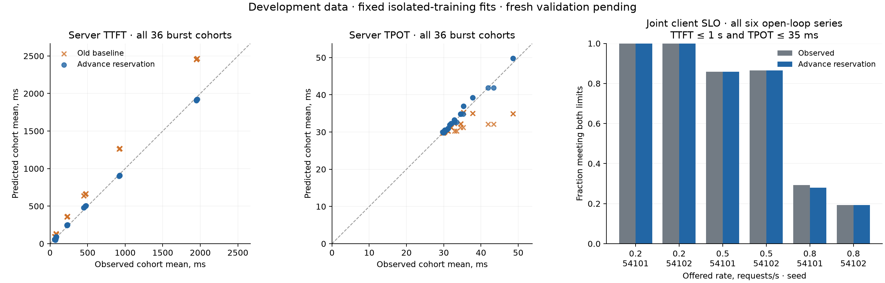

# Advance reservation: model audit and development results

Status: implemented and evaluated on the existing A40 calibration fixture.
Those observations are now **development data for v2**, including the cohorts
that were held out for v1. Fresh validation is a separate campaign. This is an
effective timing model for one pinned configuration, not an exact vLLM emulator.

## What the engine and clocks establish

The inspected primary sources are pinned to vLLM **v0.32.0**:

- [Metrics design](https://github.com/vllm-project/vllm/blob/v0.32.0/docs/design/metrics.md):
  QUEUED is receipt by EngineCore, SCHEDULED is scheduling, and NEW_TOKENS
  carries an engine output timestamp. Frontend arrival includes different work.
- [GPU model runner](https://github.com/vllm-project/vllm/blob/v0.32.0/vllm/v1/worker/gpu_model_runner.py):
  sampling from incomplete prefill chunks is discarded; completed prefill
  produces the first output token. A separate decode iteration is unnecessary.
- [Configuration](https://github.com/vllm-project/vllm/blob/v0.32.0/vllm/config/vllm.py)
  and [engine core](https://github.com/vllm-project/vllm/blob/v0.32.0/vllm/v1/engine/core.py):
  async scheduling defaults on for this non-pooling, single-GPU, non-speculative
  CUDA profile; it permits two concurrent batches. The core prioritizes filling
  the batch queue before waiting for a result.
- [Scheduler](https://github.com/vllm-project/vllm/blob/v0.32.0/vllm/v1/core/sched/scheduler.py)
  and [async scheduler](https://github.com/vllm-project/vllm/blob/v0.32.0/vllm/v1/core/sched/async_scheduler.py):
  first scheduling precedes the result; placeholders account for pending tokens.

The saved trace confirms advance scheduling. In burst n=4096, m=32, c=4,
repetition 1, times relative to the first client start are:

| Request index | Engine queue entry, ms | First scheduling, ms | First token, ms |
|---|---:|---:|---:|
| 109 | 47.533 | 47.580 | 669.143 |
| 110 | 94.542 | 94.579 | 2497.626 |
| 108 | 94.556 | 94.579 | 2497.626 |
| 111 | 94.566 | 94.579 | 2497.626 |

Thus the last three requests were scheduled before the first prefill finished.
Interpreting SCHEDULED as actual GPU execution start misclassifies part of the
scheduled-to-first-token interval as queue waiting. The original simulator's
extra decode iteration also delays the first request's first token behind
other prefills. These are confirmed differences between specified policies;
they are not bugs in the original paper-model implementation.

This also explains the short-output TPOT discrepancy. Request 109 emits its
first token before the other three long prefills. Their computation then
interrupts its generation span: (3523.077-669.143)/31 is about 92.1 ms per
remaining token. For the later three requests the corresponding span is
about 34.2 ms per token. Delaying the first request's first token until after
the intervening prefills excludes that stall from TPOT, underestimating it.
Early reservation addresses a different issue: which part of the delay is
reported as queue wait versus post-scheduling wait.

## The added policy

`AdvanceReservationSim` keeps a FCFS waiting queue and B reserved active slots.
An arrival reserves a free slot immediately, even during another iteration.
It joins computation at the next iteration boundary. Running actions stay fixed.
All completed prefills emit their first output token at that iteration's end;
later iterations emit one token per decoder. Departures release slots before
the next iteration. The conservative envelope `B * max(input_tokens) <= token_budget`
ensures no prefill is chunked. All tied arrivals are considered before computing.

For prefilling set P, decoding set D and current processed context c_j:

```text
iteration duration = alpha
                   + sum_{j in P} (beta*n_j + gamma*n_j)
                   + sum_{j in D} (beta + gamma*(c_j+1)).
```

Reservation timestamps and first-compute timestamps are both returned. Queue
wait ends at reservation. Scheduled-to-first-token includes any subsequent GPU
wait. The two-inflight engine is **approximated**, not reproduced: speculative
reservation release, output handling, frontend contention, scheduling overhead,
hardware variability and individual kernels are not modeled. No observations
of scheduling or token completion enter a replay as predictors: only exact
engine queue arrivals, lengths and frozen costs are inputs.

`PrefillDecodeSim` retains its existing discipline and calibration API. It remains
the baseline and the simulator for the original analytical model. The new
subclass shares event/statistics machinery; tests independently check B=1
against the Lindley recursion and hand-computed multi-request timelines.

## Calibration equations and scope

Only the **27 original isolated training requests** estimate coefficients.
For n input and m output tokens, with m>1:

```text
F(n)   = alpha + (beta+gamma)*n
T(n,m) = alpha + beta + gamma*(n+m/2)
client_TTFT - server_TTFT = d0 + d1*n.
```

F is measured scheduling-to-first-token; T is measured first-to-last-token
span divided by m-1. Each server metric is divided by its training mean and
columns are normalized before nonnegative least squares. The affine client
residual is fitted independently. Designs must have full column rank and
scaled condition <=1e8. The residual is not called a network latency: it also
includes frontend, tokenization, output processing and transport work.

Fitted seconds: alpha=0.0293104471, beta=0.000142699092,
gamma=3.55555925e-7, d0=0.0368216972, d1=3.53610782e-6.
Exact values, design diagnostics and provenance are in
[the frozen fit](../../configs/runpod/reservation-v2-fit.json).
Client TPOT is approximated by server TPOT, equivalent to applying the same
residual to first and last output. The discrepancy is reported, not hidden.

## Development comparison



Comparison uses 9 isolated requests, 36 burst cohorts (108 requests) and six
180-second open-loop cohorts (556 requests). Both policies use their original
training-only fitting rules and the same exact engine arrival trace. Relative
error here is the absolute difference of cohort means divided by the observed
mean. These are errors across finite cohorts, not confidence intervals.

| Mode / metric | v1 median / maximum | v2 median / maximum |
|---|---:|---:|
| Isolated server TTFT | 32.22% / 51.14% | 9.29% / 12.34% |
| Burst client TTFT | 23.01% / 35.39% | 4.59% / 33.20% |
| Burst server TTFT | 41.54% / 70.53% | 6.63% / 30.43% |
| Burst server TPOT | 1.51% / 28.15% | 0.81% / 4.69% |
| Open-loop client TTFT | 3.39% / 17.42% | 4.70% / 8.74% |
| Open-loop server TTFT | 17.29% / 24.90% | 1.82% / 9.28% |
| Open-loop server TPOT | 0.40% / 1.16% | 0.53% / 1.23% |

Not every metric improves. Small-prompt bursts retain up to 33.20% client and
30.43% server TTFT error; the linear prefill law and isolated client residual
do not capture all timing effects. Median open-loop client TTFT error slightly
increases. Sparse observed queue waits are about 24–26 microseconds; the new
model predicts zero, whereas v1 predicted milliseconds. Relative error near
zero is not meaningful: preserve absolute errors and explicitly label the
50-ms denominator floor used only for queue diagnostics.

## A practical joint SLO example

Both conditions are evaluated **on each client's request**: TTFT <=1 s and
TPOT <=35 ms. The fraction is not the product of marginal pass fractions.

| Arrival rate, requests/s | Seed | Observed joint fraction | Predicted |
|---:|---:|---:|---:|
| 0.2 | 54101 | 1.000 | 1.000 |
| 0.2 | 54102 | 1.000 | 1.000 |
| 0.5 | 54101 | 0.859 | 0.859 |
| 0.5 | 54102 | 0.865 | 0.865 |
| 0.8 | 54101 | 0.293 | 0.279 |
| 0.8 | 54102 | 0.193 | 0.193 |

These thresholds are illustrative and chosen during development. The report
also gives the entire fixed 4x3 grid: TTFT 0.25/0.5/1/2 s and TPOT 30/35/40 ms,
with false passes and false failures. No p99, production capacity, steady-state
or independence claim follows from this agreement. All offered outcomes remain
in the SLO denominator. Paired timing replay refuses incomplete or failed
cohorts instead of silently dropping them; the general SLO summarizer supports
failures and pending outcomes separately.

Reproduce locally, without a GPU:

```bash
PYTHONPATH=. .venv/bin/python examples/serving_reservation_slo.py \
  --frozen-fit configs/runpod/reservation-v2-fit.json \
  --output docs/research/serving-v2-development-results.json
```

[Full request-level results](serving-v2-development-results.json).
[Fresh-validation plan](serving-reservation-v2-plan.md). Changing this model
after seeing fresh outcomes makes those outcomes development data as well.
The [pre-collection SHA256 manifest](../../configs/runpod/reservation-v2-freeze.json)
freezes the exact scientific code, coefficients, workload, profile and plan.
Verify these hashes before allocation and preserve this manifest with the
fresh fixture. The policy's authorization flag is operational state and is
deliberately outside these scientific hashes.

## Local implementation verification

The final full suite passed **4013 tests** (19 existing warnings, 588.84 s).
The earlier non-slow run passed 3974 tests; subsequent example/audit additions
were covered by focused checks and the final full run. Black/isort, pre-commit,
JSON and local-link checks passed. Pylint is 10/10 on the changed model/helpers
and remains 9.97/10 for the library as a whole.

The first full run exposed an existing unseeded Fork-Join test (error 0.020302
against its unchanged 0.02 tolerance). Its owned random generator is now seeded
before creating distributions; both Fork-Join/Split-Join tests and the complete
final suite pass. No analytical tolerance or production Fork-Join code changed.

A development sdist and wheel were built and passed `twine check`. Installation
outside the checkout verified imports, isolated timing and known-coefficient
recovery, and checked archive contents. This development build retains version
2.11 for local checking only; no new release is claimed here.
