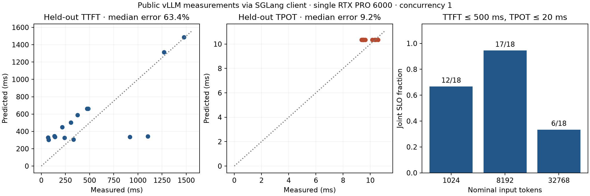

# Serving measurements, isolated calibration, and joint SLOs

[Русская версия](serving_measurements.ru.md) · [LLM/GPU roadmap](roadmaps/llm_gpu_growth_roadmap.md)

Most-Queue can import request-level serving measurements, evaluate simultaneous
TTFT/TPOT requirements, and test a simple isolated-request cost model on held-out
runs. The example uses real, public measurements without requiring a GPU:

```bash
python -m examples.serving_measurements
```

Run from a source checkout after `python -m pip install -e .`. It writes a PNG
and a strict JSON report. The [pinned fixture](../tests/fixtures/serving_measurements/flash_next/README.md)
contains original files, checksums, hardware/engine metadata, the train/test split
and the upstream MIT license. The [protocol](epics/EPIC-099-serving-measurements.md)
was fixed before fitting; the [saved report](research/serving-measurements-2026.json)
includes all predictions and diagnostic results.



## What the measurements mean

| Field or metric | Meaning |
|---|---|
| `ttfts` | Client send to first streamed output, in seconds |
| `latencies` | Per-request client latency as recorded by the exporter |
| TPOT | `(latency - ttft) / (actual output_tokens - 1)`, for more than one output token |
| `itls` | Gaps between streamed output events; an event can carry several tokens |
| `queue_times` | Waiting for a **client benchmark** concurrency slot |
| `server_queue_times` | Optional server scheduler waiting; missing values stay `None` |
| `server_ttfts` | Optional scheduled-to-first-generation server timing, separate from client TTFT |

The vLLM reader was checked against the serializer in
[v0.33.0rc3, commit 4ba787e](https://github.com/vllm-project/vllm/blob/4ba787ec9959e566d3b587a796dff07673324da5/vllm/benchmarks/serve.py).
See the [official metric definitions](https://docs.vllm.ai/en/latest/benchmarking/cli/).
Record the producer version, model revision, hardware, engine arguments and
cache/warm-up policy alongside a result: the JSON arrays do not establish them.

```python
from most_queue.io.serving import read_vllm_benchmark, summarize_serving_slo

bench = read_vllm_benchmark("detailed-result.json", measurement_profile="my-pinned-stack")
report = summarize_serving_slo(bench, ttft_limit=0.5, tpot_limit=0.02)
print(report["joint_passed"], report["offered"], report["observed_goodput"])
```

Generate detailed results with the matching benchmark client's `--save-result
--save-detailed`. Recent vLLM servers can expose per-request metrics with
`--enable-per-request-metrics`; availability and overhead depend on the pinned
engine build. Neither client queueing nor TTFT can substitute for a missing
server queue measurement.

The public example used **vLLM as the server and SGLang as the client**. Those
files omit per-request full latencies. `read_sglang_stream_benchmark()` therefore
uses `TTFT + sum(ITL)` as the span ending at the last output event and labels it
`latency_basis="stream_span"`. Its TPOT uses that span and the actual output
count; it must not be silently presented as full HTTP completion latency.
The readers require aligned detailed arrays and consistent completion counters.
Aggregate means or percentiles cannot recover a joint SLO and are refused.
The upstream `request_rate=Infinity` convention is normalized to the string
`"inf"` in report metadata; all measured times must be finite.

## Joint SLO and incomplete outcomes

A completed request passes only if **both** TTFT and TPOT satisfy their limits.
The joint fraction is calculated from paired request outcomes, not from a product
of marginal pass rates. Failed and cancelled requests stay in the offered
denominator and do not pass. For a one-token answer, TPOT is undefined: it passes
the no-further-token condition by vLLM's goodput convention, is counted separately,
and is excluded from TPOT means and quantiles.

Pending outcomes yield lower/upper bounds on the eventual cohort SLO fraction.
An already-observed TTFT violation cannot become a pass. `observed_goodput` counts
only completed passes divided by the explicit observation duration; it does not
count pending requests as if they had completed. Quantiles are labelled as
conditional on completed requests and do not hide the other outcome counts.

`from_prefill_decode(result, arrivals, inputs, outputs, horizon=...)` converts
the existing token DES and can censor at a fixed horizon. Future arrivals stay
outside the offered cohort; future completions and output tokens remain hidden.
This finite-cohort calculation is not a steady-state capacity estimate.

The example also runs 12 separately seeded, synthetic DES cohorts and reports
a Student t interval across the run-level goodputs/fractions. Requests sharing
a queue are dependent: no iid binomial interval is claimed for a single run.
The synthetic runs are explicitly separate from the real GPU measurements.

## Isolated-request calibration

For one active request, unchunked prefill, input length `n` and output length `m`,
the existing two-stage token model gives

\[
\mathrm{TTFT}=\delta+2\alpha+\beta(n+1)+\gamma(2n+1),
\qquad
\mathrm{TPOT}=\alpha+\beta+\gamma\left(n+\frac{m+2}{2}\right),\quad m>1.
\]

The prefill iteration costs `alpha + beta*n + gamma*n`. The first decode
iteration costs `alpha + beta + gamma*(n+1)`. Averaging subsequent decode costs
over tokens `2..m` gives the second formula. `delta` is a nonnegative additional
client-observed offset. Client timings cannot causally separate its network,
frontend and other components. The equations describe this specified surrogate;
vLLM's execution policy need not have the same stage boundaries.

`fit_isolated_serving()` fits four nonnegative effective coefficients by NNLS.
It scales each metric by its training mean and normalizes the design columns.
The design must have rank four and scaled condition number at most `1e8`.
Identical lengths cannot identify all four coefficients. Training runs must share
an explicit `measurement_profile`, latency definition and `max_concurrency=1`;
all calibration outcomes must be complete. Client isolation alone does not prove
there was no other traffic on the server.

`evaluate_isolated_serving()` uses the fitted coefficients without updating them,
reports held-out TTFT/TPOT errors and length-range violations, and refuses a
different profile or latency definition. The fit predicts no queueing delay.
Its coefficients must not be transferred to concurrent serving without a new
validation experiment.

## Result of the public-data pilot

The source is [Marco Pizeta's Flash-Next benchmark](https://github.com/MarcoPizeta/flash-next-rtxpro6000-bench/tree/fcdded55d1415d2a9b9256e58666d7c993cb5c2a):
one RTX PRO 6000 Blackwell 96 GB, the documented vLLM build, mixed NVFP4/FP8,
INT4 PLE offload, MTP disabled. Three nominal input sizes and three repeats
provide 54 requests at client concurrency one. Actual lengths, not nominal
filename lengths, enter the fit.

The author's first request is affected by prompt reuse during warm-up. Before
fitting, index 0 of every run was excluded from calibration only. Runs r1/r2
give 30 training requests; r3 gives 15 held-out requests. The original files are
unchanged, and all 54 measured requests remain in the separate SLO calculation.
The old `results-v1-seed42/` dataset is not used.

| Held-out metric | Median absolute relative error | Mean absolute error |
|---|---:|---:|
| TTFT | 63.40% | 227.37 ms |
| TPOT, multi-token outputs | 9.18% | 0.68 ms |

**The frozen target of at most 15% for each metric failed.** This simple cost
law should not be used as a validated TTFT predictor for this stack. The fit
sets `gamma=0`; that boundary estimate does not demonstrate that real KV access
is free. Small sample size, remaining cache effects, runtime variability and
the chosen model form may matter; this experiment does not establish which
caused the error.

For the illustrative TTFT ≤ 500 ms and TPOT ≤ 20 ms SLO, paired outcomes pass
in 12/18, 17/18 and 6/18 requests at nominal input lengths 1024, 8192 and 32768.
These are observed finite-sample counts, including the documented warm-up
effect, not production SLO guarantees or evidence that longer prompts are faster.

Server queue times are absent. Calibrating queueing delay and validating the
model under offered load remain open and require server timings/iteration
profiles and fresh validation runs. This limitation is retained in the report,
roadmap and release notes.
