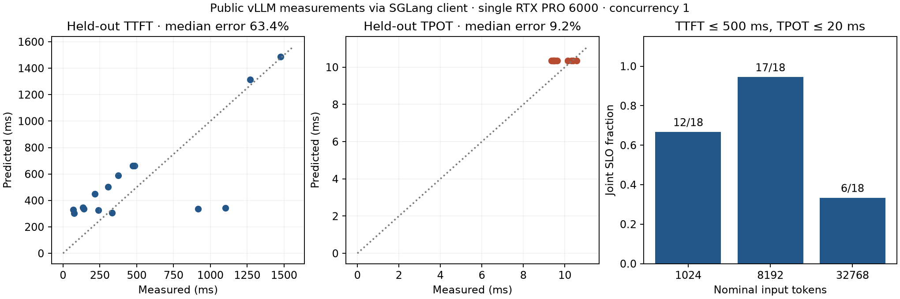

# Измерения serving, калибровка и совместный SLO

[English](serving_measurements.md) · [План LLM/GPU](roadmaps/llm_gpu_growth_roadmap.md)

Добавлены импорт подробных результатов vLLM/SGLang, совместный расчёт ограничений
TTFT/TPOT и проверка простого закона обслуживания на отложенных измерениях.
Пример работает без GPU и сети, используя сохранённые открытые данные:

```bash
python -m examples.serving_measurements
```

Из корня исходников после `python -m pip install -e .`. Результат — график и JSON.
[Исходные измерения и лицензия](../tests/fixtures/serving_measurements/flash_next/README.md),
[зафиксированный план проверки](epics/EPIC-099-serving-measurements.md),
[сохранённый отчёт](research/serving-measurements-2026.json).



## Что именно измеряется

TTFT — время от отправки клиентом до первого потокового вывода.
TPOT рассчитывается для каждого завершённого запроса как
`(latency − TTFT)/(число выходных токенов − 1)`. Между потоковыми событиями
может передаваться несколько токенов: число ITL-интервалов не заменяет число
токенов. Все времена API задаются в секундах.

`queue_times` в экспорте vLLM — ожидание свободного места **у клиента бенчмарка**.
Серверные `server_queue_times` и `server_ttfts` хранятся отдельно. Отсутствующие
значения остаются неизвестными; TTFT не используется как замена серверного ожидания.
Контракт адаптера проверен по исходнику vLLM `v0.33.0rc3`.

В открытом примере сервером служил vLLM, клиентом — SGLang. Полные времена
отдельных HTTP-запросов не сохранены; отдельный адаптер использует
`TTFT + sum(ITL)` как время до последнего потокового события и явно помечает
этот смысл. Подробный [английский документ](serving_measurements.md) содержит
контракт полей и ссылки на исходники.

```python
from most_queue.io.serving import read_vllm_benchmark, summarize_serving_slo

bench = read_vllm_benchmark("result.json", measurement_profile="my-pinned-stack")
report = summarize_serving_slo(bench, ttft_limit=0.5, tpot_limit=0.02)
print(report["joint_passed"], report["offered"], report["observed_goodput"])
```

Адаптер требует согласованные массивы результатов отдельных запросов.
Совместную вероятность выполнения двух ограничений нельзя восстановить
по двум средним или процентилям: такой ввод отклоняется.

## Учёт исходов

Запрос должен удовлетворять обоим ограничениям одновременно. Ошибки и отмены
остаются в знаменателе; незавершённые запросы дают явные границы доли успеха.
Goodput учитывает только уже завершённые успешные запросы за длительность
наблюдения. Для однотокенного ответа TPOT не определён: условие отсутствующих
последующих токенов считается выполненным по соглашению vLLM, но такой ответ
не входит в среднее и процентили TPOT.

`from_prefill_decode()` переносит временные отметки токенового симулятора
в тот же формат. При заданном горизонте будущие поступления исключены,
будущие завершения скрыты, ожидающие запросы сохранены. Пример отдельно
проводит 12 синтетических прогонов с различными seed и строит интервал Стьюдента
по итогам прогонов. Независимость заявок одной очереди не предполагается.

## Результат калибровки

Использованы открытые измерения Flash-Next на одной RTX PRO 6000 Blackwell
96 ГБ: MTP выключен, клиентская конкуренция равна единице. Файлы, версия
движка, конфигурация и SHA256 закреплены в манифесте. Первые запросы каждого
прогона исключены из калибровки из-за описанного автором повторного использования
префикса при прогреве. Это правило принято до подгонки: 30 запросов для обучения,
15 — для проверки; из расчёта SLO строки не удалены.

Подбираются неотрицательные параметры простого двухстадийного закона и постоянной
клиентской задержки. Решатель проверяет ранг и обусловленность; одинаковые длины
не позволяют определить все параметры. Это эффективная модель наблюдений,
а не измерение физических затрат отдельных GPU-ядер.

Медианная абсолютная относительная ошибка на проверочной выборке:
**TTFT — 63,40%, TPOT — 9,18%**. Заранее заданный порог 15% по каждой метрике
**не выполнен**. Такой закон нельзя считать проверенным прогнозом TTFT
для данного сервера. Нулевой подобранный коэффициент при KV-компоненте
также не означает отсутствия реальных затрат на KV-доступ.

Для иллюстративных ограничений TTFT ≤ 500 мс и TPOT ≤ 20 мс совместный успех
составил 12/18, 17/18 и 6/18 при номинальных входах 1024, 8192 и 32768 токенов.
Это результаты небольшой измеренной выборки с указанным эффектом прогрева;
в подгонке использованы фактические длины из массивов.

Серверного ожидания в данных нет. Для калибровки очереди и проверки под нагрузкой
нужны дополнительные серверные времена/профили итераций и новые контрольные
прогоны. Возможные причины ошибки TTFT пока не разделены экспериментально.
