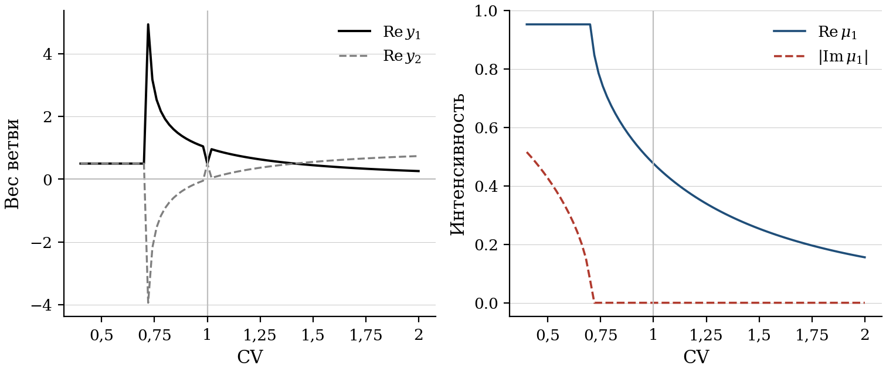
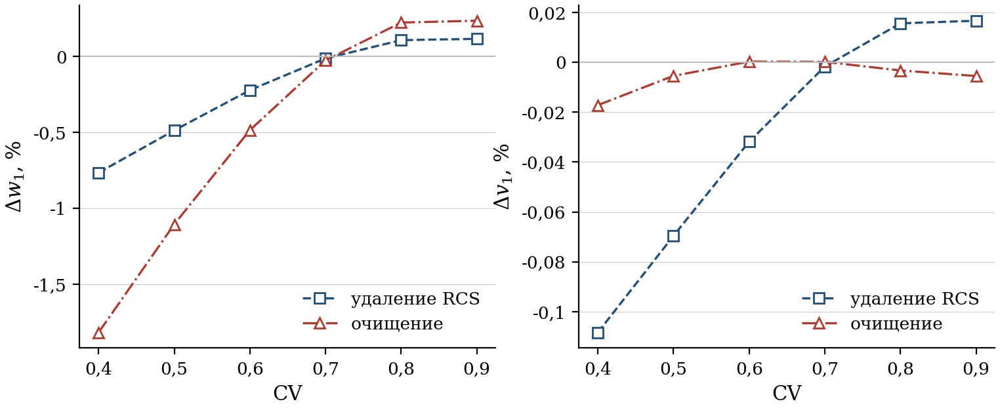
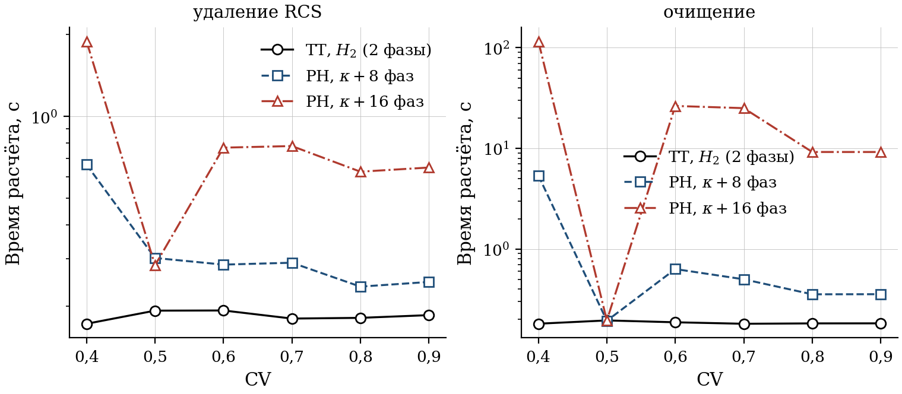
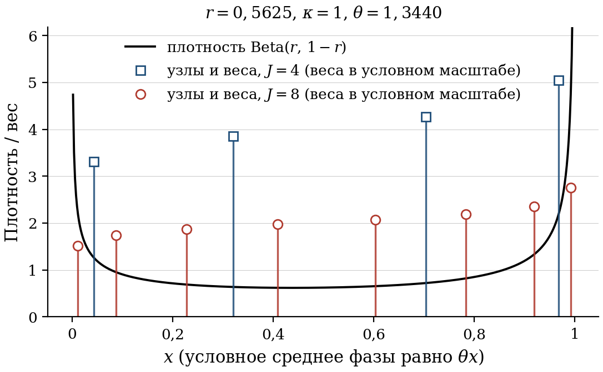
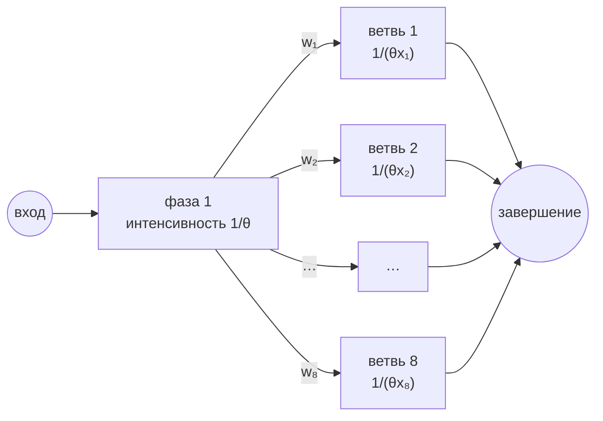
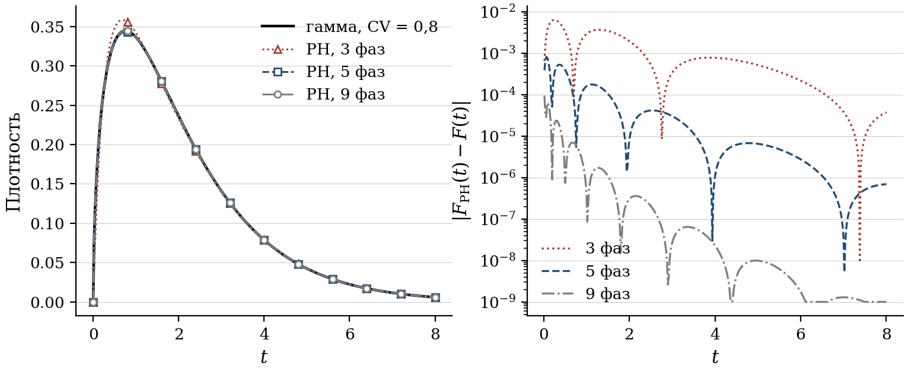
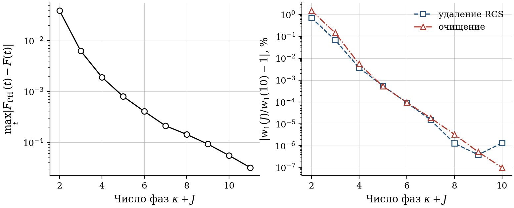

# PH-представление гамма-распределения и замена закона на $H_2$

Пояснительная заметка к версии 9 статьи «Расчёт многоканальных СМО с отрицательными заявками
и повторным обслуживанием». Заметка не входит в публикацию и хранится только в репозитории.
Все числа ниже посчитаны скриптом `notes_data.py` (данные в `notes-data.json`), рисунки —
скриптом `make_notes_figures.py`, сам текст собран `make_notes_md.py`.

Параметры везде те же, что в основных таблицах статьи: $n=3$, $\lambda=1$, $b_1=2,1$,
$\rho=0{,}7$, интенсивность воздействий $\delta=0{,}3$.

---

## 1. Почему при $\mathrm{CV}<1$ распределение $H_2$ перестаёт быть фазовым

Метод Такахаси–Таками работает с гиперэкспоненциальным распределением второго порядка
$H_2$: с вероятностью $y_1$ обслуживание идёт в фазе с интенсивностью $\mu_1$, с вероятностью
$y_2=1-y_1$ — в фазе с интенсивностью $\mu_2$. Три параметра подбираются по трём первым
моментам исходного закона. Пока $\mathrm{CV}>1$ это обычное PH-распределение. При
$\mathrm{CV}<1$ решение системы для моментов по-прежнему существует, но перестаёт быть
вероятностным: сначала один из весов становится отрицательным, а при
$\mathrm{CV}<1/\sqrt2\approx0{,}707$ параметры образуют комплексно-сопряжённую пару
(на сетке с шагом 0,02 последняя точка с комплексными параметрами — $\mathrm{CV}=0,70$).

| CV | $y_1$ | $y_2$ | $\mu_1$ | $\mu_2$ | характер параметров |
|---|---|---|---|---|---|
| 1,50 | 0,4476 | 0,5524 | 0,2535 | 1,6512 | вещественные неотрицательные (PH) |
| 1,20 | 0,6849 | 0,3151 | 0,3613 | 1,5435 | вещественные неотрицательные (PH) |
| 1,00 | 0,5000 | 0,5000 | 0,4762 | 0,4762 | вещественные неотрицательные (PH) |
| 0,90 | 1,2943 | −0,2943 | 0,5582 | 1,3465 | вещественные, один вес отрицателен |
| 0,80 | 1,9191 | −0,9191 | 0,6741 | 1,2306 | вещественные, один вес отрицателен |
| 0,72 | 4,9320 | −3,9320 | 0,8475 | 1,0572 | вещественные, один вес отрицателен |
| 0,70 | 0,5000 − 6,1852i | 0,5000 + 6,1852i | 0,9524 − 0,0780i | 0,9524 + 0,0780i | комплексно-сопряжённые |
| 0,60 | 0,5000 − 1,8792i | 0,5000 + 1,8792i | 0,9524 − 0,3056i | 0,9524 + 0,3056i | комплексно-сопряжённые |
| 0,50 | 0,5000 − 1,5652i | 0,5000 + 1,5652i | 0,9524 − 0,4259i | 0,9524 + 0,4259i | комплексно-сопряжённые |
| 0,40 | 0,5000 − 1,4649i | 0,5000 + 1,4649i | 0,9524 − 0,5156i | 0,9524 + 0,5156i | комплексно-сопряжённые |



*Рисунок 1. Параметры $H_2$ по трём моментам гамма-распределения в зависимости от CV.
Слева — веса ветвей, справа — вещественная и мнимая части $\mu_1$. Излом при $\mathrm{CV}=1$ —
вырождение: обе интенсивности совпадают, и веса определены неоднозначно; всплеск весов
около $\mathrm{CV}\approx0{,}71$ — граница, за которой параметры становятся комплексными.*

Объект с такими параметрами — не распределение фазового типа, а матрично-экспоненциальное
распределение: у него рациональное преобразование Лапласа, но нет марковской цепи, которую оно
описывает. Для расчёта стационарных вероятностей это не мешает: уравнения баланса —
алгебраические тождества, и итерации Такахаси–Таками выполняются в комплексной арифметике,
а мнимые части итоговых характеристик контролируются (в статье они не превышают $10^{-7}$).
При $\mathrm{CV}=0{,}8$ ситуация ещё мягче: преобразование Лапласа такого $H_2$ совпадает
с преобразованием распределения Кокса с неотрицательными параметрами, то есть закон всё же
фазовый, только в другой записи (см. приложение, раздел «PH-представления законов обслуживания»).

Где этого недостаточно:

* **повторное обслуживание** — при повторе фаза выбирается заново с вероятностями $y_\ell$,
  и это должны быть настоящие вероятности;
* **сохранённая работа** — состояние должно помнить класс работы, то есть нужна цепь;
* **эталон** — чтобы отделить погрешность замены закона от погрешности метода, нужен расчёт
  для самого гамма-распределения.

Для этих трёх задач и построено PH-представление гамма-распределения (раздел 3).

---

## 2. Насколько велика погрешность замены закона

Вопрос ставился так: имитация использует обычное гамма-распределение, расчёт — $H_2$
с отрицательным весом или комплексными параметрами. Насколько они разойдутся?
Ответ даёт сравнение метода Такахаси–Таками с расчётом по PH-представлению гамма-распределения
с 16 узлами квадратуры (от 17 до 22 фаз; это практически точный закон, см. раздел 3.5).

| CV | механизм | $w_1$, $H_2$ | $w_1$, гамма | $\Delta w_1$, % | $v_1$, $H_2$ | $v_1$, гамма | $\Delta v_1$, % |
|---|---|---|---|---|---|---|---|
| 0,4 | удаление RCS | 0,3875 | 0,3905 | −0,76 | 2,1681 | 2,1704 | −0,108 |
| 0,4 | очищение | 0,2058 | 0,2096 | −1,82 | 1,6191 | 1,6194 | −0,017 |
| 0,5 | удаление RCS | 0,3947 | 0,3966 | −0,49 | 2,1544 | 2,1559 | −0,070 |
| 0,5 | очищение | 0,2039 | 0,2062 | −1,10 | 1,5912 | 1,5913 | −0,005 |
| 0,6 | удаление RCS | 0,4014 | 0,4023 | −0,22 | 2,1362 | 2,1369 | −0,032 |
| 0,6 | очищение | 0,2011 | 0,2021 | −0,48 | 1,5586 | 1,5586 | 0,000 |
| 0,7 | удаление RCS | 0,4069 | 0,4069 | −0,01 | 2,1132 | 2,1132 | −0,002 |
| 0,7 | очищение | 0,1973 | 0,1974 | −0,03 | 1,5223 | 1,5223 | 0,000 |
| 0,8 | удаление RCS | 0,4104 | 0,4100 | 0,11 | 2,0850 | 2,0847 | 0,016 |
| 0,8 | очищение | 0,1925 | 0,1921 | 0,22 | 1,4830 | 1,4831 | −0,003 |
| 0,9 | удаление RCS | 0,4115 | 0,4110 | 0,12 | 2,0516 | 2,0512 | 0,017 |
| 0,9 | очищение | 0,1867 | 0,1863 | 0,24 | 1,4416 | 1,4417 | −0,006 |



*Рисунок 2. Относительная погрешность $\Delta=100\,(H_2-\text{гамма})/\text{гамма}$
среднего ожидания (слева) и среднего пребывания (справа).*

Что видно:

* по **среднему пребыванию** погрешность практически нулевая: наибольшее отклонение
  −0,108 % (CV = 0,4). Занятость каналов при удалении и очищении
  определяется преобразованием Лапласа закона обслуживания в точке $\delta$, а оно у $H_2$
  и гамма-распределения близко, потому что совпадают три первых момента;
* по **среднему ожиданию** картина нелинейная. Между $\mathrm{CV}=0{,}7$ и $1$, где $H_2$
  вещественно с отрицательным весом, погрешность положительна и невелика (0,1–0,24 %) и почти
  не зависит от CV. Около $\mathrm{CV}\approx0{,}7$, там, где параметры становятся
  комплексными, она проходит через ноль, а ниже быстро растёт по модулю, причём метод уже занижает
  ожидание. Наибольшее отклонение −1,82 % (CV = 0,4,
  очищение); очищение всегда чувствительнее удаления;
* полуширина доверительных интервалов имитации по $w_1$ в основных таблицах статьи —
  0,3–0,5 %. Значит, при $\mathrm{CV}\ge0{,}6$ имитация погрешность замены ещё не
  отличит, при $\mathrm{CV}=0{,}5$ они одного порядка (около 1 % при очищении), а при
  $\mathrm{CV}=0{,}4$ погрешность достигает 1,8 %. Для расчёта ожидания при малых CV следует
  брать PH-представление исходного закона; для пребывания $H_2$ достаточно во всём диапазоне.

Для $\mathrm{CV}=0{,}8$ это уже проверено в основных таблицах статьи: расчёт по $H_2$,
имитация по гамма-распределению, все характеристики внутри доверительных интервалов.


---

## 2а. Компромисс «точность — стоимость»

Замена закона на $H_2$ — это именно размен точности на размер пространства состояний.
У $H_2$ ярус содержит $n+1$ микросостояние независимо от CV; у PH-представления с $m$ фазами —
$\binom{n+m-1}{m-1}$, причём $m=\kappa+J$ растёт при уменьшении CV
($\kappa=\lfloor1/\mathrm{CV}^2\rfloor$: 1 при $\mathrm{CV}=0{,}8$, 6 при $\mathrm{CV}=0{,}4$).
Ниже — время одного расчёта (стационарные вероятности и первые моменты ожидания и пребывания)
на той же машине при $n=3$, $N=200$, $H=60$; погрешность $w_1$ отнесена к расчёту с $\kappa+16$ фазами.
При $\mathrm{CV}=0{,}5$ форма $a=4$ целая, закон — точный Эрланг четвёртого порядка, квадратура
не нужна, и погрешность $H_2$ в этой строке измерена относительно точного закона.

| CV | механизм | ТТ с $H_2$: с | PH, $\kappa+8$ фаз: микросост./ярус, с | PH, $\kappa+16$ фаз: микросост./ярус, с | $\lvert\Delta w_1\rvert$ ТТ, % | $\lvert\Delta w_1\rvert$ PH ($\kappa+8$), % |
|---|---|---|---|---|---|---|
| 0,4 | удаление RCS | 0,17 | 14 фаз: 560, 0,66 | 22 фазы: 2024, 1,9 | 0,76 | 8,2·10⁻⁷ |
| 0,4 | очищение | 0,18 | 14 фаз: 560, 5,38 | 22 фазы: 2024, 115,8 | 1,82 | 1,5·10⁻¹² |
| 0,5 | удаление RCS | 0,19 | 4 фазы: 20, 0,30 | 4 фазы: 20, 0,3 | 0,49 | 0 |
| 0,5 | очищение | 0,20 | 4 фазы: 20, 0,19 | 4 фазы: 20, 0,2 | 1,10 | 0 |
| 0,6 | удаление RCS | 0,19 | 10 фаз: 220, 0,29 | 18 фаз: 1140, 0,8 | 0,22 | 2,7·10⁻⁸ |
| 0,6 | очищение | 0,19 | 10 фаз: 220, 0,63 | 18 фаз: 1140, 26,4 | 0,48 | 6,2·10⁻¹⁰ |
| 0,7 | удаление RCS | 0,18 | 10 фаз: 220, 0,29 | 18 фаз: 1140, 0,8 | 0,01 | 1,0·10⁻⁷ |
| 0,7 | очищение | 0,18 | 10 фаз: 220, 0,50 | 18 фаз: 1140, 25,1 | 0,03 | 5,7·10⁻⁹ |
| 0,8 | удаление RCS | 0,18 | 9 фаз: 165, 0,24 | 17 фаз: 969, 0,6 | 0,11 | 1,6·10⁻⁷ |
| 0,8 | очищение | 0,18 | 9 фаз: 165, 0,36 | 17 фаз: 969, 9,2 | 0,22 | 5,3·10⁻⁷ |
| 0,9 | удаление RCS | 0,19 | 9 фаз: 165, 0,25 | 17 фаз: 969, 0,6 | 0,12 | 2,0·10⁻⁶ |
| 0,9 | очищение | 0,18 | 9 фаз: 165, 0,36 | 17 фаз: 969, 9,2 | 0,24 | 2,6·10⁻⁶ |



*Рисунок 2а. Время одного расчёта при $n=3$ для трёх маршрутов.*

Что из этого следует.

* При $n=3$ все три маршрута доступны: ТТ с $H_2$ занимает до 0,2 с, PH-представление
  с $\kappa+8$ фазами — до 0,7 с при удалении и до 5 с при очищении
  (очищение дороже из-за вспомогательной цепочки состояний и плотной структуры переходов),
  эталон с $\kappa+16$ фазами при очищении — до 116 с. Разница в точности при этом —
  доли процента по ожиданию и сотые доли по пребыванию.
* Разрыв растёт с $n$: при $n=8$ и девяти фазах ярус содержит 12 870 микросостояний, а при 22 фазах —
  более четырёх миллионов; ТТ по-прежнему $n+1=9$. То есть для больших $n$ и для серий вариантов
  (рисунки 2 и 3 статьи) практический выбор один — $H_2$, и его погрешность в 0,1–1,8 % по ожиданию
  при $\mathrm{CV}\ge0{,}4$ для инженерных задач приемлема: в теории очередей точность первого момента
  порядка нескольких процентов обычно считается достаточной.
* PH-представление нужно не ради сотых долей процента, а там, где без настоящей цепи нельзя:
  повторное обслуживание (сброс фазы с вероятностями) и сохранённая работа (память класса).
  Побочная роль — эталон, по которому погрешность $H_2$ измерена, а не предположена.

---

## 3. Как устроено PH-представление гамма-распределения

### 3.1. Разложение формы

Гамма-распределение с параметром формы $a=1/\mathrm{CV}^2$ и масштабом $\theta=b_1/a$
при нецелом $a$ не является фазовым: его плотность $t^{a-1}e^{-t/\theta}$ нельзя получить
как время до поглощения конечной цепи. Но форма раскладывается на целую и дробную части,
$a=\kappa+r$, $0<r<1$, и сумма независимых $\mathrm{Gamma}(\kappa,\theta)$ и
$\mathrm{Gamma}(r,\theta)$ есть $\mathrm{Gamma}(a,\theta)$. Первое слагаемое — распределение
Эрланга: $\kappa$ последовательных экспоненциальных фаз со средним $\theta$. Остаётся
представить второе.

Для $\mathrm{CV}=0{,}8$: $a=1,5625$, $\kappa=1$, $r=0,5625$, $\theta=1,3440$.

### 3.2. Гамма-распределение с формой меньше единицы — смесь экспонент

При $r<1$ плотность $\mathrm{Gamma}(r,\theta)$ вполне монотонна, а по теореме Бернштейна
такая плотность есть смесь экспоненциальных плотностей. Смесь можно выписать явно. Пусть
$X\sim\mathrm{Beta}(r,\,1-r)$, а при данном $X$ длительность экспоненциальна со средним
$\theta X$. Её преобразование Лапласа

$$
\mathbb{E}\,e^{-sY}=\mathbb{E}\frac{1}{1+s\theta X}
=\frac{1}{B(r,1-r)}\int_0^1\frac{x^{r-1}(1-x)^{-r}}{1+s\theta x}\,dx
={}_2F_1(1,\,r;\,1;\,-s\theta)=(1+s\theta)^{-r},
$$

а это и есть преобразование $\mathrm{Gamma}(r,\theta)$. Средний шаг — интеграл Эйлера для
гипергеометрической функции (DLMF, §15.6), последний — формула
${}_2F_1(a,b;b;z)=(1-z)^{-a}$. Итак, $\mathrm{Gamma}(r,\theta)$ — непрерывная смесь экспонент,
в которой среднее экспоненты равно $\theta X$, а $X$ распределено по бета-закону.

### 3.3. От непрерывной смеси к конечной: квадратура Гаусса–Якоби

Бета-плотность $x^{r-1}(1-x)^{-r}$ — это в точности вес Якоби на $[0,1]$ (после линейной
замены переменной из $[-1,1]$ его параметры $\alpha=-r$, $\beta=r-1$). Квадратура Гаусса–Якоби
с $J$ узлами заменяет интеграл по бета-закону конечной суммой:

$$
\int_0^1 g(x)\,\frac{x^{r-1}(1-x)^{-r}}{B(r,1-r)}\,dx\approx\sum_{j=1}^J w_j\,g(x_j),
\qquad w_j>0,\quad \sum_j w_j=1 .
$$

Подставив $g(x)=\mathrm{Exp}$-плотность со средним $\theta x$, получаем гиперэкспоненциальное
распределение $H_J$ с положительными весами $w_j$ и интенсивностями $1/(\theta x_j)$ — настоящее
PH-распределение. Главное свойство гауссовой квадратуры: она точна для всех многочленов степени
до $2J-1$. Момент порядка $k$ смеси равен $k!\,\theta^k\,\mathbb{E}X^k$ — многочлен от $X$
степени $k$. Поэтому первые $2J-1$ моментов исходного гамма-распределения сохраняются
автоматически, без какой-либо подгонки: при $J=8$ — пятнадцать моментов.



*Рисунок 3. Бета-плотность смеси и узлы квадратуры Гаусса–Якоби при $J=4$ и $J=8$
для $\mathrm{CV}=0{,}8$. Узлы сгущаются к концам отрезка, где плотность неограничена.*

Узлы и веса при $J=8$:

| $j$ | узел $x_j$ | вес $w_j$ | среднее фазы $\theta x_j$ | интенсивность $1/(\theta x_j)$ |
|---|---|---|---|---|
| 1 | 0,011045 | 0,091872 | 0,0148 | 67,3627 |
| 2 | 0,087933 | 0,105808 | 0,1182 | 8,4616 |
| 3 | 0,227572 | 0,113546 | 0,3059 | 3,2695 |
| 4 | 0,408720 | 0,119794 | 0,5493 | 1,8204 |
| 5 | 0,603802 | 0,125887 | 0,8115 | 1,2323 |
| 6 | 0,783117 | 0,132900 | 1,0525 | 0,9501 |
| 7 | 0,919364 | 0,142939 | 1,2356 | 0,8093 |
| 8 | 0,991780 | 0,167255 | 1,3330 | 0,7502 |

Проверка моментов 9-фазного закона против моментов гамма-распределения
(относительная ошибка): $k=1$: 6,7·10⁻¹⁶, $k=3$: 1,1·10⁻¹⁵, $k=5$: 1,3·10⁻¹⁵, $k=10$: 2,0·10⁻¹⁵, $k=15$: 2,2·10⁻¹⁵, $k=16$: −8,3·10⁻¹¹, $k=17$: −7,7·10⁻¹⁰. Первые пятнадцать совпадают с машинной точностью,
начиная с шестнадцатого появляется расхождение — ровно как предсказывает степень точности $2J-1$.

### 3.4. Итоговая цепь

Начальная фаза — первая из $\kappa$ эрланговых; после последней из них с вероятностями $w_j$
выбирается одна из $J$ экспоненциальных ветвей, завершение которой означает окончание обслуживания.
Всего $\kappa+J$ фаз; для $\mathrm{CV}=0{,}8$ и $J=8$ — девять.



*Схема для $\kappa=1$. При $\kappa>1$ перед ветвлением стоит цепочка из $\kappa$ фаз
с интенсивностью $1/\theta$; при целом $a$ ветвления нет и закон — точный Эрланг.*

В матричной записи начальный вектор $\boldsymbol\alpha=(1,0,\dots,0)$, а подгенератор $T$
имеет $-1/\theta$ на первых $\kappa$ диагональных позициях, $1/\theta$ над диагональю внутри
эрланговой цепочки, строку $w_j/\theta$ из последней эрланговой фазы в ветви и $-1/(\theta x_j)$
на диагонали ветвей. Именно этот $T$ используется в совместной фазовой модели каналов
(раздел 3.3 статьи), а при повторе обслуживания фаза сбрасывается в первую.

### 3.5. Точность и сходимость



*Рисунок 4. Слева — плотность гамма-распределения ($\mathrm{CV}=0{,}8$) и её PH-представления
с 3, 5 и 9 фазами; справа — отклонение функции распределения.*

| узлов $J$ | фаз $\kappa+J$ | точных моментов $2J-1$ | $\max_t\lvert F_{\mathrm{PH}}-F\rvert$ | $w_1$, удаление RCS | $w_1$, очищение |
|---|---|---|---|---|---|
| 1 | 2 | 1 | 3,9·10⁻² | 0,407007 | 0,195046 |
| 2 | 3 | 3 | 6,3·10⁻³ | 0,409683 | 0,191780 |
| 3 | 4 | 5 | 1,9·10⁻³ | 0,409951 | 0,192051 |
| 4 | 5 | 7 | 8,1·10⁻⁴ | 0,409965 | 0,192061 |
| 5 | 6 | 9 | 4,1·10⁻⁴ | 0,409966 | 0,192062 |
| 6 | 7 | 11 | 2,1·10⁻⁴ | 0,409967 | 0,192062 |
| 7 | 8 | 13 | 1,4·10⁻⁴ | 0,409967 | 0,192062 |
| 8 | 9 | 15 | 9,3·10⁻⁵ | 0,409967 | 0,192062 |
| 9 | 10 | 17 | 5,5·10⁻⁵ | 0,409967 | 0,192062 |
| 10 | 11 | 19 | 3,2·10⁻⁵ | 0,409967 | 0,192062 |



*Рисунок 5. Слева — максимальное отклонение функции распределения, справа — относительное
изменение среднего ожидания по сравнению с 11-фазным законом.*

Совпадение конечного числа моментов само по себе ничего не говорит о характеристиках очереди,
поэтому в статье сходимость проверяется по самим характеристикам. Среднее ожидание при переходе
от 5 к 9 фазам меняется на 0,0005 % (удаление) и
0,0005 % (очищение), а от 9 к 11 — менее чем на
$10^{-5}$ % — это уже уровень точности решения линейных систем, а не квадратуры.
Поэтому в статье для повторов при $\mathrm{CV}=0{,}8$ принято девять фаз, а в качестве эталона
для погрешности замены закона — 16 узлов.

### 3.6. Что это даёт и чего не даёт

* Представление точное в пределе $J\to\infty$, веса всегда положительны, моменты
  совпадают без подгонки. Никаких итерационных процедур (EM и т. п.) не требуется.
* Цена — число фаз: $\kappa+J$ растёт при уменьшении CV ($\kappa=\lfloor 1/\mathrm{CV}^2\rfloor$),
  а размер насыщенного уровня совместной модели равен $\binom{n+m-1}{m-1}$ при $m$ фазах.
  При $n=8$ и девяти фазах это уже 12 870 микросостояний на уровень; поэтому для больших $n$
  и серий вариантов в статье используется $H_2$ с методом Такахаси–Таками.
* Конструкция относится к гамма-распределению. Для других законов с вполне монотонной плотностью
  (Вейбулл при форме меньше единицы, Парето) смесь экспонент существует, но смешивающая мера
  другая и, как правило, не выражается через классический вес; тогда нужны численные подгонки.

---

## 4. Та же идея для сохранённой работы

При повторе с сохранённой длительностью система должна помнить требуемую работу заявки.
В статье (разделы 4.1–4.2) работа заменяется конечным набором классов: узлы квадратуры по закону
обслуживания задают $J$ значений работы, каждое из них делится на $K$ эрланговых стадий, затем
результат экстраполируется по $1/K$. Здесь конечное $J$ даёт уже не «почти точный» закон,
а систематическое занижение времени ожидания, поэтому к результату применяется поправка,
вычисленная по системе без воздействий с тем же $J$ и тем же усечением.

---

## 5. Литература к заметке

* Бернштейн С. Н. Sur les fonctions absolument monotones // Acta Mathematica. 1929. Т. 52. С. 1–66
  (теорема о вполне монотонных функциях как смесях экспонент).
* Feldmann A., Whitt W. Fitting mixtures of exponentials to long-tail distributions to analyze
  network performance models // Performance Evaluation. 1998. Т. 31, № 3–4. С. 245–279
  (гиперэкспоненциальная подгонка вполне монотонных плотностей).
* Asmussen S., Bladt M. Renewal theory and queueing algorithms for matrix-exponential
  distributions // Matrix-Analytic Methods in Stochastic Models. New York: Marcel Dekker, 1996.
  С. 313–341 (матрично-экспоненциальные распределения).
* Bladt M., Nielsen B. F. Matrix-Exponential Distributions in Applied Probability. New York:
  Springer, 2017.
* NIST Digital Library of Mathematical Functions, §3.5 (квадратуры Гаусса), §15.6
  (интеграл Эйлера для ${}_2F_1$): https://dlmf.nist.gov/.

## 6. Воспроизведение

```bash
# из корня репозитория, один процесс
PYTHONPATH=. OPENBLAS_NUM_THREADS=1 .venv/bin/python works/negative_queues/revision_v9_20261108/supplement/notes_data.py
PYTHONPATH=. .venv/bin/python works/negative_queues/revision_v9_20261108/supplement/make_notes_figures.py
PYTHONPATH=. .venv/bin/python works/negative_queues/revision_v9_20261108/supplement/make_notes_md.py
```

Квадратура — `scipy.special.roots_jacobi`; построение цепи — функция `gamma_ph`
в `revision_v7_20261107/positive_ph.py`; расчёт очереди — `ph_queue.calculate`;
метод Такахаси–Таками — `tt_tagged.calculate` поверх `most_queue`.
